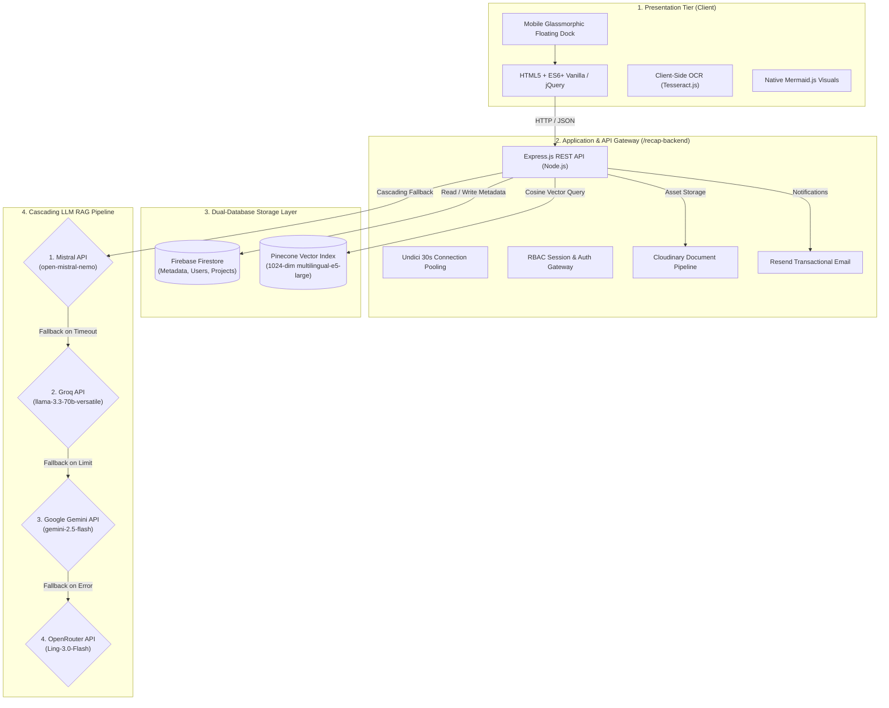

# 📚 RE-CAPS — Research Capstone Archiving and Retrieval System

[](https://nodejs.org/)
[](https://firebase.google.com/)
[](https://www.pinecone.io/)
[](https://tailwindcss.com/)
[](LICENSE)

> **RE-CAPS** is an AI-powered academic discovery platform and digital undergraduate theses repository engineered for institutional research management, semantic vector search, and Retrieval-Augmented Generation (RAG) at **Cebu Technological University (CTU) — Daanbantayan Campus**.

---

## 🎯 1. Overview & Institutional Purpose

Traditional university thesis archiving relies on rigid keyword matching and manual shelves, making related research difficult to locate. RE-CAPS bridges this gap through high-dimensional vector embeddings and multi-provider AI assistance across diverse academic degree programs:
- **BSIT** (Information Technology)
- **BIT** (Industrial Technology - Computer, Electronics, Automotive, Drafting)
- **BSFi** (Fisheries)
- **BSHM** (Hospitality Management)
- **BSIE** (Industrial Engineering)
- **BEEd & BSEd** (Elementary & Secondary Education)
- **BTLEd-HE** (Technology and Livelihood Education - Home Economics)

---

## 🏗️ 2. System Architecture & Tech Stack

RE-CAPS employs a modern, decoupled architecture separating client rendering, backend orchestration, and dual-database indexing.



---

## ✨ 3. Core Capabilities

### 🧠 A. Semantic Vector RAG Search
- **Pinecone Vector Database:** High-dimensional vector indexing using the Pinecone Inference API (`multilingual-e5-large`, 1024 dimensions, cosine distance metric).
- **Dual Indexes:**
  - `recaps-capstone`: Indexes research abstracts, methodology, problem statements, and academic degree programs.
  - `recaps-staff-copilot`: Dedicated knowledge index for librarian operations, call numbers, and institutional repository rules.

### 🤖 B. Resilient Cascading LLM Fallback
The RAG chatbot leverages multi-provider cascading failover to maintain 99.9% uptime:
1. **Mistral AI** (`open-mistral-nemo`) — Primary grounded synthesizer.
2. **Groq** (`llama-3.3-70b-versatile`) — Ultra-low latency fallback.
3. **Google Gemini** (`gemini-2.5-flash`) — Context-rich secondary fallback.
4. **OpenRouter** (`Ling-3.0-Flash`) — Autonomous tertiary safety net.

### 📱 C. Glassmorphic Mobile Navigation Dock
- **Responsive Dock:** Automatically transforms from the desktop sidebar rail into a floating glassmorphic pill bar on mobile viewports (`<= 768px`).
- **Center Action Focus:** Elevated circular button for instant access to the **Citation Generator**.
- **Role-Accented Glow:** Emerald accent for Student profiles, warm amber/gold for Teacher profiles.
- **Dynamic Content Clearance:** Viewport-aware padding prevents floating dock occlusion.

### 🛡️ D. Role-Based Access Control (RBAC)
- **Student (`student`):** Semantic search, public capstone exploration, interactive RAG chatbot, and project bookmarking.
- **Teacher / Adviser (`teacher`):** Title originality analysis, research tracking, OCR paper parsing, and student advising tools.
- **Librarian (`librarian`):** Physical library cataloging (`callNumber`, `accessionNo`, `location`), thesis ingestion, and Staff Copilot access.
- **Administrator (`admin`):** Account provisioning, catalog vector synchronization, storage pruning, and audit inspection.

### 📜 E. Automated Citation Generator
Generates instant, academic-grade bibliography citations across 5 standard formats:
- **APA (7th Edition)**
- **MLA (9th Edition)**
- **Chicago (17th Edition)**
- **IEEE**
- **Harvard**

### ⚡ F. Spark Free-Tier Quota Guard
- Activity tracking strictly resides in device-local storage (`localStorage`) rather than Firestore, safeguarding against daily Spark write limit exhaustion.

---

## 📂 4. Project Directory Layout

```
RE-CAPS/
├── public/                         # Client-Side Frontend
│   ├── index.html                  # Public Landing & Search Portal
│   ├── pages/                      # Role-Specific Dashboard Pages
│   │   ├── student_page.html       # Student Research Workspace
│   │   ├── teacher_page.html       # Adviser Review Portal
│   │   ├── librarian_page.html     # Cataloging & Submission Ingestion
│   │   └── admin_page.html         # System Administration & Analytics
│   ├── css/                        # Modular Stylesheets & Glassmorphic UI
│   │   ├── shared/dashboard-rail.css # Desktop Rail & Mobile Floating Dock
│   │   └── ...
│   └── js/                         # Vanilla ES6+ & jQuery Modules
│       ├── core/auth-service.js    # Firebase Auth Client Gateway
│       ├── shared/dashboard-rail.js# Navigation & Badge Sync Logic
│       └── shared/citation-generator.js # Citation Engine
├── recap-backend/                  # Express REST API Tier
│   ├── server.js                   # Main Backend Server & LLM Cascade
│   └── package.json                # Backend Dependencies
├── scripts/                        # Automated CI/CD & Guard Scripts
│   ├── preflight.js                # Instant Pre-Flight Integrity Test Suite
│   ├── test-routes.js              # Route Contract Verification
│   └── oxlint.json                 # Static Bug Analysis Config
├── .agents/                        # Agentic Pair-Programming Rules
│   ├── rules/academic-standards.md # Manuscript Layout & Degree Schemas
│   ├── rules/coding-standards.md   # Security, Architecture & README Rules
│   └── rules/rag-pipeline.md       # Pinecone Inference & Vector Sync
├── AGENTS.md                       # Master Architectural Blueprint & Directives
└── README.md                       # Public Project Documentation (This File)
```

---

## 🚀 5. Getting Started & Local Setup

### Prerequisites
- [Node.js](https://nodejs.org/) v18.0.0 or higher
- Modern Web Browser (Chrome, Edge, Firefox, Safari)
- Git

### 1. Clone the Repository
```bash
git clone https://github.com/JohnPerez012/Digital-Undergraduate-Theses-Repository-with-RAG-Search-at-Cebu-Technological-University-Library.git
cd RE-CAPS
```

### 2. Install Dependencies
```bash
# Install root preflight dependencies
npm install

# Install backend API dependencies
cd recap-backend
npm install
cd ..
```

### 3. Configure Environment Variables
Create a `.env` file inside `recap-backend/` following this template:

```env
# Application Port
PORT=3000

# Pinecone Vector Search
PINECONE_API_KEY=your_pinecone_api_key_here
PINECONE_INDEX_HOST=your_pinecone_index_host_here
PINECONE_STAFF_COPILOT_HOST=your_staff_copilot_host_here

# Cascading LLM API Providers
MISTRAL_API_KEY=your_mistral_api_key_here
GROQ_API_KEY=your_groq_api_key_here
GEMINI_API_KEY=your_gemini_api_key_here
OPENROUTER_API_KEY=your_openrouter_api_key_here

# Asset & Cloud Storage
CLOUDINARY_CLOUD_NAME=your_cloudinary_name_here
CLOUDINARY_API_KEY=your_cloudinary_api_key_here
CLOUDINARY_API_SECRET=your_cloudinary_api_secret_here

# Transactional Email
RESEND_API_KEY=your_resend_api_key_here
```

> [!NOTE]
> Never commit your live `.env` file. It is ignored by default in `.gitignore`.

### 4. Run the Application
```bash
# Start backend server
node recap-backend/server.js

# Access in browser
# Open: http://localhost:3000/
```

---

## 🔒 6. Security, Privacy & Secret Protection

RE-CAPS maintains a strict **Public vs. Private Information Boundary**:
- 🚫 **Strictly Private:** Live API keys, service account JSON certificates, database connection strings, bot tokens, and user credentials are **never exposed** in source code, commit history, or public documentation.
- 📢 **Public Transparency:** Architecture workflows, public endpoints, UI guidelines, and mock configuration schemas are openly documented to support academic peer review and open science.
- **Client Security:** All client inputs pass through sanitizers before DOM insertion to mitigate Cross-Site Scripting (XSS).

---

## 🧪 7. Automated Quality & Pre-Flight Suite

The repository includes a comprehensive 5-stage preflight guard script (`scripts/preflight.js`):
```bash
node scripts/preflight.js
```

| Guard Stage | Tool / Method | Purpose |
| :--- | :--- | :--- |
| **1. Syntax Check** | `node -c` | Verifies zero syntax typos across all server & client scripts |
| **2. Static Bug Scan** | `oxlint` (Rust) | Sub-millisecond linting for dead code and undefined references |
| **3. Route Contract** | Custom Scanner | Cross-checks frontend `fetch()` routes against Express endpoints |
| **4. Secrets Hygiene** | Regex Audit | Ensures no private keys or bot tokens leak into public directories |
| **5. Graph Status** | `graphify-out` | Verifies AST call-graph indexing freshness |

*Integrated Git Hooks (`.git/hooks/pre-commit` and `post-commit`) run these health checks automatically on every commit.*

---

## 📝 8. Recent Changelog & Visual Enhancements

- **Device-Adaptive Hero Background Engine:** Transformed background presentation in `public/js/home/cinematic-slider.js`: on mobile phones, eliminates recurring 6-second elastic GPU transitions and multi-image preloading in favor of a single randomized static background on entrance/page visit, resolving mobile lag and GPU throttling while preserving full dynamic animated slider transitions on desktop monitors and laptops.
- **Mobile Viewport Optimization & Modal Ergonomics:** Upgraded modern authentication modal (`public/css/shared/modern-login.css`) with dynamic viewport height (`100dvh`), compact mobile header branding, unclipped vertical scrolling, and safe-area padding (`env(safe-area-inset-bottom)`) ensuring registration links and OAuth action buttons are never obscured by mobile browser chrome or system gesture navigation bars.
- **Mobile Floating Bottom Dock:** Replaced drawer navigation on mobile viewports with an ergonomic glassmorphic tab dock featuring an elevated center Citation tool and real-time saved badge counter.
- **Pre-Flight Quality Suite:** Automated sub-second syntax checks, route contract validation, and secret hygiene verification prior to commits.
- **Continuous Knowledge Graph (graphify):** Real-time AST dependency graph indexing tracking over 1,100 nodes across all frontend and backend services.
- **Cascading LLM Resilience:** Quadruple failover engine guaranteeing constant availability for student and faculty queries.

---

## 🎓 Institutional Credits

- **Institution:** Cebu Technological University — Daanbantayan Campus
- **Repository:** Digital Undergraduate Theses Repository with RAG Search
- **Academic Year:** 2026
