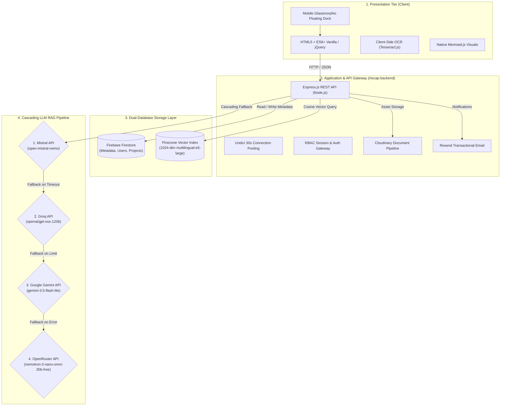

# 📚 RE-CAPS — Research Capstone Archiving and Retrieval System

[](https://nodejs.org/)
[](https://firebase.google.com/)
[](https://www.pinecone.io/)
[](https://tailwindcss.com/)
[](LICENSE)

> **RE-CAPS** is an AI-powered academic discovery platform and digital undergraduate theses repository engineered for institutional research management, semantic vector search, and Retrieval-Augmented Generation (RAG) at **Cebu Technological University (CTU) — Daanbantayan Campus**.

---

## 🎯 1. Overview & Institutional Purpose

Traditional university thesis archiving relies on rigid keyword matching and manual shelves, making related research difficult to locate. RE-CAPS bridges this gap through high-dimensional vector embeddings and multi-provider AI assistance across diverse academic degree programs:

- **BSIT** (Information Technology)
- **BIT** (Industrial Technology - Computer, Electronics, Automotive, Drafting)
- **BSFi** (Fisheries)
- **BSHM** (Hospitality Management)
- **BSIE** (Industrial Engineering)
- **BEEd & BSEd** (Elementary & Secondary Education)
- **BTLEd-HE** (Technology and Livelihood Education - Home Economics)

---

## 🏗️ 2. System Architecture & Tech Stack

RE-CAPS employs a modern, decoupled architecture separating client rendering, backend orchestration, and dual-database indexing.



---

## ✨ 3. Core Capabilities

### 🧠 A. Semantic Vector RAG Search

- **Pinecone Vector Database:** High-dimensional vector indexing using the Pinecone Inference API (`multilingual-e5-large`, 1024 dimensions, cosine distance metric).
- **Dual Indexes:**
  - `recaps-capstone`: Indexes research abstracts, methodology, problem statements, and academic degree programs.
  - `recaps-staff-copilot`: Dedicated knowledge index for librarian operations, call numbers, and institutional repository rules.

### 🤖 B. Resilient Cascading LLM Fallback

The RAG chatbot leverages multi-provider cascading failover to maintain 99.9% uptime:

1. **Mistral AI** (`open-mistral-nemo`) — Primary grounded synthesizer.
2. **Groq** (`openai/gpt-oss-120b`) — High-throughput fallback tier.
3. **Google Gemini** (`gemini-3.5-flash-lite`) — Low-latency secondary fallback.
4. **OpenRouter** (`nvidia/nemotron-3-nano-omni-30b-a3b-reasoning:free`) — Autonomous tertiary safety net.

### 📱 C. Glassmorphic Mobile Navigation Dock

- **Responsive Dock:** Automatically transforms from the desktop sidebar rail into a floating glassmorphic pill bar on mobile viewports (`<= 768px`).
- **Center Action Focus:** Elevated circular button for instant access to the **Citation Generator**.
- **Role-Accented Glow:** Emerald accent for Student profiles, warm amber/gold for Teacher profiles.
- **Dynamic Content Clearance:** Viewport-aware padding prevents floating dock occlusion.

### 🛡️ D. Role-Based Access Control (RBAC)

- **Student (`student`):** Semantic search, public capstone exploration, interactive RAG chatbot, and project bookmarking.
- **Teacher / Adviser (`teacher`):** Title originality analysis, research tracking, OCR paper parsing, and student advising tools.
- **Librarian (`librarian`):** Physical library cataloging (`callNumber`, `accessionNo`, `location`), thesis ingestion, and Staff Copilot access.
- **Administrator (`admin`):** Account provisioning, catalog vector synchronization, storage pruning, and audit inspection.

### 📜 E. Automated Citation Generator

Generates instant, academic-grade bibliography citations across 5 standard formats:

- **APA (7th Edition)**
- **MLA (9th Edition)**
- **Chicago (17th Edition)**
- **IEEE**
- **Harvard**

### ⚡ F. Spark Free-Tier Quota Guard

- Activity tracking strictly resides in device-local storage (`localStorage`) rather than Firestore, safeguarding against daily Spark write limit exhaustion.

### 🤖 G. Institutional Staff AI Copilot & 5-Chat Memory (Admin & Librarian Staff)

- **Dedicated Vector Index (`recaps-staff-copilot`):** Grounded RAG assistance covering physical Dewey Decimal Classification (DDC) call numbers, physical shelf locations, accession numbers, and repository search protocols.
- **5 Saved Conversations Memory:** Head Librarian and Library Staff can persist up to **5 full conversations** in Firestore (`portal: 'staff_copilot'`), complete with slide-over history drawer, real-time slot counter (`0/5`), and single-click chat restoration (compared to 3 for standard student/faculty users).
- **Dual Surface Deployment:** Synchronized across dedicated full-screen workspaces (`#section-copilot`) and bottom-right floating quick-assist widgets on both Administrator (`admin_page.html`) and Librarian Staff (`librarian_page.html`) portals.

---

## 📂 4. Project Directory Layout

```
RE-CAPS/
├── public/                         # Client-Side Frontend
│   ├── index.html                  # Public Landing & Search Portal
│   ├── pages/                      # Role-Specific Dashboard Pages
│   │   ├── student_page.html       # Student Research Workspace
│   │   ├── teacher_page.html       # Adviser Review Portal
│   │   ├── librarian_page.html     # Cataloging & Submission Ingestion
│   │   └── admin_page.html         # System Administration & Analytics
│   ├── css/                        # Modular Stylesheets & Glassmorphic UI
│   │   ├── shared/dashboard-rail.css # Desktop Rail & Mobile Floating Dock
│   │   └── ...
│   └── js/                         # Vanilla ES6+ & jQuery Modules
│       ├── core/auth-service.js    # Firebase Auth Client Gateway
│       ├── shared/dashboard-rail.js# Navigation & Badge Sync Logic
│       └── shared/citation-generator.js # Citation Engine
├── recap-backend/                  # Express REST API Tier
│   ├── server.js                   # Main Backend Server & LLM Cascade
│   └── package.json                # Backend Dependencies
├── scripts/                        # Automated CI/CD & Guard Scripts
│   ├── preflight.js                # Instant Pre-Flight Integrity Test Suite
│   ├── test-routes.js              # Route Contract Verification
│   └── oxlint.json                 # Static Bug Analysis Config
├── .agents/                        # Agentic Pair-Programming Rules
│   ├── rules/academic-standards.md # Manuscript Layout & Degree Schemas
│   ├── rules/coding-standards.md   # Security, Architecture & README Rules
│   └── rules/rag-pipeline.md       # Pinecone Inference & Vector Sync
├── AGENTS.md                       # Master Architectural Blueprint & Directives
└── README.md                       # Public Project Documentation (This File)
```

---

## 🚀 5. Getting Started & Local Setup

### Prerequisites

- [Node.js](https://nodejs.org/) v18.0.0 or higher
- Modern Web Browser (Chrome, Edge, Firefox, Safari)
- Git

### 1. Clone the Repository

```bash
git clone https://github.com/JohnPerez012/Digital-Undergraduate-Theses-Repository-with-RAG-Search-at-Cebu-Technological-University-Library.git
cd RE-CAPS
```

### 2. Install Dependencies

```bash
# Install root preflight dependencies
npm install

# Install backend API dependencies
cd recap-backend
npm install
cd ..
```

### 3. Configure Environment Variables

Create a `.env` file inside `recap-backend/` following this template:

```env
# Application Port
PORT=3000

# Pinecone Vector Search
PINECONE_API_KEY=your_pinecone_api_key_here
PINECONE_INDEX_HOST=your_pinecone_index_host_here
PINECONE_STAFF_COPILOT_HOST=your_staff_copilot_host_here

# Cascading LLM API Providers
MISTRAL_API_KEY=your_mistral_api_key_here
GROQ_API_KEY=your_groq_api_key_here
GEMINI_API_KEY=your_gemini_api_key_here
OPENROUTER_API_KEY=your_openrouter_api_key_here

# Asset & Cloud Storage
CLOUDINARY_CLOUD_NAME=your_cloudinary_name_here
CLOUDINARY_API_KEY=your_cloudinary_api_key_here
CLOUDINARY_API_SECRET=your_cloudinary_api_secret_here

# Transactional Email
RESEND_API_KEY=your_resend_api_key_here
```

> [!NOTE]
> Never commit your live `.env` file. It is ignored by default in `.gitignore`.

### 4. Run the Application

```bash
# Start backend server
node recap-backend/server.js

# Access in browser
# Open: http://localhost:3000/
```

---

## 🔒 6. Security, Privacy & Secret Protection

RE-CAPS maintains a strict **Public vs. Private Information Boundary**:

- 🚫 **Strictly Private:** Live API keys, service account JSON certificates, database connection strings, bot tokens, and user credentials are **never exposed** in source code, commit history, or public documentation.
- 📢 **Public Transparency:** Architecture workflows, public endpoints, UI guidelines, and mock configuration schemas are openly documented to support academic peer review and open science.
- **Client Security:** All client inputs pass through sanitizers before DOM insertion to mitigate Cross-Site Scripting (XSS).

---

## 🧪 7. Automated Quality & Pre-Flight Suite

The repository includes a comprehensive 5-stage preflight guard script (`scripts/preflight.js`):

```bash
node scripts/preflight.js
```

| Guard Stage                  | Tool / Method     | Purpose                                                            |
| :--------------------------- | :---------------- | :----------------------------------------------------------------- |
| **1. Syntax Check**    | `node -c`       | Verifies zero syntax typos across all server & client scripts      |
| **2. Static Bug Scan** | `oxlint` (Rust) | Sub-millisecond linting for dead code and undefined references     |
| **3. Route Contract**  | Custom Scanner    | Cross-checks frontend `fetch()` routes against Express endpoints |
| **4. Secrets Hygiene** | Regex Audit       | Ensures no private keys or bot tokens leak into public directories |
| **5. Graph Status**    | `graphify-out`  | Verifies AST call-graph indexing freshness                         |

*Integrated Git Hooks (`.git/hooks/pre-commit` and `post-commit`) run these health checks automatically on every commit.*

---

## 📝 8. Recent Changelog & Visual Enhancements

- **Saved Projects Session Guard & Firestore Permission Hardening (`public/js/home/project-list.js`, `public/js/shared/user-dashboard.js`):**
  - *Caller-Session Alignment:* Hardened `loadSavedProjectsFromFirestore(userId)` across project catalog and dashboard views by strictly verifying that `auth.currentUser.uid === userId` prior to dispatching Firestore read queries against `usersSavedProjects/{userId}`.
  - *Permission-Denied Noise Elimination:* Prevented false-positive `Missing or insufficient permissions` console errors triggered during auth state transitions, role switches, or when save-restricted roles (Librarians, Administrators) are being resolved. Gracefully falls back to local storage cache with non-blocking diagnostic logs.

- **Firebase App Check & reCAPTCHA Enterprise Safeguard (`public/js/shared/firebase-config.js`, `public/js/shared/network-monitor.js`):**
  - *reCAPTCHA Enterprise 400 Resolution:* Safeguarded Firebase App Check initialization by restricting automatic token requests across local development, loopback, and LAN IP subnets (`192.168.*`, `10.*`, `172.*`, `*.local`). Prevented unverified reCAPTCHA Enterprise site-key network requests to `google.com/recaptcha/enterprise/clr` from triggering HTTP 400 rejection loops.
  - *Auth Latency & Interruption Elimination:* Removed background `_getAppCheckToken()` failure chains that previously delayed and blocked Firebase Authentication popups and token generation.
  - *Unhandled Rejection Hygiene:* Enhanced the global `unhandledrejection` telemetry listener in `network-monitor.js` to filter out benign Firebase App Check token cancellations (`cancelled`, `recaptcha-error`), preventing repetitive false warning toasts in the user interface.

- **Google Authentication Resilience & Automatic Redirect Fallback (`public/js/shared/auth-modal.js`, `public/js/registration/registration.js`, `firebase.json`, `recap-backend/server.js`):**
  - *COOP Security Alignment:* Enforced `Cross-Origin-Opener-Policy: same-origin-allow-popups` across both Firebase Hosting headers (`firebase.json`) and the Express.js API gateway (`server.js`). This explicitly permits OAuth popup opener references while upholding strict origin isolation, eliminating browser cross-origin opener policy conflicts with Google authentication endpoints.
  - *User Activation Preservation:* Resolved browser `auth/popup-blocked` and iframe timeout errors by decoupling button loading states from HTML `.disabled = true` prior to popup initialization. Using non-destructive CSS pointer-events (`style.pointerEvents = 'none'`) and visual opacity preserves the native browser User Activation token across Chromium, Safari, and Firefox.
  - *Seamless Redirect Fallback:* When browser popups or third-party storage partitioning block `signInWithPopup`, the authentication workflow automatically transitions to `auth.signInWithRedirect(provider)` with `prompt: 'select_account'`, eliminating dead-end error prompts.
  - *Synchronous Redirect Handling:* Handled `auth.getRedirectResult()` on DOM initialization via a shared `processGoogleAuthSuccess(user)` pipeline, ensuring returning users are seamlessly authenticated, verified against Firestore RBAC and disciplinary sanctions, and routed to their destination with zero manual intervention.

- **Important Account Notice Modal — Sanction Awareness System (`public/js/shared/sanction-notice.js`, `public/css/shared/sanction-notice.css`, `public/index.html`):**
  - *Session-Entry Sanction Notice:* Implements a fullscreen overlay modal that displays an Important Account Notice to users whose account `status` is `suspended` or `quarantined`, surfacing the sanction type, duration/scheduled purge date, reason, category, and issuing administrator, sourced directly from Firestore user records.
  - *Dramatic Intro Sequencing:* The modal fires after the DramaticIntro animation completes (`recapsIntroCompleted` custom event), maintaining the established dramatic-intro → notice sequence. A secondary `onAuthStateChanged` path handles cases where the intro was already shown in the current session (event suppressed).
  - *Once-Per-Session Gate:* Gated by `sessionStorage` key `recaps-sanction-notice-shown`. The notice never re-surfaces on the same browser session; a hard refresh clears the gate naturally.
  - *Persistent Nav Bell Indicator:* Dismissing the modal (Noted — Dismiss) moves the notice to a bell icon button (`.sn-notice-bell`) inserted in both header nav blocks. The bell badge (`.sn-bell-badge` — small flat 7 px red dot, no glow) persists for the session and reopens the modal on click.
  - *Zero-Emoji, Palette-Compliant Design:* Strictly follows AGENTS.md Pillar 2 (SVG lock icon for suspended — `#f59e0b` amber; SVG trash icon for quarantined — `#ef4444` danger red) and Pillar 1 palette constraints. Flat rectangular badges (`border-radius: 4px`, no glow, no capsule pills).
  - *New Files:* `public/js/shared/sanction-notice.js`, `public/css/shared/sanction-notice.css`.
  - *Modified Files:* `public/index.html` — CSS link added, JS script tag added, bell button inserted in both nav blocks, modal markup inserted before `</body>`.

- **Account Governance & Sanctions Justification Dynamic Character Limitation (`public/pages/admin_page.html`, `public/js/admin/main.js`):**
  - *Dynamic Min / Max Character Limitation (15–250 chars):* Upgraded the Tier 2 audit justification notes field (`#ug-justification-notes`) in the User Governance Modal (`#user-governance-modal`) to dynamically switch between minimum and maximum constraints to prevent database bloat and payload overloading.
  - *Contextual Dual-State UI Counter:*
    - *Under Minimum Requirement (`< 15` chars):* The live counter displays `<count> / 15 min chars` styled in warning red (`#ef4444`), preventing submission until the formal institutional justification minimum is met.
    - *At or Above Minimum (`>= 15` chars):* The counter dynamically transitions to the maximum capacity indicator `<count> / 250 max chars`, turning emerald green (`#10b981`), shifting to warning amber (`#f59e0b`) at 90% (225+ chars), and locking at red (`#ef4444`) when the 250-character limit is reached.
  - *Hard Input Enforcement:* Enforced `maxlength="250"` directly on `<textarea id="ug-justification-notes">` and hardened client-side validation in `validateGovernanceForm()` and the submission handler to ensure justification text length is strictly bounded between 15 and 250 characters before committing disciplinary records to Firestore and audit logs.

- **Universal Institutional Zero-Emoji Directive Enforcement & Modular SVG Iconography (`public/js/admin/main.js`, `public/pages/admin_page.html`, `public/pages/librarian_page.html`, `public/js/pages/librarian_main.js`, `public/js/admin/admin-settings.js`, `public/index.html`, `public/css/home/rag-styles.css`, `public/css/shared/style.css`, `public/pages/account_registration.html`, `public/js/registration/registration.js`, `public/maintenance.html`):**
  - *Full Compliance with AGENTS.md Pillar 2:* Executed a comprehensive institutional UI cleanup eradicating raw unicode emojis across all administrator, librarian, and user interfaces in accordance with the institutional design standard.
  - *Permanent Purge & Confirmation Modals:* Replaced unicode warning/shield emojis (`⚠️ PERMANENT PURGE WARNING`, `🛡️ ACADEMIC INTEGRITY SAFEGUARD`) with clean uppercase typography, relying on the top SVG header icon of `ModalDialog.confirm`.
  - *Duplicate Detection & Approval Alert Banners:* Replaced raw alert emojis (`⚠️`) inside `.adc-alert-icon` and batch conflict pills with accessible inline vector SVGs (`M10.29 3.86L1.82 18...`) and brand token strokes (`#f59e0b` / `#08D488`).
  - *Error States & Diagnostics:* Converted raw permission and connection emojis (`🔒`, `⚠️`, `🔌`) in project/user error boxes to scalable vector SVGs and normalized system diagnostic text (e.g., `Connected` instead of `🟢 Connected`).
  - *Batch Operations & Empty States:* Replaced package emojis (`📦`) in Staged Batches headers and catalog empty states with crisp box/archive SVGs, replaced document icons (`📄`) in project details empty view with SVG document paths, and replaced search emojis (`🔍`) in empty search results with clean vector magnifying glass iconography.
  - *Form Validation & Registration Controls:* Replaced unicode warning characters (`⚠`) in CSS field errors (`.field-error::before`) with crisp SVG data-URIs, and replaced `✏️` and `🪪` badges in account registration with clean SVG badges and editorial text labels.

- **Admin User Management Sanction Modal Scroll Lock & Real-Time Table Refresh Fix (`public/js/admin/main.js`, `public/css/shared/dashboard-rail.css`, `public/css/admin/admin-settings.css`, `public/pages/admin_page.html`):**
  - *Eliminated Post-Sanction Vertical Scroll Lock:* Resolved a bug in Admin User Management where applying a sanction or escalating a suspended user to the 14-Day Quarantine holding bin via `#user-governance-modal` caused the page to lose vertical scroll capability after the modal closed.
  - *Focus & Root Overflow Restoration:* `closeModal()` in `#user-governance-modal` now re-enables `#ug-submit-btn` and blurs any focused element inside the modal before hiding it, explicitly clears any residual `overflow` / `overflowY` locks and `modal-open` / `dialog-open` classes on `document.body` and `document.documentElement`, and resets `#ug-modal-body` scroll position on re-open.
  - *Zero-Collapse Table Refresh & Real-Time Snapshot Deduplication:* Prevented `loadUsersData(true)` from wiping existing `#users-table-body` rows to a 1-row loading spinner during post-sanction refreshes, preserved the user's vertical scroll position (`window.scrollY`) across table re-renders, and updated the real-time Firestore `users` `onSnapshot` listener to render directly from the freshly synced snapshot cache without triggering a duplicate concurrent Firestore fetch.
  - *CSS Root Scroll Container Normalization:* Replaced `html, body { height: 100%; }` and `@media (max-width: 1024px)` `overflow-x: hidden !important` rules in `dashboard-rail.css` and `admin-settings.css` with `min-height: 100%; height: auto; overflow-x: clip !important; overflow-y: auto !important;` so dashboard containers never create nested `100vh` vertical scroll traps.

- **Nullable Academic Metadata Schema & Dynamic UI/RAG Placeholder Translation (`admin_page.html`, `librarian_page.html`, `public/js/admin/main.js`, `public/js/pages/librarian_main.js`, `public/js/shared/view-manager.js`, `public/js/home/project-list.js`, `public/js/shared/user-dashboard.js`, `recap-backend/server.js`):**
  - *Strict Core vs. Nullable Schema Boundary:* Standardized project validation so only Core Identity fields (`title`, `authors`, `program`, `year`, `status`) are strictly required. Optional/nullable archival attributes—including `abstract`, `adviser`, `keywords`, `topics`, `images`, `catalogLocation`, `callNumber`, `accessionNumber`, and `subjectHeading`—can be left blank by Administrators and Librarians across single creation, pending submission, evaluation/approval, and Excel/JSON bulk import modals.
  - *Zero Placeholder Persistence in Firestore:* Eliminated literal fallback string writes (such as `"No abstract provided."` or `"Not specified"`) into Cloud Firestore and Pinecone vector metadata. Empty nullable scalar fields are stored strictly as `""` and array fields as `[]` via `cleanNullableField()` / `cleanNullableMetadataValue()`.
  - *Dynamic Formal Academic Metadata Placeholder Translation:* Whenever a nullable field is empty (`""`, `null`, or `[]`) in Firestore, all presentation surfaces (Catalog Cards, Project Detail Reader, Saved Projects Dashboard, Librarian Quick Preview Modal, Admin Projects Table) and the `/api/chat` RAG prompt builder dynamically translate the empty value at render time into a formal academic metadata placeholder (e.g., *"Not specified in physical manuscript record. An abstract was not included in the hardbound volume; please consult the physical manuscript at the campus library for the complete study contents."*).

- **Authenticated-Only Physical Book Placement & Accountability Guard (`public/js/shared/view-manager.js`, `firestore.rules`):**
  - *Strict Guest & Anonymous Block on Physical Shelf Coordinates:* Unauthenticated guest and anonymous users are strictly prohibited from viewing a capstone's physical library placement (`callNumber`, `accessionNo`, `catalogLocation`, `subjectHeading`).
  - *Zero-Leak DOM Rendering:* Physical shelf placement HTML (`buildVerifiedCatalogPanelHtml()`) is withheld from the `#catalog-details-dropdown-panel` DOM until an authenticated user passes the accountability modal, and is immediately purged back to a locked placeholder whenever the dropdown is closed.
  - *Login-First Accountability Action Button:* When an unauthenticated visitor opens the **Physical Archive Location Accountability** modal, `Accountable User` displays `Guest User (Sign-In Required)` alongside an authentication requirement banner, and clicking the action button (`Log In to View Location >`) never reveals the shelf location—instead routing the user directly to the **Login Modal (`#login-modal`)**.
  - *Firestore Security Rule Hardening (`firestore.rules`):* Removed the unauthenticated `guest-session` rule from `match /physicalLocationAccessLogs/{logId}`, strictly enforcing `isSignedIn() && request.resource.data.agreed == true && request.resource.data.userId == request.auth.uid`.

- **Two-Way User Feedback Pipeline (Authenticated-Only Auto-Email) & Role-Differentiated Stakeholder Panels (`recap-backend/server.js`, `firestore.rules`, `feedback.js`, `about_page.html`, `admin-feedback.js`, `librarian-feedback.js`, `feedback-panel.css`):**
  - *Strict Authenticated-Only Access & Automatic Account Email Retrieval:* Feedback submission is strictly restricted to signed-in RE-CAPS users. Unauthenticated visitors on `about_page.html` are presented with an institutional authentication gate (`#feedback-auth-guest-gate`) and a direct **Sign In to Submit Feedback** action while form inputs remain locked. Once authenticated, `feedback.js` automatically retrieves the user's verified account name, role, and email address from Firebase Authentication and `users/{uid}`—locking `#feedback-email` and `#feedback-name` as `readonly` so users never manually type or spoof an email address. On the backend, `POST /api/feedback` verifies the Firebase Auth Bearer ID token (`admin.auth().verifyIdToken`, returning `401 AUTH_REQUIRED` for unauthenticated requests) and authoritatively resolves the user's email, name, UID, and role directly from the verified token and Firestore user profile.
  - *Automated Dual-Dispatch Pipeline:* When an authenticated user submits feedback, the submission is atomically persisted to the Firestore `feedback` collection and an automated, zero-emoji institutional receipt is dispatched to the user's verified account Gmail address via Resend API, complete with tracking reference code (`Ref #FB-...`), exact message excerpt, timestamp, and routing status. If configured, an administrative summary is also routed to the repository admin email.
  - *Administrator Dashboard Full CRUD Panel (`#section-feedback`):* Outfitted with full CRUD capabilities:
    - *Read:* Real-time data table, debounced search across name/email/subject/message, status filtering (`pending`, `reviewed`, `in_progress`, `resolved`, `archived`), priority filtering (`urgent`, `high`, `normal`, `low`), and 4 live KPI counters (Total, Pending, In-Progress, Resolved).
    - *Create / Reply:* Direct modal reply engine (`POST /api/feedback/:id/reply`) dispatching an official branded response email to the submitter's Gmail and automatically marking the ticket resolved.
    - *Update:* Status & Notes modal (`PATCH /api/feedback/:id`) enabling administrators to adjust ticket status, assign priority, and record internal investigation notes.
    - *Delete:* Destructive confirmation modal (`DELETE /api/feedback/:id`) permanently removing invalid or archived feedback records.
  - *Librarian Personnel Read-Optimized Panel (`#section-feedback`):* Designed strictly for institutional awareness and catalog improvement insight:
    - *Read-Only Enforcement:* Displays feedback data, search, status filters, and 3 KPI counters (Total, Open, Resolved) with a clear institutional banner explaining that write, reply, and deletion permissions are reserved for System Administrators.
    - *Zero Modification Controls:* Inspection modal allows library personnel to review submitter details, screenshots, and administrative resolution notes without destructive or status-altering buttons.
  - *Institutional UI Hardening & Security:* Styled via `feedback-panel.css` adhering strictly to all 4 aesthetic pillars (official palette `#2a2f35`, `#F7F7F8`, `#08D488`, `#FCCC56`, flat 4px rectangular badges, zero emojis). Guarded by `firestore.rules` (`isStaff()` read, `isAdmin()` write) and backend RBAC middleware (`requireStaff`, `requireAdmin`).

- **Institutional Figure & Diagram Box Standard (Pillar 4 — Strict Academic Geometry) & Fig. 4 Alignment (`Chapter1_Capstone_Enhanced.docx`):**
  - *Universal Figure Box Formatting Standard:* Enforced strict academic geometry across all architectural diagrams, functional decomposition diagrams, flowcharts, entity boxes, and component shapes throughout the thesis manuscript (`.docx` and exported `.pdf`):
    - **Font:** Strictly `Tahoma` across all text inside figure boxes (`w:rFonts w:ascii="Tahoma" w:hAnsi="Tahoma" w:cs="Tahoma"`).
    - **Line & Paragraph Spacing:** Strictly single line spacing `1.0` (`w:line="240" w:lineRule="auto"`) with zero before/after spacing (`w:before="0" w:after="0"`).
    - **Background Fill:** Pure solid white background (`#FFFFFF`, `<a:solidFill><a:srgbClr val="FFFFFF"/></a:solidFill>` in DrawingML, `fillcolor="#FFFFFF"` in VML fallback). Completely eliminated transparent fills (`noFill`) and theme tints (`sysClr`).
    - **Borders & Strokes:** Crisp, solid black border (`#000000`, 0.75pt–1pt stroke, `<a:ln>` with `<a:srgbClr val="000000"/>` and VML `strokecolor="#000000"`).
    - **Text Color:** Solid full black text (`#000000`, `<w:color w:val="000000"/>`).
    - **Margins & Insets:** Strict zero margins `00` (`lIns="0" tIns="0" rIns="0" bIns="0"` in DrawingML `<wps:bodyPr>`, and `inset="0,0,0,0"` in VML `<v:textbox>`).
  - *Fig. 4 (Functional Decomposition Diagram) Rigorous Audit & Defect Remediation:*
    - Audited Fig. 4 ("Functional Decomposition Diagram of the AI-Integrated Capstone Metadata Repository") and identified that it was **NOT** originally correct, containing 7 critical discrepancies against the research methodology and codebase:
      1. Contained obsolete `Chicago` citation style references (removed in accordance with the study's scope of APA 7th, MLA 9th, and IEEE formats).
      2. Contained spelling typo `RAG DRIVEN AI CHATBOT ASSISSTANT` (corrected to `ASSISTANT`).
      3. Contained non-standard lowercase `(archival)` (corrected to `(ARCHIVAL)`).
      4. Contained missing space in `upload &delete` (corrected to `upload & delete`).
      5. Contained outdated cataloging labels `call no., accession no., subject heading` (standardized to `Call No., Accession No., Shelf Location`).
      6. Contained transparent / system-tinted box backgrounds instead of solid white.
      7. Contained non-zero box insets and non-single line spacing instead of strict `00` margins and `1.0` line spacing.
    - *ECMA-376 DrawingML Schema-Compliant Repair:* Re-architected `apply_fig4_box_styling()` in `scratch/transform_manuscript.py` to adhere strictly to OpenXML schema element sequencing in `wps:spPr` (`xfrm` -> `prstGeom` -> `solidFill` -> `ln`), eliminating conflicting `<a:noFill>` tags and guaranteeing flawless opening and repagination in Microsoft Word COM.
    - *Zero-Fault Verification:* Verified that all 35 DrawingML boxes and 35 VML fallback shapes in Fig. 4 pass with `non_white=0`, `non_black_border=0`, `non_zero_ins=0`, `non_single_spc=0`, `non_tahoma=0`, `non_black_text=0`, and `chicago_found=0`. Word COM repagination and PDF export completed cleanly with 0 stale terms, 0 blank pages, and 0 `PAGEREF` mismatches.
- **Universal Auto-Save Architecture Across All "Add New Project" Modals & Workstations:** Standardized comprehensive draft preservation across all project submission modals in every corner of the system (`admin_page.html`, `librarian_page.html`, `public/js/admin/main.js`, `public/js/pages/librarian_main.js`, `librarian_renovated.css`):
  - *Unified Auto-Save Switch Interface & Layout Protection:* Integrated the identical tactile toggle switch (`.pmodal-autosave-label`, `.pmodal-autosave-track`, `.pmodal-autosave-thumb`, `.pmodal-autosave-text`) in the header of the Librarian "Add New Project" modal (`#upload-metadata-modal`), seamlessly aligned with the Admin Capstone modal (`#project-modal`). Hardened flexbox properties with `white-space: nowrap`, `flex-shrink: 0`, and `min-width: 0` on `.pmodal-header-left`, eliminating text-wrapping collisions between long subtitles and the Auto-save label.
  - *Symmetric Switch Thumb Calibration:* Calibrated the 38px switch capsule with `translateX(18px)` translation, ensuring exact 2px margin symmetry on both active and inactive states with zero capsule overhang.
  - *Comprehensive Input Event Listeners:* Debounced auto-save (1500ms) triggers automatically on all form inputs—including Title, Adviser, Year (with step buttons and arrow keys), Program select, Abstract, Physical Archival coordinates (Location, Call Number, Accession Number), and all dynamic multi-row inputs (Authors, Topics, Keywords, additions, removals, and split pastes).
  - *Isolated Local Draft Persistence:* Admin drafts persist under `admin_project_draft` and Librarian drafts under `librarian_project_draft` in `localStorage`, maintaining complete role boundary safety without overwriting each other.
  - *Intelligent Rehydration & Clean Lifecycle:* Opening the Add Project modal from any corner (Dashboard Quick Actions, Action Cards, or Catalog Navigation) automatically restores all draft fields with a reassuring `Draft restored ✨` toast. Drafts are safely retained across modal closures, permanently cleared upon successful Firebase Firestore submission, and guarded by explicit user confirmation when triggering "Clear Form".

- **Evaluate Project Submission Modal: Author Field Consistency & Dynamic Author Management:** Harmonized the author input interface in the Librarian/Admin "Evaluate Project Submission" modal (`#approval-review-modal`) with the "Edit Capstone Project" modal (`admin_page.html`, `public/js/admin/main.js`):
  - *Dynamic Multi-Row Author Interface:* Replaced the legacy single comma-separated input (`#approval-authors`) with `#approval-authors-container` utilizing `.dynamic-inputs-container.pform-dynamic-list`, `createDynamicRow()`, and an `Add Author` button (`#approval-add-author-btn`).
  - *Row Management & Paste Splitting:* Each author row features individual text entry and an instant remove button (`✕`). Retains automated multi-author splitting on paste (detecting commas, semicolons, and newlines) and Enter-key keyboard auto-advance.
  - *Seamless Data Population & Submission Handling:* Hydrates author arrays dynamically when opening pending project reviews, cleanly supporting both existing array structures and legacy delimited strings. Form submission extracts, trims, and validates author entries via `getDynamicValues()`.
  - *Project Lock State Enforcement:* When reviewing an evaluation record locked by an administrator, the `Add Author` button and row removal buttons (`.remove-row-btn`) are automatically disabled to prevent unauthorized edits.
- **Edit Capstone Project Modal: "Save Project" Button Visibility & Change Tracking:** Resolved modal state bug where the primary action button would intermittently hide or fail to render during project updates (`public/js/admin/main.js`):
  - *Persistent Action Visibility:* Enforced `#submit-project-btn` visibility (`inline-flex`) with the authoritative label "Save Project" upon modal opening, preventing accidental button suppression.
  - *Comprehensive Baseline State Tracking:* Enhanced `originalFormData` to track all catalog parameters including physical location, call number, accession number, and project gallery images (`images`), ensuring reliable dirty state detection without falsely dropping controls.
- **Admin Record Lock Status Toggle Resilience (`window.__adminToggleLockProject`):** Fixed `ReferenceError: saveProjectsToCache is not defined` when toggling capstone lock status (`public/js/admin/main.js`). Defined `saveProjectsToCache = saveToCache` and wrapped cache persistence with safe function detection and automatic fallback to `localStorage`, guaranteeing seamless real-time lock/unlock state updates in table views and toast notifications.

- **Tablet & Mobile Navigation Alignment: Eradication of .mobile-rail-toggle & Tablet Bottom Dock Expansion:** Addressed tablet breakpoint (`768px < width <= 1024px`) inconsistencies where the deprecated floating hamburger button was erroneously reappearing on tablet viewports (e.g. `776px`):

  - *Complete Eradication of `.mobile-rail-toggle`:* Removed `<button class="mobile-rail-toggle">` from DOM in `student_page.html` and `teacher_page.html`, and permanently disabled `.mobile-rail-toggle` in `dashboard-rail.css` (`display: none !important; visibility: hidden !important; pointer-events: none !important;`) across all viewports and media queries.
  - *Unified Tablet & Mobile Floating Dock (`<= 1024px`):* Extended the floating bottom navigation dock (`.mobile-bottom-dock-container`, `.mobile-bottom-dock`, `.mobile-back-home-btn`) from `768px` to `1024px`. On tablets (such as iPads and `776px` screens), provides a centered, ergonomic 480px dock with thumb-friendly access to all 5 sections and the Back Home button, while granting the dashboard content area 100% unobstructed full width.
  - *Accurate "Dashboard" Dock Tab Identification:* Corrected the first tab item in the mobile bottom floating dock from "Home" to "Dashboard", accurately reflecting that tapping it switches views to the active workstation dashboard (`#section-dashboard`).
  - *Dedicated Floating "Back Home" Navigation Anchor:* Integrated a prominent, pill-shaped "Back Home" button (`.mobile-back-home-btn`) positioned directly above the first dock item on mobile and tablet devices (`<= 1024px`). Tapping this button seamlessly returns users to the primary repository home portal (`../index.html`), complete with left-arrow iconography, emerald/gold brand tints, subtle backdrop blur, and touch-scale micro-interactions.
  - *Responsive Label Typography Clamping:* Implemented CSS `clamp(0.575rem, 2.3vw, 0.6875rem)` on `.dock-label` to guarantee the 9-character "Dashboard" text never wraps or clips, even on compact smartphone screens (320px–360px).
  - *Content Area Bottom Clearance:* Set `.dashboard-content` padding bottom to `calc(130px + env(safe-area-inset-bottom, 0px))` across mobile and tablet (`<= 1024px`), ensuring cards never get obscured behind floating navigation elements.
  - *Uniform Borderless Citation Dock Icon:* Removed the circular/oval container (`.dock-featured-btn`) around the Citations generator icon in the bottom floating dock across Student and Teacher workstations, unifying all five navigation tabs to use the identical, clean, borderless `.dock-icon-wrap` presentation.
- **Citation Generator Workspace De-clutter & Stress-Free Guided UX:** Overhauled the Academic Citation & Bibliography Studio across Student and Teacher dashboards (`citation-generator.js`, `citation-generator.css`, `student_page.html`, `teacher_page.html`):

  - *Mobile Studio Header Vertical Stacking (Zero Text Squishing / Zero Button Collisions):* Completely resolved mobile header compression on devices (`<= 768px`) where `.citation-studio-header` was erroneously attempting to fit title text and action buttons (`Import Saved Project` + `Reset`) on the same horizontal row, squishing the title and paragraph into a 90px vertical strip (1 word per line) and overlapping the badge. Enforced `flex-direction: column !important; align-items: stretch !important;` with 100% full-width text flow and a dedicated action button row underneath.
  - *Eradication of Bottom Horizontal Scrollbar & Mobile Width Blowouts:* Eliminated the unnecessary horizontal scroll pane at the bottom of mobile viewports by enforcing `overflow-x: hidden !important; width: 100% !important;` across `#section-citations`, `.citation-workstation-grid`, and `.dashboard-content`. Rescaled mobile card padding to `16px` (from `28px`) and stacked `.citation-fields-row` into a single vertical column (`grid-template-columns: 1fr !important;`), preventing `minmax(200px, 1fr)` two-column blowout from pushing inputs outside the screen.
  - *Vertical-Only Smooth Auto-Scroll on Generate (Zero Lost Width / Zero Horizontal Shift):* Replaced `scrollIntoView()` on mobile with strict vertical-only scrolling `window.scrollTo({ top: targetY, left: 0, behavior: 'smooth' })`. This permanently locks horizontal scroll to 0, ensuring `#generate-citation-btn` and the formatted output cards never lose their width, clip off-screen, or jump horizontally when clicked.
  - *Authoritative Import Saved Capstone Modal (Zero Overlapping / Zero Screen Clipping):* Completely eradicated the legacy floating dropdown menu (`.citation-import-menu`) which previously suffered from severe left-margin clipping (`-150px` offscreen on mobile) and awkward visual collision directly over the Citation Style selector. Replaced with an accessible, centered modal dialog (`.citation-import-modal-overlay`) with frosted backdrop blur (`rgba(42, 47, 53, 0.75)` + `backdrop-filter: blur(5px)`), clean dialog header with brand green bookmark badge, close button (`×`), escape key dismissal, and backdrop click handler.
  - *Full-Width Touch-Friendly Capstone List:* The modal displays the user's saved capstones with multiline titles, department pills, defense year tags, and copyable author lines (`data-allow-copy="true"`), protected under R.A. 10173 and anti-plagiarism guidelines (`user-select: none` on titles). Tapping any item auto-fills the studio fields, smoothly dismisses the modal, and provides a clear toast notification.
  - *Horizontal Swipeable Citation Style Track:* Transformed the multi-row wrapped citation style pills (`.citation-format-bar`, `.citation-format-pills`) into a sleek, single-row momentum-scrollable horizontal track (`flex-wrap: nowrap !important; overflow-x: auto !important; scrollbar-width: none;`). Clicking any citation pill automatically centers it into view (`scrollIntoView({ inline: 'center' })`).
  - *Device-Only On-Demand Results Visibility:* On mobile and tablet devices (`<= 1024px`), both `.citation-output-card` and `.citation-intext-card` remain hidden initially (`.device-hidden`), eliminating vertical scrolling clutter. They are revealed smoothly (`.device-visible` with `citationCardReveal` animation) and auto-scrolled into focus ONLY when the user taps "Generate & Save Citation" (`#generate-citation-btn`). On desktop (`> 1024px`), cards remain permanently visible in their side-by-side workstation column.
  - *Complete Purge of Dummy / Templated Data:* Completely removed all hardcoded student author names (`Cadaro, John P.`, `Allan P. De Jesus Jr.`, `Christine D. Conde`, `Cabardo`, `Ompoy`), dummy fallback titles (`[Project Title]`), and fake in-text citations (`(Cadaro et al., 2024)`).
  - *Serene Empty State on Load:* On initial workstation load or form clearing, replaces broken fake citations with a clean, reassuring empty-state illustration (`.citation-empty-state`) guiding the scholar to enter their thesis details or import directly from their bookmarked capstones.
  - *Awaiting Input Live Pill:* Status indicator now dynamically toggles between `Awaiting Input` (neutral tone) when empty and `Live Preview Active` (brand green) once active research details are provided.
  - *Contextual In-Text Writing Guides:* In-text citation cards now feature concise usage micro-guides explaining exactly when to use *Parenthetical* (end-of-sentence citations) versus *Narrative* (in-sentence subject citations) to eliminate student writing stress.
  - *Intelligent Copy & Export Guards:* Copy and download buttons are cleanly guarded when fields are empty, preventing accidental clipboard pollution or empty file downloads while providing helpful toast feedback.
  - *Sanitized Form Reset:* Replaced the legacy reset function that was re-injecting templated values with a clean reset mechanism that returns all fields to a pristine state.
- **Brand Palette Hardening, Saved Collection Export Modal, and 4-Step Account Deletion Lifecycle:** Comprehensive institutional alignment and security enhancements across student settings (`student-settings.css`, `settings-handler.js`, `password-change.css`, `auth-modal.js`):

  - *Institutional Color Alignment (Zero Lingering Blue):* Strictly purged unauthorized blue hues (`#3b82f6`, `#2563eb`, `#1d4ed8`, `#60a5fa`) across toggles, chips, status pills, and focus states in settings. Replaced colorful purple/blue linear gradients on `.password-change-icon` with institutional brand green accents (`rgba(8, 212, 136, 0.1)`, `border: 2px solid rgba(8, 212, 136, 0.25)`, `color: var(--brand-green, #08D488)`), locking all visuals to the core brand palette (`#2a2f35`, `#F7F7F8`, `#08D488`, `#FCCC56`).
  - *Progressive 4-Step Account Deletion Wizard:* Replaced the abrupt single-click deletion modal with an audited 4-step progressive lifecycle:
    1. *Security Confirmation:* Requires user to type exact uppercase `DELETE` before unlocking navigation.
    2. *Grace Period Selection:* User selects **15 Days** (Standard) or **30 Days** (Extended) inactivity grace period.
    3. *Departure Reason:* Dropdown menu selection with conditional "Other" custom explanation textarea.
    4. *Password Verification & Immediate Sign-Out:* Verifies account credentials with Firebase reauthentication, stores scheduled countdown metadata in Firestore (`deletionScheduled: true`, `scheduledDeletionTimestamp`, `deletionGraceDays`, `deletionReason`, `accountStatus: 'pending_deletion'`), and immediately logs out the user without blocking prompts or conditions.
    5. *Automatic Login Cancellation Guard:* The sole condition to cancel the timer is logging back in. Logging into an active pending-deletion account instantly removes the timer and restores the account to active status.
  - *Decoupled Account Data Clearing from Search History:* Separated "Clear Account Data" from search query storage. Clearing account data purges bookmarks, chat conversations, and local activity logs while strictly preserving user search history (`recap_search_history`, `recap_recent_searches`).
  - *Interactive Saved Projects Export Modal:* Replaced direct JSON downloads with an interactive `.export-modal-modern` dialog featuring live collection metrics (Saved Projects count, estimated payload size, export date, format), custom filename input with dynamic extension badge, and one-click export to JSON, CSV, or BibTeX format.
  - *Theme Toggle Toast Suppression:* Removed noisy toast notifications when switching between Light Mode and Dark Mode.
- **Mobile UI Responsiveness & UX Suite for Settings Blocks (.sset-block):** Comprehensive ergonomic overhaul across all Student and Teacher settings workstations (student-settings.css, student_page.html, settings-handler.js):

  - *Uncramped Vertical Stacking for Action Rows:* Replaced cramped horizontal flex wrapping on action rows (e.g. Password & Security) with a dedicated vertical stack (.sset-row-stacked, .sset-row:has(.sset-row-actions)). Titles and password masking dots now have full breathing room, helper notes display without truncation, and action buttons span full width with 44px thumb-friendly touch targets.
  - *Mobile Toggle Alignment:* Streamlined toggle switch rows (Dark Mode Theme, Toast Notifications) with high-priority flex alignment, keeping switches locked to the right while labels and descriptions wrap naturally without clipping.
  - *Mobile Danger Zone Optimization:* Refactored collapsible Danger Zone toggle and item actions with clean vertical stacking, clear hazard descriptions, and full-width touch buttons on screens <= 768px and <= 480px.
  - *Data Management & Cinematic Background Grids:* Converted multi-column action grids (.sset-actions-grid) and background mode options (.sset-bg-mode-grid) into clean single-column cards on mobile, with a balanced 2-column image gallery (
    epeat(2, 1fr)) for campus ambiance selection.
  - *Intelligent UX Auto-Scroll on Expansion:* Integrated subtle viewport auto-scrolling on mobile when expanding settings blocks or opening the Danger Zone, smoothly bringing expanded content into view.
- **Institutional Anti-Plagiarism & Intellectual Property Protection System (R.A. 10173):** Comprehensive codebase-wide hardening safeguarding capstone research assets against unauthorized reproduction across all surfaces:

  - *Universal Title & Abstract Shield:* Closed loopholes across Saved Projects cards (`.saved-card-title`, `.saved-card-abstract`), search catalogs (`.project-title`, `.project-abstract`), detail modals (`.project-title-large`, `.section-text`), recent theses spotlights (`.recent-thesis-title`), and catalog cells (`.project-title-cell`, `.catalog-card-title`), enforcing strict uncopyable attributes (`user-select: none !important; -webkit-touch-callout: none !important; data-protected="true"`).
  - *Author Citation Whitelist Guarantee:* Explicitly whitelisted research authors across all views (`.authors`, `.saved-card-authors`, `.project-authors-line`, `.recent-thesis-authors`, `[data-allow-copy="true"]`), guaranteeing that scholars can seamlessly highlight, select, and copy author names for bibliography and literature citations without false-positive protection alerts.
  - *Multi-Event Callout Interception:* Intercepts text selection, copy key combinations (`Ctrl+C` / `Cmd+C`), drag attempts, right-click/context menus, and mobile 450ms touch-holds (`touchstart` with scroll displacement cancellation) on protected titles and abstracts, displaying the institutional Data Privacy Act (R.A. 10173) and Anti-Plagiarism callout modal.
- **Mobile Activity Controls Overhaul & Horizontal Chip Track:** Completely decluttered the search and filter panel (`.activity-controls-card`) in `public/css/shared/activity-log.css`:

  - *Unified Single-Row Search & Date Filter:* Paired the search input and "All Time" select dropdown side-by-side in one compact 38px row (`.activity-controls-top`), eliminating the tall stacked dropdown box.
  - *Horizontal Swipeable Chip Bar:* Replaced the 5-row wrapped cluster of 9 filter buttons (`.activity-category-pills`) with a single-line, momentum-scrollable chip track (`overflow-x: auto; flex-wrap: nowrap !important; scrollbar-width: none;`). Users can now smoothly flick between categories horizontally without screen clutter or visual fatigue.
  - *Vertical Height Savings:* Reduced the mobile controls card footprint by over 70% (~108px down from ~350px), bringing the actual Activity Timeline directly into immediate view upon opening the tab.
- **Ergonomic 2 \| 2 \| 1 Activity Stats Grid on Mobile:** Overhauled the activity metrics summary cards (`.activity-stats-grid`, `.activity-stat-card`) in `public/css/shared/activity-log.css`: on mobile screens (`<= 768px` and `<= 480px`), converted the layout into a balanced, symmetrical **2 \| 2 \| 1 configuration** (`grid-template-columns: repeat(2, 1fr) !important;`). The first four cards (Total Activities, Actions Today, Storage Used, Top Category) form two compact 2-column rows, while the fifth card (Last Active) spans full width across both columns (`grid-column: 1 / -1;`), providing abundant horizontal space for full timestamp dates without awkward wrapping or vertical overflow.
- **Compact 2x2 Workstation Stat Cards on Mobile Viewports:** Re-architected the interactive workstation KPI cards (`.student-stats-grid`, `.student-stat-card`) on mobile devices (`<= 768px` and `<= 480px`) in `public/css/pages/student_page.css`: replaced the vertical single-column stack with an ergonomic 2-column by 2-row compact grid (`grid-template-columns: repeat(2, 1fr) !important;`). Optimized card paddings (`0.85rem 0.8rem`), typography, status badges, and action link spacing while applying 2-line vertical truncation (`-webkit-line-clamp: 2`) to descriptions, ensuring uniform card row heights and eliminating endless vertical scrolling on smartphones.
- **Student-Exclusive ID Badge Display & Interactive Copy Action:** Added a dedicated, strictly role-guarded Student ID badge to the Student profile card (`student_page.html`, `student-settings.css`, `settings-handler.js`, `auth-service.js`, `registration.js`):

  - *Strict Role & Privacy Boundary:* The Student ID badge is strictly restricted to authenticated students viewing their own profile card; it remains completely hidden from all other user roles (Teachers, Administrators, Librarians) and unauthenticated contexts.
  - *Morphing Checkmark Clipboard Feedback:* Outfitted with a dedicated copy button (`#sset-card-copy-id-btn`) that mirrors the email copy behavior—morphing into an emerald checkmark (`#10b981`), triggering a "Student ID copied to clipboard" toast notification, and falling back gracefully on insecure local LAN/HTTP mobile origins before resetting after 2.5 seconds.
  - *Dual-Layer Cache & Hydration:* Cached directly via `sessionStorage` upon login/registration with automatic Firestore `users/{uid}` fallback hydration on session restore.
- **Monochrome Dynamic Icon Badges Across Settings Workstations:** Replaced colorful rainbow gradients and static pastel icon backgrounds with clean, dynamic monochrome black & white badges across Admin, Student, Teacher, and Librarian settings cards (`admin-settings.css`, `student-settings.css`, `librarian_renovated.css`, `admin_page.html`, `student_page.html`, `teacher_page.html`, `librarian_page.html`). In light mode, badges adopt subtle neutral slate tones (`rgba(0, 0, 0, 0.04)`); in dark mode, they adapt automatically to translucent white (`rgba(255, 255, 255, 0.06)`), removing generic AI-styled gradient signatures in favor of a clean, minimalist institutional theme.
- **Jump Navigation Deprecation & Profile Card Simplification:** Completely removed in-page jump navigation bars (`*-jump-nav`, `*-jump-link`) and their associated scroll-spy IntersectionObservers across all roles (Admin, Student, Librarian, Teacher) and all device viewports (`admin_page.html`, `student_page.html`, `librarian_page.html`, `admin-settings.js`, `settings-handler.js`, `librarian_main.js`, and associated CSS stylesheets). This declutters user profile cards across desktop and mobile, removing redundant anchor buttons and allowing users to navigate directly via the collapsible settings cards.
- **Interactive Email Copy SVG Checkmark Feedback:** Enhanced the email copy action button across Student (`student_page.html`), Teacher (`teacher_page.html`), Admin (`admin_page.html`), and Librarian (`librarian_page.html`) profile cards (`settings-handler.js`, `admin-settings.js`, `librarian_main.js`):

  - *Dynamic Icon Morphing:* Clicking the copy icon immediately transforms the copy SVG into an emerald checkmark (`#10b981`), scales subtly with active feedback styling (`.is-copied`), and reverts cleanly back to the copy SVG icon after 2.5 seconds.
  - *Resilient Insecure LAN / HTTP Clipboard Fallback:* Wrapped standard `navigator.clipboard.writeText` with an automatic `document.execCommand('copy')` textarea fallback, guaranteeing smooth copy execution and icon morphing on mobile phones accessing local LAN IP addresses (e.g., `pcg-2.local:3000`).
- **Mobile Collapsible Settings Cards (Student & Teacher Dashboards):** Implemented an ergonomic collapsible accordion card system across student and teacher workstation settings (`student_page.html`, `teacher_page.html`, `student-settings.css`, `settings-handler.js`):

  - *Mobile Information Overload Shield:* On mobile viewports (`<= 1024px`), settings category cards start collapsed into sleek, compact headers (~60px tall) with rotating chevron indicators, preventing cognitive fatigue and endless scrolling across dense account, appearance, notification, telemetry, and background preference panels.
  - *Independent Interactive Toggles:* Tapping any card header smoothly expands or collapses its contents independently with hardware-accelerated slide-down transitions (`@keyframes ssetSlideDown`).
  - *Smart Jump Nav Integration:* Tapping any category in the horizontal jump chip bar automatically expands the targeted section (and uncollapses nested containers such as Danger Zone) before smoothly scrolling to it with highlight flashing (`.sset-flash`).
  - *Desktop Integrity:* Desktop monitors and laptops (`> 1024px`) retain full static layout fidelity with all sections expanded and toggle chevrons safely hidden (`display: none !important;`).
- **Modernized Settings Gear Icon & Uniform Navigation Visuals:** Standardized the Settings / Profile icon across the Student (`student_page.html`) and Teacher (`teacher_page.html`) dashboards and mobile bottom floating docks. Replaced the outdated spiky asterisk geometry with the clean, canonical Feather/Lucide gear icon (`19.4 15...`) matching Admin settings, and updated the dock label from `Profile` to `Settings` for cross-role navigational clarity.
- **Floating Bottom Dock Citations Inactive State Hardening:** Neutralized the default idle appearance of the featured Citations button (`.dock-featured-btn`) in `public/css/shared/dashboard-rail.css`. Replaced persistent green/gold background gradients, borders, and box-shadow glows with subtle dark/light theme-adaptive neutral tokens (`rgba(255, 255, 255, 0.06)`, border `rgba(255, 255, 255, 0.12)`, text `#94a3b8`), reserving vibrant emerald/gold gradients, halos, and scaling strictly for active selection or touch hover.
- **Mobile Non-Sticky Ergonomic Profile Card & Horizontal Pill Jump Bar:** Overhauled profile card ergonomics on mobile viewports (`<= 1024px`) in `public/css/pages/student-settings.css` (`.sset-profile-card`) and `public/css/admin/admin-settings.css` (`.aset-profile-card`). Replaced desktop sticky anchoring (`position: sticky`) with a natural non-sticky flow (`position: static !important; max-height: none !important;`) so the card sits cleanly at the top of the single-column layout without overlaying or obscuring settings sections underneath during scrolling. Streamlined mobile cover/avatar dimensions and transformed vertical jump navigation into an ergonomic horizontal scrollable chip/pill bar (`.sset-jump-nav`, `.aset-jump-nav`).
- **Collapsible OCR Error Notice & Spinner Geometry Hardening:** Upgraded OCR scanning feedback in `public/pages/account_registration.html`, `public/js/registration/registration.js`, and `public/css/registration/registration.css`: fixed squished spinner geometry by enforcing `flex-shrink: 0; min-width: 20px;` and automatically hiding the spinner on verification failures. Replaced multi-line error dumps with a streamlined collapsible warning banner (`.ocr-error-banner`) that defaults to collapsed to maintain mobile viewport headroom while allowing one-tap expansion for detailed error explanations.
- **Registration Script Integrity & Gatekeeper Pre-Flight Guard:** Fixed a syntax termination token in `public/js/registration/registration.js` that halted the gatekeeper slider captcha execution. Added `registration.js` and `slider-captcha.js` to `scripts/preflight.js` (`CRITICAL_JS_FILES`) to ensure automated syntax testing across all future commits.
- **Registration State Synchronization, Insecure LAN Camera Fallback & Viewport Fit:** Resolved registration flow and device compatibility issues in `public/pages/account_registration.html`, `public/js/registration/registration.js`, and `public/css/registration/registration.css`:

  - *Dynamic Step 1 ↔ Step 2 Name Synchronization:* Implemented live state sync (`syncSummaryCardName()`) ensuring name corrections made on Step 1 immediately update the Step 2 verification summary card and registration state, resolving stale name persistence after ID scanning.
  - *LAN / Local Network Device Camera Shutter Fallback & Desktop Webcam Resilience:* Introduced an automatic camera shutter fallback (`<input type="file" capture="environment">`) and adaptive constraints for desktop/mobile. On desktop, relaxes mobile-specific `facingMode: 'environment'` constraints and falls back gracefully to `{ video: true }`, with contextual diagnostic badges explaining origin security (prompting `localhost:3000` or HTTPS) or missing webcam hardware.
  - *Zero-Scroll Mobile Viewport Ergonomics:* Refactored Step 1 container padding, step indicator dimensions, and form group spacing on mobile devices (`<= 640px` and `<= 480px`) to fit cleanly within dynamic viewport height (`100dvh`), eliminating unnecessary vertical scrollbars on smartphones while preserving vertical scrollability for taller content steps.
- **Modernized Authentication Notice Modals:** Overhauled "No Account Found" dialog on both desktop and mobile viewports (`public/js/shared/auth-modal.js`, `public/css/shared/style.css`): replaced emoji icons with a custom vector user-search SVG, switched from jarring multi-color gradients to an elegant tone-on-tone emerald palette, balanced button hierarchy, and enhanced light/dark mode presentation.
- **Mobile Smoothness & Touch Lag Optimization Suite:** Dedicated mobile-only performance overhaul preserving 100% desktop fidelity while eliminating mobile bottlenecks:

  - *Native Touch Scrolling:* Bypasses `smooth-scroll.js` on mobile devices (`<= 768px`), restoring native 120Hz compositor-threaded inertial touch momentum.
  - *Glassmorphic GPU Shield:* Replaced heavy `backdrop-filter: blur(24px)` with high-opacity 98% solids on mobile headers, docks, and secondary navigations, eliminating multi-pass GPU framebuffer capture overhead.
  - *Canvas Particle Sleep:* Bypasses the 200-particle 2D canvas animation loop in `ai-particles.js` on mobile devices to preserve battery and CPU cycles.
  - *Virtual DOM Paint Acceleration:* Injected CSS `content-visibility: auto; contain-intrinsic-size: auto 240px;` into mobile `.project-card` containers to skip rendering off-screen cards during long search queries.
  - *Asset Deduplication:* Eliminated duplicate SVG loader script tags in `public/index.html`.
- **Device-Adaptive Hero Background Engine:** Transformed background presentation in `public/js/home/cinematic-slider.js`: on mobile phones, eliminates recurring 6-second elastic GPU transitions and multi-image preloading in favor of a single randomized static background on entrance/page visit, resolving mobile lag and GPU throttling while preserving full dynamic animated slider transitions on desktop monitors and laptops.
- **Mobile Viewport Optimization & Modal Ergonomics:** Upgraded modern authentication modal (`public/css/shared/modern-login.css`) with dynamic viewport height (`100dvh`), compact mobile header branding, unclipped vertical scrolling, and safe-area padding (`env(safe-area-inset-bottom)`) ensuring registration links and OAuth action buttons are never obscured by mobile browser chrome or system gesture navigation bars.
- **Mobile Floating Bottom Dock:** Replaced drawer navigation on mobile viewports with an ergonomic glassmorphic tab dock featuring an elevated center Citation tool and real-time saved badge counter.
- **Comprehensive Workstation, Citation, and Responsive Alignment Suite:**

  - *Welcome Modal Brand Palette & Icon Modernization:* Replaced the corny waving-hand emoji and circular green-to-yellow gradient bubble in the welcome-back dialog (`auth-modal.js`, `style.css`) with a clean institutional academic cap vector SVG. Stripped all colorful gradients from the icon wrapper and primary action button ("Continue"), aligning the modal strictly with core brand tokens (`--brand-green: #08D488` and `--brand-black: #2a2f35`).
  - *Balanced 2-Top, 1-Bottom Activity Header Actions:* Redesigned `.activity-header-actions` on mobile viewports (`<= 768px`) into a clean CSS grid layout where "Refresh" and "Export Log" share the top row equally (`1fr 1fr`) and "Clear History" spans full width below them (`grid-column: 1 / -1`), eliminating asymmetrical gaps and awkward wrapping.
  - *Institutional Account Sign-Out / Log Out Button:* Integrated prominent Log Out buttons in the Settings section across Student and Teacher workstations (`student_page.html`, `teacher_page.html`, `dashboard-rail.js`) inside Account Management (`#student-settings-logout-btn`) and at the base of the profile card (`#student-card-logout-btn`), connecting to centralized confirmation dialogs, activity logging, and Firebase sign-out.
  - *Citation Generator Precautionary Reset Modal:* Added an intelligent confirmation precaution to `#btn-citation-reset` (`citation-generator.js`). Automatically verifies if user-entered manuscript details (Title, Authors, Year, Program) exist; if data is present, triggers `ModalDialog.confirm` to prevent accidental loss, while clearing immediately if all custom fields are empty (ignoring institutional defaults).
  - *Strict Viewport Width Locking & Seamless Home/Dashboard Return:* Fixed layout scale drifting when navigating between project views on the repository home page and workstation dashboards (`student_page.html`, `teacher_page.html`, `student_page.css`, `dashboard-rail.css`). Locked viewport meta with `maximum-scale=1.0, user-scalable=no, viewport-fit=cover` and enforced `overflow-x: hidden !important; max-width: 100vw !important;` across all dashboard containers and card lists.
  - *Mobile Chatbot Send Button Right-Lock:* Formatted `.chatbot-fullpage .input-footer` and `.input-controls-right` on mobile viewports (`<= 768px`) to guarantee the send button (`#send-btn`) is permanently anchored at the far right edge of the input wrapper without overlapping character counters or mobile navigation docks.
  - *Project Detail Abstract Text Alignment Customizer:* Introduced a sleek, non-intrusive segmented toolbar (`.abstract-align-toolbar`) directly in the Abstract header on the Project Detail page (`view-manager.js`, `view_project_details.css`). Allows readers to toggle text alignment between Justify, Left, Center, and Right with instant CSS application and `localStorage` persistence, while strictly preserving R.A. 10173 anti-plagiarism protection (`data-protected="true"`).
  - *Unified Saved Projects Counter Across Desktop & Mobile Dropdowns:* Upgraded `updateSecondaryNavSavedCount` in `view-manager.js` and dropdown triggers in `auth-modal.js` and `project-list.js` using `querySelectorAll`, ensuring the emerald saved count badge (`#pd-saved-count`) displays reactively and identically on both desktop profile menus and mobile devices.
  - *Core Brand Palette Enforcement for Projects Scope Filter:* Purged unauthorized blue hues (`#2563eb`, `#38bdf8`) from `.projects-scope-filter` and `.scope-filter-btn` in `public/css/home/project-list.css`, strictly aligning all active, hover, and badge styles with official brand tokens: `--brand-black: #2a2f35`, `--brand-white: #F7F7F8`, `--brand-green: #08D488`, and `--brand-yellow: #FCCC56`.
  - *Project Detail Bookmark Toggle Inversion Fix:* Fixed a race condition in `view-manager.js` where clicking the save buttons (`#header-save-btn`, `#detail-save-btn`) inside the Project Detail view dispatched an optimistic bookmark event before `ProjectBookmarkService.toggleSave` executed. This had caused premature state pollution in `window.savedProjectIds` and `localStorage`, inverting subsequent save operations into unexpected removals and rollback toasts. The service now accepts an explicit target state (`desiredState = nextSaved`), eliminates premature event emissions, and ensures reliable single-click bookmarking.
  - *Instant Cache Render & Lazy Background Sync (Cinematic Entrance Zero-Wait Architecture):* Engineered a high-efficiency Stale-While-Revalidate data pipeline in `project-list.js`. Upon visiting the homepage, locally cached capstone projects (`projectsData`) and bookmark states (`savedProjects`) render immediately into the DOM in 0 milliseconds with zero user waiting time. During the cinematic dramatic intro animation (~3.5s) or initial load, background validation runs asynchronously via Realtime Database (RTDB) version counters and Firestore sync without freezing the UI or blocking page paint. When the cinematic entrance concludes, the entire catalog, counter badges, and pagination are already 100% prepared and populated.
  - *Desktop Workstation Dashboard Layout & Grid Overflow Alignment Fix:* Resolved horizontal blowout and column crushing on desktop viewports (`dashboard-rail.css`, `student_page.css`). Enforced strict `width: calc(100% - var(--content-shift))` and `box-sizing: border-box` across `.dashboard-main` and `.dashboard-content` to prevent the fixed slim sidebar rail from pushing dashboard content off-screen. Upgraded `.student-content-columns` to `grid-template-columns: minmax(0, 1.4fr) minmax(320px, 1fr)` and constrained `.student-card-panel`, `.recent-thesis-item`, and `.recent-thesis-title` with `min-width: 0` and ellipsis truncation, preventing long thesis titles from expanding the left column track and squishing the right Academic Program discovery column.
- **Pre-Flight Quality Suite:** Automated sub-second syntax checks, route contract validation, and secret hygiene verification prior to commits.
  - *Formal Institutional Activity Register & Multi-Selection Audit Table:* Overhauled the User Activity Timeline card (`activity-ui.js`, `activity-log.css`, `activity-service.js`) from an informal timeline into a formal, dignified academic audit ledger. Engineered a strict 4-column structured layout:
    - **Col 0 (Selection Checkbox):** Dedicated selection column with select-all header toggle. Activates a reactive Universal Action Toolbar (`#activity-universal-toolbar`) upon checking one or more records, providing instant batch actions (`Remove Selected`, `Export Selected` in CSV/JSON, and `Deselect All`) with atomic local storage cleanup (`ActivityService.deleteActivities`).
    - **Col 1 (Activity Record Portion):** Concise academic presentation displaying strictly the title and detail description portion without bulky cartoon avatars or vertical connector lines.
    - **Col 2 (Category Badge):** Formal neutral monochrome badges (`.activity-formal-badge`) stripped of all rainbow colors, utilizing subtle dark and light mode tone-on-tone contrast.
    - **Col 3 (Date & Time):** Tabular numeric date and time formatting (`Nov 2, 2026` / `05:43 PM`) with chronological date grouping sections.
    - **Uniform Modal Header & Scroll Height Hardening:** Fixed vertical crowding and collapsed gaps in `#activity-details-modal` when inspecting capstones with long thesis titles. Implemented a uniform 2-line title clamp (`-webkit-line-clamp: 2`) in the modal header with dedicated full-title representation inside the body, pinned the close button to the top-right corner (`align-self: flex-start`), and enforced an automated scroll-top reset (`modalBody.scrollTop = 0`) on modal open to ensure guaranteed visual padding and formal separation between the header and activity cards regardless of manuscript title length.
    - **Activity Ledger "View Manuscript →" Direct Navigation & Deep-Link Resolution:** Fixed the action link (`.activity-item-action-link`) across the formal Activity Register and inspection modal (`activity-ui.js`, `activity-log.css`, `view-manager.js`). Replaced passive anchor links with an interactive handler (`navigateToProjectDetails`) that queries the client's repository cache (`projectsData`, `libCatalogProjectsData`, `libProjectsData`, and `window.__allProjectsData`) using project ID and title normalization. Stores the resolved capstone record directly into `sessionStorage.selectedProjectForViewDetails` and arms `showProjectDetails = 'true'` before transitioning to `index.html`. On page load, `view-manager.js` detects the payload, merges cached catalog metadata, and automatically switches the active view to `project-detail` displaying the specific manuscript, rather than falling back to the default catalog view. Also added a dedicated "View Manuscript →" action button (`.btn-formal-primary`) inside the Activity Inspection Modal footer for one-click access while auditing records.
    - **Alternating Zebra Lightness Differentiation for Activity Rows:** Implemented subtle alternating row lightness (`.activity-row-odd`, `.is-odd-row`, `.activity-row-even`, `.is-even-row`) across the Activity Register (`activity-ui.js`, `activity-log.css`). Applies a refined 3.8% light overlay (`rgba(255, 255, 255, 0.038)`) on odd rows in dark mode (and `rgba(0, 0, 0, 0.025)` in light mode) with balanced hover and selection tints. Guarantees immediate visual separation and scannability between adjacent rows on both desktop and mobile viewports.
    - **Mobile-Adaptive Morphing Category Filter Pills (Icon-Only Inactive, Text-Only Active):** Engineered a specialized mobile UI pattern for `.activity-category-pills` in `activity-log.css` and `activity-ui.js`. On mobile viewports (`<= 768px`), inactive filter pills collapse into compact circular icon discs (`width: 34-36px`) hiding their text label (`span { display: none }`), while the active pill expands to display its descriptive title without its icon (`svg { display: none }`). Tapping any inactive icon smoothly morphs it into the active text pill with auto-scroll centering (`scrollIntoView`), while collapsing the previously selected pill into an icon disc. Desktop screens (`> 768px`) preserve full static fidelity with both icon and text displayed simultaneously across all pills.
    - **Role-Aware Activity Pill Scoping (Student & Teacher Exclusions):** Scoped `.activity-category-pills` rendering in `activity-ui.js` by checking active user roles (`document.documentElement[data-required-role]` and `sessionStorage.userRole`). Strictly excludes the `"Administrative"` category pill for Student (`student`) and Faculty (`teacher`) accounts, ensuring their activity view displays only relevant academic interaction categories (Searches, Project Views, Bookmarks, Citations, Auth & Security, AI Assistant, System) while retaining the Administrative pill exclusively for authorized administrative roles.
    - **Academic Prompt Starter Redesign & Non-AI Badge Polish:** Refactored the interactive prompt cards in the Chatbot welcome view (`index.html`, `chatbot.css`, `chatbot.js`). Stripped all conversational emojis (`🔍`, `💡`, `📊`, `📝`, `🤖`) in favor of clean institutional typography. Removed the playful green pill background on `.prompt-card-tag`, replacing it with bold, background-complimenting uppercase typography (`--text-secondary` slate in dark/light modes) and direct logo avatars to eliminate toy-AI aesthetics and elevate the discovery portal's academic rigor.
    - **Settings Profile Card Vertical Proportions & Logout Button Alignment:** Corrected excessive vertical gap between the Academic Activity KPI block and the Log Out button in `.sset-profile-card` (`student-settings.css`, `student_page.html`). Removed colliding inline margins, balanced bottom card padding, and aligned button insets to the standard `1.4rem` card gutter.
    - **Modal Chrome Modernization & Elimination of Pseudo-Element Accent Bars:** Stripped all top colored gradient accent bars (`.app-dialog-card::before`, `.librarian-modal-content .pmodal-header::before`) across all system modals in `modal-dialog.css` and `admin/style.css`, enforcing clean, unencumbered dialog aesthetics.
    - **Silent Theme Switching (Zero-Toast Experience):** Suppressed redundant toast notifications during light/dark theme toggling (`dashboard-rail.js`, `settings-handler.js`), delivering an immediate, seamless visual transition without alert distraction.
    - **Functional Settings Toast Notification Control:** Connected the Toast Notifications toggle switch in user Settings (`settings-handler.js`, `toast.js`) to active toast dispatch. Fleeting confirmation alerts are instantly suppressed across all views when toggled off while strictly preserving high-priority security notifications.
    - **Universal Institutional Home Button (`home.svg`):** Standardized the universal Home navigation button across all dashboard side rails and top headers (`student_page.html`, `teacher_page.html`, `admin_page.html`, `librarian_page.html`, `index.html`, `svg-registry.js`, `home.svg`), ensuring consistent SVG path geometry and `currentColor` theme inheritance.
    - **Dashboard Launchpad Card Content Clamping & Ellipsis Alignment:** Resolved multi-line subtext truncation and overflow collisions on `#launchpad-chatbot-btn` (`student_page.css`, `student_page.html`, `teacher_page.html`). Enforced strict 2-line WebKit clamping with ellipsis and set `margin-top: auto` on `.stat-card-action` to guarantee clean vertical anchoring across all screen sizes.
    - **Bare Modal SVG Icons (Purged Circular & Shape Backgrounds):** Stripped all circular, shaded, or bordered background containers (`.app-dialog-icon-wrapper`, `.logout-modal-icon`, `.password-change-icon`, `.delete-modal-icon`, `.export-modal-icon-wrap`) across all modal dialogs (`modal-dialog.css`, `logout-modal.css`, `password-change.css`, `admin/style.css`, `chatbot.css`, `student-settings.css`). Modal dialog icons now render purely as clean, crisp bare SVGs with complementary semantic stroke colors (`#ef4444`, `#f59e0b`, `#10b981`, `#6366f1`) without shape backgrounds.
    - **Unified Formal Action Toolbar Button Styling:** Resolved styling inconsistency on the Activity Register universal multi-select toolbar (`activity-log.css`, `activity-ui.js`). Added cohesive class definitions for `.btn-formal-neutral` and `.btn-formal-danger`, unifying "Remove Selected", "Export Selected", and "Deselect" into refined dark/light theme-compliant elevated action buttons with subtle borders and balanced hover states.
    - **Settings Profile Card Logout Centering & Full-Width Alignment:** Resolved desktop left-alignment and fixed-width bug in `.sset-profile-logout-wrap` and `.sset-profile-logout-btn` (`student-settings.css`, `student_page.html`). Moved rules to base stylesheet with `width: calc(100% - 2.8rem)` and `display: flex !important; width: 100% !important; justify-content: center;`, symmetrically matching the card gutter and `.sset-contrib` KPI block directly above it across desktop and mobile screens.
    - **Harmonized Home Button & Text Spacing:** Eliminated cramped zero-gap collisions between the universal Home icon and "Home" label by applying `gap: 0.75rem;` to `.rail-footer-item` in `dashboard-rail.css` and `gap: 0.55rem;` to `.nav-item` in `secondary-header.css`, ensuring elegant breathing room across side rails, secondary navigation, and mobile viewports.
    - **Chatbot Conversation Deletion Streamlining (Purged Countdown Badge & Timers):** Removed the pulsating 5-second red countdown badge (`#countdown-badge`) and eliminated all artificial delay timers (`startDeleteCountdown`, `stopDeleteCountdown`, `deleteCountdownInterval`) from the Chatbot Clear Conversation modal (`index.html`, `chatbot.css`). The confirmation button is now immediately active and executes instantaneous conversation clearing upon user confirmation.
    - **Streamlined Academic Citation Generator (Purged Chicago 17th, Harvard, and BibTeX):** Refined the institutional citation engine across all dashboard surfaces (`student_page.html`, `teacher_page.html`, `about_page.html`, `index.html`, `citation-generator.js`, `citation.js`, `citation-generator.css`). Deprecated and stripped all UI tabs, selectors, methods, format builders (`buildChicago`, `buildHarvard`, `buildBibTeX`), and toolbar buttons (`btn-copy-bibtex`) for Chicago 17th, Harvard, and BibTeX. Standardized the system strictly onto the university repository's primary authoritative citation styles: APA 7th Edition, MLA 9th Edition, and IEEE Style.
    - **Universal Toast Notification Overhaul (Full-Text Wrapping & Emoji/Icon Elimination):** Overhauled the centralized toast notification system across all application pages (`toast.css`, `toast.js`, `network-monitor.js`):
      - *Zero Text Truncation Guarantee:* Eliminated fixed 70px/66px height constraints, removed `-webkit-line-clamp: 2`, and replaced ellipsis text clipping (`overflow: hidden; text-overflow: ellipsis`) with dynamic, auto-expanding card containers (`height: auto; min-height: 56px; max-height: none; width: min(480px, calc(100vw - 2.5rem)); padding: 0.85rem 1.25rem;`). All messages—including extensive connectivity diagnostics and database status notices—wrap naturally and display 100% of their text without truncation.
      - *Universal Anti-Emoji & Icon Sanitization:* Implemented a centralized sanitizer (`stripEmojisAndIcons`) inside `window.showToast` that automatically filters all Unicode emojis, pictographs, SVGs, and images across all callers. Toasts across every page now render solely as clean, legible text accompanied by the minimalist `✕` dismiss control, with bottom progress bars and status accent borders preserved.
    - **Chatbot Response Interface Simplification (Purged "Projects Referenced" Pill Badge):** Removed the green gradient pill badge (`[rag-book] X projects referenced`) and all accompanying detection logic (`detectProjectUsage`, inline styles, and `rag-book` SVG definitions) from AI responses in `chatbot.js` and `svg-registry.js`. AI chatbot answers now render directly and cleanly into the conversation bubble without decorative project-count pill clutter.
    - **Student & Teacher Settings Architecture Unification:** Unified the Settings section (`#section-settings`) between Student and Faculty/Teacher dashboards (`teacher_page.html`, `student_page.html`, `settings-handler.js`, `student-settings.css`). Replaced the legacy single-column teacher settings with the identical modern 2-column layout (`.sset-layout`), including the sticky left profile card (avatar, live status, name, email copy, institutional ID badge, academic activity telemetry counters, and centered full-width log out button) and 5 collapsible main content blocks (Account Management, Appearance & Theme, Notifications, Research Data Management, and Cinematic Background Preference). Upgraded `settings-handler.js` to dynamically hydrate teacher profile data (`#teacher-name`, `teacherId`, `employeeId`, `idNumber`) seamlessly alongside student accounts.
    - **Administrator Profile Identity Form Hardening:** Re-engineered the Edit Admin Profile modal (`admin_page.html`, `admin-settings.js`). Replaced the generic "Full Name / Institutional Title" field with structured, dedicated "First Name" and "Last Name" responsive grid inputs. Kept the Institutional Email field permanently locked (`readonly`/`disabled`) to protect Firebase Authentication integrity. Added a mandatory "Personal Email" input for administrative communications and recovery with regex validation, and permanently fixed the Department / Office field to "University Library" across form rendering, Firebase Auth profile updates, and Firestore persistence.
    - **Administrator Project Edit Modal Button Visibility & Form Hardening:** Fixed an issue where the "Save Project" button in the "Edit Capstone Project" modal (`admin_page.html`, `public/js/admin/main.js`) was dynamically hidden (`display: none`) on initial load for projects with no pre-existing field mismatches. Standardized `submitProjectBtn.style.display` to permanently render (`inline-flex`) with the label "Save Project" across all projects. Extended change detection (`hasFormChanges`, `getChangedFields`) to monitor Section 5 Physical Catalog details (Shelf Location, Call Number, Accession Number) and image modifications, ensuring changes across all form sections are tracked and saved to both `projects` and `catalogNotes` collections with non-destructive verification guards.
    - **Administrator Project Lock Toggle & Cache Resilience Fix:** Resolved a runtime exception in `__adminToggleLockProject` and `__adminForceReleaseCatalogLock` (`admin/main.js`). When an administrator toggled a project's edit/cataloging lock, Firestore was successfully updated (displaying the red `LOCKED` badge via real-time listeners), but execution threw `ReferenceError: saveProjectsToCache is not defined`. This triggered the error `catch` block and falsely showed the toast `"Failed to update project lock status."`. Fixed by aliasing `const saveProjectsToCache = saveToCache` and wrapping cache updates with safe async verification (`await saveToCache(allProjectsData)` with fallback to `localStorage`), ensuring success toasts dispatch accurately.
    - **In-Place Image Orientation & Mirroring Pipeline:** Engineered a zero-modal, in-place orientation toolkit directly on the thumbnail cards in the Capstone Project image gallery (`admin/main.js`, `admin/style.css`, `librarian_main.js`, `librarian_renovated.css`):
      - *Sleek Glassmorphic Floating Toolbar:* Integrated a floating control bar (`.image-preview-toolbar`) with dedicated actions: Rotate 90° Left (`⟲`), Rotate 90° Right (`⟳`), and Mirror / Flip Horizontal (`⇄`), styled with dark glassmorphism and institutional emerald hover accents without obscuring book cover previews.
      - *Lossless Cloudinary URL Transformations:* For existing uploaded book photos, orientation changes manipulate dynamic Cloudinary URL transformation segments (`/upload/a_90/`, `/upload/a_180/`, `/upload/a_270/`, `/upload/a_hflip/`) with zero re-upload latency and zero storage overhead.
      - *Client-Side Canvas Processing for Local Uploads:* For newly dropped local files before cloud upload, orientation changes execute via off-screen HTML5 `<canvas>` matrix transformations, replacing the raw file with an accurately oriented Blob/File ready for cloud synchronization upon project saving.
    - **Chatbot-to-Project-Detail Full Record Hydration & Live Image Pipeline:** Resolved an issue where clicking a capstone project link inside an AI Chatbot response opened the Project Detail view with empty image placeholders and a zero save count (`chatbot.js`, `ai-service.js`, `message-formatter.js`, `view-manager.js`). The root cause was identified as Pinecone vector RAG snippets returning partial text-only metadata, while early termination in `openProjectDetailsFromChat` bypassed Firestore and local catalog cache lookups. Implemented a multi-layered hydration pipeline:
      - *Precise ID Embedding:* Upgraded `formatProjectTitles` and `formatLinks` in `message-formatter.js` to automatically attach `data-project-id` to generated `.ai-project-link` elements for instantaneous document resolution.
      - *RAG Result Enrichment:* Enhanced `searchRelevantProjects` in `ai-service.js` to cross-reference Pinecone search results against local catalog caches (`projectsData`, `libCatalogProjectsData`, `libProjectsData`, `window.__allProjectsData`), attaching book covers, gallery arrays (`images: [...]`), live save metrics (`saveCount`), and physical shelf classifications prior to conversation delivery.
      - *Multi-Source Hydration in Chatbot:* Overhauled `openProjectDetailsFromChat` in `chatbot.js`. It now checks in-memory catalog arrays, local storage collections, and executes a live Firestore document lookup (`db.collection('projects').doc(id).get()` or normalized title query) whenever images or save counts are missing.
      - *Robust ViewManager Hydration Guard:* Patched `switchView('project-detail')` in `view-manager.js` to detect missing images or save counts, perform an intelligent non-destructive cache merge without overwriting populated fields with `undefined`, and trigger an asynchronous background Firestore document refresh to seamlessly update the gallery and community save badges in real time.
    - **Role-Based Record Seeder (`scripts/seed-roles.js`):** Added a production-safe CLI seeder that creates Student, Teacher, and Librarian accounts (Firebase Auth + `users/{uid}`) mirroring the exact live schema produced by registration and `/api/users/create-librarian`. Students and teachers receive saved-project milestones (`usersSavedProjects` drawn from existing `Completed` projects, with matching `projects.saveCount` increments) and AI conversation history; librarians receive their role claim, profile, and conversations with no catalog writes. Citations, activity logs, and the Realtime Database are intentionally untouched (localStorage-only / project-counter scope). Runs as a dry run by default, tags every record with `seedBatch`, uses the reserved `@seed.recaps.local` domain, records a per-run manifest, and supports exact reversal via `--rollback=<tag> --commit`. Usage: `node scripts/seed-roles.js --role=all --count=3 [--saved=3] [--chats=2] [--commit]`. Optional `SEED_PASSWORD` placeholder in `recap-backend/.env`.
    - **Universal Local-First Firebase SDK Architecture & Offline Auth Guard:**
      - *Local Vendor SDK Delivery (`public/vendor/firebase/`):* Eliminated external Google CDN single-point-of-failure (`gstatic.com`) by serving official Firebase v9.22.0 compat SDKs (`firebase-app-compat.js`, `firebase-auth-compat.js`, `firebase-firestore-compat.js`, `firebase-database-compat.js`) directly through the local Node.js Express server with seamless dynamic fallbacks to Google CDN. Protects against browser adblockers, enterprise firewalls, and offline interruptions.
      - *Bulletproof Auth Exception Prevention (`auth-modal.js`, `firebase-config.js`):* Resolved a fatal `ReferenceError: firebase is not defined` on the login interface. Hardened `auth-modal.js` by defensively checking `typeof firebase !== 'undefined'` across all persistence handlers (`Auth.Persistence.LOCAL`/`SESSION`), server timestamps (`FieldValue.serverTimestamp()`), and account deletion cancellation flags (`FieldValue.delete()`). Enforced global `window.firebase` namespace stubs and mock auth persistence methods in `firebase-config.js` to guarantee graceful, crash-free degradation in offline or restricted environments.
    - **Institutional UI & Visual Design Directives (The 3 Immutable Aesthetic Pillars):**
      - *Strict Palette Adherence (Zero Out-of-Palette Colors):* Enforced absolute conformance to official institutional tokens (`--brand-black: #2a2f35`, `--brand-white: #F7F7F8`, `--brand-green: #08D488`, `--brand-yellow: #FCCC56`) across all dashboards, modals, and components. Purged all unauthorized purples, sky blues, cyans, and magentas.
      - *Zero Emoji Directive (Strict Modular SVG Architecture):* Formally banned all emojis from labels, buttons, headers, and toasts. Created independent SVGs (`public/assets/svgs/shelved.svg`, `public/assets/svgs/unassigned.svg`) and registered them in `SVGRegistry` (`svg-registry.js`) for crisp, theme-inheriting vector rendering.
      - *Monochromatic Gradient Law (Anti-AI Signature):* Restricted all CSS gradients strictly to monochromatic transitions within the exact same color hue (e.g. brand green to dark brand green `#08D488` to `#069F66`), permanently eliminating multi-color/cross-hue gradients characteristic of generic AI UI. Refactored the Librarian Archival Summary modal (`#catalog-thesis-modal`) to strictly adhere to these 3 pillars.
    - **Semantic Relevance Score Precision & Borderline Rounding Resolution:** Resolved visual tier ambiguity and rounding misconceptions on the catalog discovery search interface (`project-list.js`, `rag-styles.css`, `project-list.css`):
      - *Root Cause Diagnosis:* Vector cosine similarity scores from Pinecone are continuous floating-point values (e.g. `0.8015` vs `0.7984`). Results are partitioned strictly at `>= 0.8` (High tier, green) and `< 0.8` (Moderate tier, orange). However, `(relevanceScore * 100).toFixed(0)` rounded scores between `0.7950` and `0.7999` up to `80%`, causing projects in the "Below 80% Match" section to paradoxically display "80% Match" in orange.
      - *Exact Decimal Hover Inspection:* Upgraded the badge tooltip (`title="Semantic relevance score: ${exactPercent}%"`) and stylized CSS popover (`.relevance-badge[title]:hover::after`) to render the exact 2-decimal score (e.g. `79.84%` or `80.15%`) in monospace typography upon hover.
      - *Truthful Non-Contradictory Badge Text:* Enforced guard logic preventing scores in the `< 0.8` tier from rounding up to `80%`. Borderline scores between `79.5%` and `80.0%` now display explicitly with 1 decimal place (e.g. `79.8% Match` or `79.9% Match`), ensuring clear distinction from the `80% and Above` green tier.
    - **Librarian Overview Dashboard Renovation & De-Cluttering:** Overhauled the primary Librarian Dashboard overview (`#section-dashboard` in `librarian_page.html`, `librarian_renovated.css`, `librarian_main.js`):
      - *Visual De-Cluttering & Micro-Chip Purge:* Stripped redundant micro-chips (`Holdings`, `Archived`, `Staged`, `Inflow`, `Latest Repository Inflow`, `Direct Access`, `Librarian Tools`) across hero banners, KPI stat cards, and widget headers.
      - *KPI Number Normalization:* Normalized stat value styling across all 4 top cards into cohesive primary typography (`var(--text-primary)`, `1.85rem`, `font-weight: 800`), eliminating glaring single-card neon green numbers while preserving subtle emerald accents on icon badge containers.
      - *Header Wrap & Alignment Fix:* Constrained `.dash-widget-header` to `flex-wrap: nowrap`, permanently resolving the awkward line-break where the "Archival Studio" action button wrapped below the "Physical Archival Coverage" title.
      - *Strict 2-Row Uniform Activity Feed Layout:* Restructured recent thesis cards in `librarian_main.js` into an invariant two-row grid: Row 1 pins the project title (with ellipsis and green hover) on the left and the intake date on the right; Row 2 neatly aligns metadata pills (Program, AY, Shelved status) on the left with author names and SVG icon truncated on the right. Guaranteed equal card heights and eliminated jagged multi-line author/date wrapping.
      - *Pillar Adherence & Emoji Elimination:* Purged emoji `⚪` and unicode entity `&#9888;`, replacing them with clean, theme-inheriting vector SVGs in strict compliance with the system's 3 Universal Institutional UI Pillars.
    - **Pending Submission Modal Visual Unification (`#pending-project-edit-modal`):** Restructured and unified the "Edit Pending Submission" modal styling (`librarian_renovated.css`) to eliminate conflicting multi-palette accents and enforce the 3 Universal Institutional UI Pillars:
      - *Brand Palette Harmonization:* Replaced arbitrary orange/amber icons (`#f59e0b`) with a refined institutional emerald badge (`background: rgba(8, 212, 136, 0.12)`, `border: 1px solid rgba(8, 212, 136, 0.3)`, `color: #08D488`).
      - *Input Focus Glow Alignment:* Replaced the glaring amber/orange input focus rings (`#f59e0b`) with institutional brand green (`border-color: #08D488 !important; box-shadow: 0 0 0 3px rgba(8, 212, 136, 0.2) !important;`), providing unified focus feedback across both dark and light themes.
      - *Live Editing Concurrency & Status Standard:* Harmonized the real-time concurrency banner with brand green accents (`rgba(8, 212, 136, 0.05)`, `#08D488`) while anchoring the "Awaiting Admin Review" status pill to official brand yellow (`#FCCC56`, `rgba(252, 204, 86, 0.1)`).
      - *Monochromatic Action Button & Scrollbar Neutralization:* Standardized `.ppe-btn-save` with a monochromatic brand green gradient (`linear-gradient(135deg, #08D488 0%, #069F66 100%)`) and normalized the modal body scrollbar thumb to subtle slate (`rgba(255, 255, 255, 0.12)`), eliminating distracting green bars against input fields.
    - **Comprehensive Full-Data Search & Interactive Non-Column Transparency Chips (`admin_page.html`, `public/js/admin/main.js`, `public/js/pages/librarian_main.js`, `public/css/admin/style.css`):**
      - *Full-Dataset Search Scope:* Expanded the live table search filter (`getFilteredProjects` in `main.js` and `getFilteredLibProjects` in `librarian_main.js`) to index the entire project corpus—including full research abstracts (`abstract`), topics (`topics`), methodology keywords (`keywords`), shelf location (`catalogLocation`), and call numbers (`callNumber`), eliminating search blind spots.
      - *Contextual Abstract Snippet Generation & Header Architecture:* Integrated a word-boundary-aware contextual excerpt generator (`extractContextSnippet`) structured into a two-tier card layout (`.matched-field-card`): an un-wrapped top header line (`.mfc-header`, `white-space: nowrap !important`) displaying the section indicator (`MATCHED IN ABSTRACT`, `MATCHED IN KEYWORD`, `MATCHED IN TOPIC`) alongside SVG icons and chevron indicators, and a clean lower body (`.mfc-body`) rendering the contextual passage with official system yellow highlighting (`#FCCC56`). Permanently eliminated awkward multi-line text wrapping on the prefix label.
      - *Multi-Field Interactive Deep-Linking (`jumpToMatchedField`):* Configured all non-column match badges (Abstract, Topics, Keywords) as clickable buttons. Clicking an abstract match opens the project modal, smooth-scrolls to the **Abstract** textarea (`#project-abstract-input`), focuses the field, highlights the exact matched text with `setSelectionRange`, and triggers an institutional emerald focus pulse (`@keyframes keywordMatchPulse`). Clicking a topic or keyword badge scrolls to and pulses the corresponding dynamic input row.
      - *Multi-Match Compact Popover Dropdown Architecture (`renderMatchedHiddenBadges`, `toggleMatchedDropdown`):* Resolved table vertical bloating caused by single-letter or high-frequency queries matching across multiple keywords and abstracts simultaneously:
        - When a project matches in only 1 hidden field (`matches.length === 1`), renders the clean `.matched-field-card` directly with its header badge and context excerpt.
        - When a project matches in multiple hidden fields (`matches.length > 1`), automatically collapses matches into a single sleek pill button (e.g. `[ 📄 3 Matched Fields (2 Keywords, 1 Abstract) ▾ ]`).
        - Clicking the toggle button displays an institutional, elevated popover menu (`.mfc-dropdown-menu`, `min-width: 360px`, `z-index: 1050`) cataloging every matched keyword, topic, and abstract passage with highlighted search tokens (`#FCCC56`).
        - Clicking any dropdown item instantly triggers `selectMatchedDropdownItem`, automatically dismissing the popover and invoking `jumpToMatchedField` to focus and highlight the exact term inside the edit modal.
        - Includes automatic click-outside detection and `Escape` key dismissal, with full dark- and light-theme support adhering to the 3 Universal Institutional UI Pillars.
      - *Catalog & Physical Archival Studio Palette Standardization (`#catalog-note-modal`, `librarian_renovated.css`):* Enforced absolute adherence to the 3 Universal Institutional UI Pillars across the physical archival studio and cataloging workspace:
        - *Elimination of Unauthorized Rainbow Hues:* Fully purged all non-system colors (sky blues `#0ea5e9`, `#0284c7`, `#38bdf8`, purples `#a855f7`, `#c084fc`, and indigos `#6366f1`, `#818cf8`, `#a5b4fc`) from modal headers, collapsible cards, inputs, focus states, and accountability audit trails.
        - *Harmonized Brand Icons & Accordion Section Accents:* Standardized header and section badge iconography with official brand tokens: Thesis Context (`#08D488`), Location Note (`#08D488`), Classification & Indexing (`#FCCC56`), and Accountability Audit (`#cbd5e1` / `#08D488`).
        - *Primary Action Button Monochromatic Gradient:* Refactored `.cn-btn-save` ("Save Catalog Note") to a sleek monochromatic brand green gradient (`linear-gradient(135deg, #08D488 0%, #069F66 100%)`) with emerald drop shadow (`rgba(8, 212, 136, 0.35)`), permanently replacing the prohibited electric cyan/blue styling.
        - *Input Focus & Light-Theme Parity:* Unified all input wrappers, textareas, and active collapsible section borders with subtle emerald focus rings (`#08D488`) across both dark and light modes.
      - *Action Column Micro-Pill Architecture & Layout Stabilization (`admin_page.html`, `public/js/admin/main.js`, `public/css/admin/style.css`):*
        - Replaced the bloated, column-stretching text pill (`In catalog by: Marco ✖`, ~180px wide) with a high-efficiency `.approvals-live-editing-mini-pill` (~80px wide).
        - Designed with a pulsating 6px brand yellow indicator (`.live-editing-dot`), ellipsis-truncated librarian name (`.live-editing-name`, max 48px), and an embedded 16px circular dismissal button (`.force-release-lock-btn`).
        - Preserves strict table geometry and column alignment without forcing horizontal scrollbars or wrapping other action buttons. Fully supports light and dark themes using `--brand-yellow: #FCCC56`.
      - *Real-Time Presence Heartbeat & Stale Lock Auto-Reclamation Engine (`librarian_main.js`, `admin/main.js`):*
        - Resolved zombie lock persistence where closing a tab, crashing, or navigating away left projects permanently marked as "In catalog by Librarian":
        - *Active Concurrency Heartbeat:* Cataloging sessions now run an active 20-second background heartbeat (`catalogingHeartbeat: serverTimestamp()`) while `#catalog-note-modal` remains open.
        - *Aggressive 45-Second TTL:* Replaced the legacy 15-minute static timeout with a 45-second stale threshold. If a librarian disconnects, closes the window, or goes inactive, the lock auto-expires within 45 seconds.
        - *Real-Time Lock Reclamation:* Both Admin and Librarian catalog loaders now proactively detect stale locks (>45s) or corrupt/orphan locks missing timestamps, automatically resetting Firestore lock fields and restoring action buttons.
        - *Multi-Surface Cleanup Guards:* Attached automatic lock-release triggers to the `Escape` key, backdrop dismissal, section/tab switches (`switchSection`), and user sign-out (`initLogout`), preventing accidental session lockouts.
      - *Institutional UI Compliance & Sorting Defense:* Enforced strict compliance with the 3 Universal Institutional UI Pillars (Zero Emojis, system palette tokens, monochromatic animations) and preserved alphabetical Title sorting via `data-original-title`.
      - *Real-Time Server-Sent Events (SSE) Admin AI Copilot Streaming (`server.js`, `admin/main.js`, `admin/style.css`):*
        - Implemented real-time token streaming via Server-Sent Events (`text/event-stream`) on the Executive Librarian AI Copilot endpoint (`POST /api/staff-copilot/chat`) and Admin UI.
        - Fulfills academic survey questionnaire requirement **4.1.4 (Real-Time Streaming AI Responses)** across both the public student chatbot and the internal admin copilot.
        - Emits real-time tokens across the 4-tier cascading fallback LLM engine (Mistral, Groq, Gemini, OpenRouter) with an emerald typewriter cursor (`.streaming-cursor`), dynamically parsing Spatial Landmark cards, Step Stepper cards, and Policy Precaution warnings in real time.
        - Preserves instant offline/local institutional knowledge base fallback if external LLM gateways are unreachable.
      - *Public Physical Library Shelf Location & Archival Dropdown (`view-manager.js`, `view_project_details.css`):*
        - Empowers students, faculty, and public visitors to independently locate hardbound thesis copies on physical library shelves without librarian intervention.
        - Integrated directly into the **Project Info** sidebar card (`.catalog-details-dropdown-wrapper`) with a default collapsed/dropdown state (`#catalog-details-dropdown-toggle`).
        - One-click expandable accordion revealing the physical location input by the librarian:
          - Physical Placement / Cabinet note (`catalogLocation` or `note`, highlighted in brand yellow `#FCCC56` badge).
          - Dewey Decimal / LC Classification Call Number (`callNumber` in monospace).
          - Accession Inventory Index (`accessionNumber` in monospace).
          - Subject Heading (`subjectHeading`).
          - Real-time cataloging status chips (`Shelved` in emerald `#08D488` vs `Awaiting Shelf` in warning amber `#FCCC56`).
          - Institutional verification watermark badge with SVG shield icon.
        - Full compliance with the 3 Universal Institutional UI Pillars (Zero Emojis, system color palette, monochromatic slide-down animation) with both dark and light theme fidelity.
        - Dynamic background Firestore and cache hydration ensuring physical location updates reflect instantly when viewing project details.
      - *Institutional Physical Shelf Location Accountability Security Modal & Firestore Audit Logging (`view-manager.js`, `view_project_details.css`):*
        - Physical thesis manuscripts and their specific shelf placements are restricted institutional assets under R.A. 10173 and university repository regulations.
        - Whenever a user clicks the collapsed physical location dropdown on a shelved project, an **Accountability Security Modal** intercepts the action before exposing the shelf coordinates.
        - *Smart Zero-Friction Bypass for Unshelved Capstones:* If a project is designated as "Awaiting Shelf" (unpopulated/not physically cataloged yet), clicking the dropdown toggles open directly to show the pending review status without displaying the security modal, preventing redundant prompts and user friction.
        - For cataloged hard copies, requires explicit user acknowledgment via a mandatory checkbox (`#catalog-accountability-checkbox`) verifying that the request is for legitimate on-site research under library supervision.
        - The **"Proceed to Location"** button (`#catalog-accountability-proceed-btn`) remains strictly disabled until the acknowledgment is checked.
        - Upon proceeding, an auditable document is automatically recorded in the Firebase Firestore `physicalLocationAccessLogs` collection, logging:
          - `timestamp`: Server timestamp (`serverTimestamp()`).
          - `userName`, `userEmail`, `userId`, `userRole`: Requesting user identity.
          - `agreed`: Boolean `true` acknowledgment flag.
          - `projectId`, `projectTitle`, `callNumber`, `catalogLocation`: Target manuscript metadata.
        - Dismissing or closing the dropdown menu automatically resets access state, ensuring the security modal and agreement check re-triggers every time the physical placement is requested.
      - *Universal Anti-Plagiarism Protection & Warning Toast Guard (`text-protection.js`, `text-protection.css`, `admin/main.js`):*
        - Enforced strict Anti-Plagiarism and R.A. 10173 guards across the Admin **Top Bookmarked & Referenced Theses** insights table (`.top-bookmarked-title`) and all repository surfaces.
        - Project titles and abstracts are made strictly uncopyable (`user-select: none !important; -webkit-touch-callout: none !important;`) while authors remain whitelisted and copyable (`.authors`, `.top-bookmarked-authors`, `data-allow-copy="true"`).
        - Any unauthorized mouse highlighting, drag-selection, double-click selection, copy shortcut (`Ctrl+C`), copy event, right-click context menu, or mobile touch-hold triggers a high-visibility warning toast notification alongside the floating callout badge.
        - Incorporated an active `selectionchange` event listener that immediately clears any rogue text selections (`selection.removeAllRanges()`) and emits the anti-plagiarism warning toast.
        - Purged legacy emojis from the text protection callout badges in adherence to Pillar 2, substituting accessible vector SVGs.
    - **Admin AI Copilot Zero-Hallucination Grounding, Security Hardening & Live E2E Verification (`recap-backend/seed-staff-copilot.js`, `recap-backend/server.js`, `public/pages/admin_page.html`, `public/js/admin/main.js`, `public/js/admin/admin-settings.js`):**
      - *Comprehensive 27-Vector Staff Knowledge Base (`recaps-staff-copilot`):* Audited every Admin UI view, modal, filter pill, shortcut, and read-only boundary across all 9 Sidebar Rail areas (`Dashboard`, `Projects`, `Approvals`, `Users`, `Analytics`, `Activity`, `Settings`, `Home`, `Logout`) plus the AI Copilot workspace (`#section-copilot` / `#admin-copilot-widget`). Removed the obsolete `admin_maintenance_mode_activation` vector, updated 4 shared physical-cataloging vectors (clarifying Admin Project Modal Section 04 Images vs Section 05 Physical Catalog & Librarian Accountability), updated 13 Admin vectors, added 7 Admin/Copilot/Negative-Boundary vectors (clarifying that `.dashboard-topbar` `#theme-toggle-admin` is inactive on Admin Dashboard and `Ctrl+Shift+A` switches to Approvals rather than batch-approving), and preserved all 3 `librarian_*` vectors untouched (`<= 1,663` chars under the 512-token `multilingual-e5-large` input ceiling).
      - *Backend Cascade Resilience, Input Sanitization & RAG Precision (`POST /api/staff-copilot/chat`, `recap-backend/server.js`):* Replaced deprecated/404 provider models across the 4-tier cascade (`Groq` -> `openai/gpt-oss-120b`, `Google Gemini` -> `gemini-3.5-flash-lite`, `OpenRouter` -> `nvidia/nemotron-3-nano-omni-30b-a3b-reasoning:free`), stripped reasoning-only stream deltas so internal chain-of-thought never leaks into client bubbles, enforced 25s provider `fetch` timeouts (`AbortSignal.timeout`), guarded against empty-token streams, added transient 429/503 backoff rescue, enforced `temperature: 0.1` + Unicode emoji stripping for Staff Copilot, rejected control-char/empty messages (`400`), whitelisted `history` roles strictly to `user`/`assistant` (blocking client `system` role injection), fixed `{ stream: false }` response routing, enforced `['admin', 'shared']` role scoping (`topK: 6`, cosine score `>= 0.60`), and grounded explicit UI negative boundaries.
      - *Frontend XSS Neutralization, UI Emoji Purge & Deterministic Navigation (`admin_page.html`, `admin/main.js`, `admin/admin-settings.js`):* Purged remaining UI emojis from `#section-copilot`, `#admin-copilot-widget`, and `admin-settings.js` fallback toast, updated obsolete delete-button quick chip text, enforced `bubble.textContent` for user chat bubbles and `escapeHtml()` before Markdown rendering inside `dynamicCopilotNormalizer()` + `formatCopilotBlockSafe()`, converted offline `getAdminCopilotResponse()` steps to pure Markdown matching online responses, added `AbortController` request serialization (`_activeCopilotRequestSeq`) + mid-stream SSE error fallback recovery, refined `buildAdminCopilotJumpButton()` precedence (preventing Section 05 `"Librarian Accountability"` or `"Catalog Security"` from misrouting to Users/Settings), and expanded `copyCopilotGuidance()` label cleanup.
    - **Admin CRUD RTDB Synchronization & Home Repository Counter Integrity (`public/js/admin/main.js`, `public/js/home/project-list.js`):**
      - *Unified Atomic RTDB State Synchronization (`syncAdminRtdbProjectState`):* Extracted a shared reconciliation helper in `public/js/admin/main.js` used uniformly across project creation, editing, deletion, single submission approvals, batch approvals (`executeBatchApproval`), and CSV bulk imports (`bulkImport`). Replaced drift-prone `±1` transactions and un-synced pending approval publishes with authoritative Firestore `projects` collection sizing (`projects_document_count`) and atomic `update_counter` + `prev update` / `recent update` tracking, alongside automatic RTDB self-healing whenever an authenticated Admin loads a diverging Firestore snapshot in `saveToCache()`.
      - *Home Repository Cache & Total Count Protection (`public/js/home/project-list.js`):* Hardened `saveToCache()` and `isCacheValid()` to anchor `localStorage.projectsMetadata.projectCount` strictly to the saved Firestore array length (validating both `projectsMetadata` and `projectsData` lengths against RTDB), and prevented `fetchProjectsCount()` from overwriting an already-loaded authoritative Firestore `allProjects.length` with stale RTDB metadata on `#total-projects-count`.
    - **Faculty & Research Adviser Survey Instrument (`CTU_RE-CAPS_Faculty_Teacher_Survey_Questionnaire.docx`):** Created an ISO/IEC 25010:2023, ISO/IEC 25059:2023, and FAIR-aligned evaluation questionnaire tailored to CTU Daanbantayan Campus Faculty / Research Advisers under Chapter 1's 40% Quota Sampling design ($N = 37$: $28$ COTE, $9$ COED), preserving comparative SOP 3 accessibility constructs alongside faculty-specific SOP 1.2 profile demographics, SOP 2 pre-system advising challenges, SOP 4.2 advising/duplication-vetting workload metrics, shared-workstation diagnostics, an expanded faculty Operational Definition of Terms (DOT), and a Complete Standard References & Bibliography table with verifiable DOIs/ISBNs.
    - **Authoritative Registration ID Uniqueness & Fail-Closed Lock (`recap-backend/server.js`, `public/js/registration/registration.js`, `public/pages/account_registration.html`, `firestore.rules`):**
      - *Server-Side Fail-Closed & Transactional ID Enforcement:* Added rate-limited `POST /api/auth/check-id-unique` (zero PII leakage) and transactionally atomic `POST /api/auth/register-profile` backed by a server-only `registeredIds` Firestore lock collection (`allow read, write: if false;` with default-deny catch-all and least-privilege collection RBAC rules in `firestore.rules`), checking canonical normalized IDs (`studentId`, `teacherId`, `idNumber`, `employeeId`, `idVerification.idNumber`) across all existing accounts and releasing claimed ID locks automatically inside `handleUserDeletion()`.
      - *Frontend Multi-Stage Verification (`registration.js`):* Eliminated the fail-open catch bypass during unauthenticated Step 1 OCR scans, cleared prior verified ID state on rescan, enforced live uniqueness checks on Faculty Step 4 `#teacher-id` edits, and moved final account creation through `/api/auth/register-profile` to block duplicate IDs or mid-race signups cleanly.
    - **Staff Copilot Streaming SSE Resolution & Linked 2FA Gmail State Reactivity (`public/js/shared/staff-copilot-controller.js`, `public/js/admin/admin-settings.js`, `public/js/shared/staff-2fa-lock.js`, `recap-backend/server.js`):**
      - *Unified Staff Copilot SSE Token Stream Parser (`staff-copilot-controller.js`):* Resolved the streaming issue where Copilot queries prematurely reverted to canned procedural text. Augmented the Server-Sent Events (SSE) reader to ingest all standard server chunk formats (`type: 'token'` with `content`, `type: 'done'` with `fullResponse`, `delta`, and standard non-streaming fallback responses) across candidate backend endpoints (`localhost:3001` with automated failover to Render production). Embedded rich offline contextual procedural guidance fallback for administrative and library workflows (e.g. creating staff, approvals, shelf indexing, sanctions) whenever networks or backend gateways are unreachable.
      - *Elimination of Competing Copilot Listeners (`admin/main.js`):* Guarded legacy prototype copilot submission listeners in `main.js` to defer exclusively to `StaffCopilotController`, preventing dual-submission collisions, race-conditioned input clearing, and duplicate chat bubble generation.
      - *Reactive 2FA Linked Gmail Badge & Active View (`admin-settings.js`, `staff-2fa-lock.js`):* Fixed the Settings status badge showing `<Sign-in Required>` despite active verified Gmail binding in Firestore. Upgraded `refreshLinkedEmailState()` to a module-level reactive method triggered on `auth.onAuthStateChanged`, section tab switching (`rail:section-change`), profile updates, and real-time 2FA lock verification events. Added resilient recognition for both `linkedEmail` and `personalEmail` flags, transitioning the badge to emerald `Active & Linked` (`#08D488`), revealing the bound Gmail address, and exposing the `Change / Unbind` control.
    - **Customizable Administrative Productivity & Keystroke Shortcuts Engine (`public/pages/admin_page.html`, `public/js/admin/admin-settings.js`, `public/css/admin/admin-settings.css`):**
      - *Client-Side Local Storage Persistence (`recaps_admin_custom_shortcuts`):* Empowered administrators to customize and rebind quick keystrokes directly in Settings. All user customizations are preserved strictly in the administrator's local machine storage (`localStorage`), while system defaults (`DEFAULT_SHORTCUTS`) remain authoritative immutable fallbacks with single-click "Reset to Defaults" capability.
      - *Interactive Keystroke Rebind Capture:* Built live in-place shortcut recording mode with pulse animation (`.recording`), capturing modifier combinations (`Ctrl`, `Alt`, `Shift`) and alphanumeric/function keys with collision guards, input-focus isolation, and keyboard cancellation (<kbd>Esc</kbd>).
      - *Expanded Operational Catalog (10 Shortcuts):* Expanded productivity hotkeys across core repository workflows: Global Search Focus (`Ctrl + K`), Add New Project modal (`Ctrl + Shift + P`), Submissions & Approvals queue (`Ctrl + Shift + A`), Librarian AI Copilot (`Ctrl + Shift + C`), Dashboard Overview (`Ctrl + Shift + D`), User Management (`Ctrl + Shift + U`), Research Analytics (`Ctrl + Shift + Y`), Local Activity Logs (`Ctrl + Shift + L`), Pinecone AI Vector Sync (`Ctrl + Shift + S`), and Dismiss Active Surface (<kbd>Esc</kbd>).
    - **Search Credential Autofill Isolation & Modal Form Scoping (`public/index.html`, `public/js/home/search-handler.js`, `public/js/shared/auth-modal.js`, `public/css/shared/style.css`, `public/pages/admin_page.html`, `public/pages/librarian_page.html`):**
      - *Root Cause Resolution for Browser Heuristic Autofill:* Fixed an irritating browser behavior where Chrome, Edge, and password managers aggressively autofilled remembered account credentials (e.g. `lib_admin@ctu.edu.ph`) into the repository search bar. Because the login modal inputs (`#login-email` and `#login-password`) were originally unwrapped in a `<form>` element, browsers treated the entire document body as an implicit login form and incorrectly mapped the first visible text input (`.search-input`) as the username field.
      - *Explicit Form Scoping & Input Isolation:* Wrapped the authentication modal in `<form id="login-modal-form" autocomplete="on">` with standard `autocomplete="username"` and `autocomplete="current-password"` semantics, isolating saved credentials strictly to the sign-in dialog.
      - *Search Bar Immunity & Password Manager Shield:* Upgraded the public search bar to `<form class="search-bar" role="search" autocomplete="off" onsubmit="return false;">` with `<input type="search" id="main-search-input" name="search_query" autocomplete="off" autocorrect="off" autocapitalize="off" spellcheck="false" data-lpignore="true" data-1p-ignore="true" data-form-type="other">`, completely neutralizing password manager auto-population (LastPass, 1Password, Bitwarden, Dashlane, Chromium).
      - *Real-Time Anti-Autofill Failsafe Guard (`search-handler.js`):* Implemented a zero-latency client-side guard that checks `matches(':-webkit-autofill')` and email patterns on initial mount and autofill passes, automatically sanitizing unrequested credential injections while preserving intentional URL and session query parameters.
    - **Staff Copilot Saved Chats Drawer Activation & Spatial Anchor Fix (`public/js/shared/staff-copilot-controller.js`, `public/js/shared/staff-copilot-service.js`, `public/css/shared/staff-copilot.css`, `public/css/admin/style.css`, `scripts/preflight.js`):**
      - *Root Cause Resolution for Inactive Drawer:* Resolved the issue where clicking the `.copilot-btn-history-trigger` button (`Saved Chats 2/5`) produced no visible output or console telemetry. The parent container `.copilot-workspace-card` lacked `position: relative !important;`, causing the absolute drawer to be positioned against the root viewport and clipped into oblivion by the card's `overflow: hidden;`. Furthermore, drawer header CSS class names (`.copilot-history-header`) diverged from the HTML markup (`.copilot-drawer-header`), leaving the panel unstyled.
      - *Positioning & Drawer Header Normalization:* Added `position: relative !important;` to `.copilot-workspace-card` across both Admin and Librarian stylesheets, enlarged the drawer to 360px with `z-index: 100`, normalized header selectors (`.copilot-drawer-header`, `.copilot-drawer-title-group`, `.copilot-drawer-title`, `.copilot-drawer-subtitle`, `.copilot-drawer-close`), and implemented clean pointer-event gating (`pointer-events: none` when closed, `pointer-events: auto` when active).
      - *Click-Outside, Keyboard Dismiss & Cross-Widget Navigation:* Added global event listeners allowing the drawer to be dismissed seamlessly via click-outside or the <kbd>Esc</kbd> key. Configured widget-level trigger buttons to auto-navigate to the primary `#section-copilot` workspace before unfurling the history drawer.
      - *Auth State Reactivity & Real-Time Telemetry:* Added `auth.onAuthStateChanged` lifecycle hooks to trigger automatic conversation sync upon login, backed by informative `[StaffCopilot]` console logs detailing drawer state transitions, loaded conversation counts, and Firestore sync operations. Added both copilot modules to `scripts/preflight.js` syntax verification.
    - **Firebase App Check with reCAPTCHA Enterprise Defense (`public/js/shared/firebase-config.js`, `public/vendor/firebase/firebase-app-check-compat.js`, all 6 client HTML entry points):**
      - *System Security & Anti-Abuse Hardening:* Integrated Google's enterprise attestation framework across all client portals (`index.html`, `account_registration.html`, `admin_page.html`, `librarian_page.html`, `student_page.html`, `teacher_page.html`) to safeguard Firebase Firestore and Realtime Database against unauthorized headless bots, malicious scraping scripts, and denial-of-wallet quota exhaustion.
      - *reCAPTCHA Enterprise Provider Activation:* Bound `firebase.appCheck()` to the registered institutional site key (`6LeWAS4uAAAAAC7KmKCsWuHmYg2KXzD2e8ZB1h`) using `ReCaptchaEnterpriseProvider` with seamless fallback to `ReCaptchaV3Provider` and automatic token background refresh (`isTokenAutoRefreshEnabled: true`).
      - *Localhost Development Protection:* Automatically injects `self.FIREBASE_APPCHECK_DEBUG_TOKEN = true` when serving from `localhost` / `127.0.0.1` so local feature development and unit testing are never locked out by cloud attestation gates.
    - **Chapter 1 Manuscript CTU Manual & Academic Alignment Overhaul (`Chapter1_Capstone_Enhanced.docx`):**
      - *Strict Manual Geometry & Pagination:* Enforced CTU Capstone Project and Research Manual standards (`8.5" x 11"`, `Top=1.6"`, `Bottom=1.0"`, `Left=1.5"`, `Right=1.0"`, `Tahoma 12pt` solid black non-underlined typography, double-spaced prose, `1.15` inside `8640 dxa` shaded tables), with three-section upper-right pagination (unnumbered 1-page Title Page, lowercase Roman preliminaries `i–xi`, and Arabic main text `1–123` across 133 total pages) driven by native Word `PAGEREF` bookmarks across Table of Contents (`77`), List of Figures (`19` preserving all `47` drawings and `45` shapes), and List of Tables (`13`).
      - *Uniform 2-Column Tabular Architecture (TOC, LOF, LOT):* Restructured all preliminary catalog indices—`TABLE OF CONTENTS` (`Title` | `Page`), `LIST OF FIGURES` (`Figure` | `Page`), and `LIST OF TABLES` (`Table` | `Page`)—into uniform, two-column Word tables with repeating table headers (`w:tblHeader`), non-splitting rows (`w:cantSplit`), centered `PAGEREF` fields, hierarchical left indentation, and 0 mismatches against live PDF repagination.
      - *Theoretical, Codebase & Bibliographic Grounding:* Refactored `Rationale of the Project` into a four-paragraph global-to-local funnel explicitly serving students and faculty advisers equally under R.A. 10173 copy protection; aligned 4 SMART `Objectives of the Project` 1:1 with SOP 1–4 and removed unmeasured variables from `H₁` alongside privacy-compliant `SOP 1` demographic sub-questions (omitting `Name`); completed all `ABSTRACT` methodology/sample metrics ($n = 351$) plus italicized `Keywords:`; clarified Slovin's formula and fixed `Table 2`; populated all empty `CAPSTONE 1` and `CAPSTONE 2` Gantt schedule cells (`August–December` and `January–May`); updated `Test Plan` (`Table 13`) to ISO/IEC 25010 5-point Likert UAT instruments; embedded a native editable 7-entity Crow's Foot ERD diagram (`Fig. 17`); sanitized stale legacy terms inside all editable diagram textboxes; and synchronized `DEFINITION OF TERMS` and `BIBLIOGRAPHY` (`22` verified real APA 7th references with `100%` 1:1 in-text parity).
    - **Standalone Comprehensive Figures Portfolio & Universal Pillar 4 Geometry (`All_Figures_Enhanced.docx`):**
      - *Dedicated Standalone Figures Portfolio:* Generated a standalone, publication-ready architectural figure compendium (`All_Figures_Enhanced.docx`, 35 pages) preserving strict CTU page geometry (`8.5" x 11"`, `Top=1.6"`, `Bottom=1.0"`, `Left=1.5"`, `Right=1.0"`), containing institutional cover headers, uniform 2-column List of Figures page index, and all 19 system blueprints without single-page text compression.
      - *Universal Academic Diagram Geometry (Pillar 4):* Enforced 100% strict compliance across all 967 DrawingML shape textboxes and VML entity blocks:
        - *Typography:* Strict `Tahoma` font across all shape runs, paragraph properties (`w:pPr/w:rPr`), document defaults (`docDefaults`), and theme font definitions (`word/theme/theme1.xml` major/minor fonts).
        - *Color & Contrast:* Solid black text (`#000000`, `w:color val="000000"`), pure solid white fill (`#FFFFFF`, `<a:solidFill><a:srgbClr val="FFFFFF"/></a:solidFill>`), and crisp solid black strokes (`#000000`, 0.75pt–1pt).
        - *Line Spacing & Insets:* Strict `1.0` single line spacing (`w:line="240" w:lineRule="auto"`, `w:before="0" w:after="0"`) and zero margin insets (`lIns="0" tIns="0" rIns="0" bIns="0"` in DrawingML, `inset="0,0,0,0"` in VML).
        - *ECMA-376 Schema Sorting:* Standardized OpenXML child sequence order (`PPR_ORDER` and `RPR_ORDER`) so Word COM repagination and saving never strip spacing or typography attributes.
      - *Connector Standards:* Flowcharts and architectural topologies maintain rigorous connector notation: circular nodes are used for on-page branches, while multi-page off-page transitions (e.g. Fig. 9 System Flowchart and Fig. 19 Deployment Diagram) strictly utilize standard ISO/ANSI downward-pointing pentagons (`flowChartOffpageConnector` geometry with flat top, vertical parallel sides, and downward V-notch) labeled alphabetically from `A` onward across distinct physical pages.
      - *100% Codebase Grounding:* All diagrams reflect verified RE-CAPS architecture (Node.js/Express REST APIs, Pinecone `multilingual-e5-large` 1024-d inference, 4-tier LLM cascade Mistral → Groq → Gemini → OpenRouter, Cloudinary media CDN, Resend transactional emails, Firebase Firestore/RTDB/Auth, client localStorage activity logging, and APA 7th/MLA 9th/IEEE citations) with 0 stale terms and 0 hallucinations.
    - **Dedicated Standalone Architectural Decomposition Document (`Fig4_Functional_Decomposition_Enhanced.docx`):**
      - *Isolated High-Fidelity Portfolio:* Generated a dedicated 4-page standalone architectural document containing the completely enhanced, non-shrunk, publication-ready Functional Decomposition Diagram of the AI-Integrated Capstone Metadata Repository (`Fig4_Functional_Decomposition_Enhanced.docx` and exported `scratch/fig4_verify.pdf`).
      - *Strict CTU Margin Adherence:* Preserved official research manual margins (`Top=1.6"`, `Bottom=1.0"`, `Left=1.5"`, `Right=1.0"` on Letter `8.5" x 11"`), ensuring usable canvas width of exactly 6.0 inches (`5,486,400 EMUs`) without page boundary overflows.
      - *Zero Text Shrinking Architecture:* Resolved the single-page horizontal compression defect of legacy representations by decomposing the 5 subsystems across 4 full-scale sheets:
        - **Sheet 1:** High-Level System Hierarchy Overview (Root Repository + 5 Subsystem Master Cards with circular off-page connectors `[A]` through `[E]`).
        - **Sheet 2:** Subsystem 1.0 (User Authentication & Access Control) and Subsystem 2.0 (Metadata Repository Management / Archival) with 12 uncompressed modular leaf boxes (1.1–1.6 and 2.1–2.6).
        - **Sheet 3:** Subsystem 3.0 (Intelligent Search & Research Discovery) and Subsystem 4.0 (RAG AI Chatbot Assistant) with 12 uncompressed modular leaf boxes (3.1–3.6 and 4.1–4.6).
        - **Sheet 4:** Subsystem 5.0 (Administrative Governance, Audit & System Telemetry) with 6 modular leaf boxes (5.1–5.6) plus a structured System Integration & Codebase Verification Cross-Reference Matrix (Table 4.1).
      - *Strict Universal Pillar 4 Geometry:* 100% compliance across all 113 shapes (0 non-white fills, 0 non-black borders, 0 non-zero insets, 0 non-single spacing, 0 non-Tahoma runs, 0 non-black text).
      - *Circular Off-Page Connector Law:* Uses perfectly circular shapes (`prst="ellipse"` with equal aspect ratio) labeled alphabetically (`A`, `B`, `C`, `D`, `E`) linking parent modules to sheet details seamlessly.
    - **Dedicated Standalone Project Schedule Gantt Document (`Fig5_Gantt_Chart_Enhanced.docx`):**
      - *Isolated High-Fidelity Schedule Portfolio:* Generated a dedicated 2-page standalone document for the official research and implementation timeline (`Fig5_Gantt_Chart_Enhanced.docx` and exported `scratch/fig5_verify.pdf`).
      - *Two-Semester Discrete Timeline:* Sheet 1 features Capstone 1 (Second Semester A.Y. 2024–2025: January–May 2025) spanning team organization, problem formulation, and proposal defense hearing. Sheet 2 features Capstone 2 (First Semester A.Y. 2025–2026: August–December 2025) detailing Firestore/Pinecone provisioning, Tesseract.js OCR ID validation, 4-tier LLM RAG cascade, campus-wide evaluation ($n=351$), and repository turnover.
      - *Strict Pillar 4 Table Geometry:* Pure solid white background (`#FFFFFF`) eliminating legacy gray/zebra shading, crisp solid black borders (`#000000`), zero margin insets, and full-scale Tahoma typography fitting official CTU margins (`Top=1.6"`, `Bottom=1.0"`, `Left=1.5"`, `Right=1.0"`).
    - **Dedicated Standalone Input-Process-Output Document (`Fig6_IPO_Diagram_Enhanced.docx`):**
      - *Isolated High-Fidelity IPO Blueprint:* Generated a dedicated 2-page standalone architecture document for the Input-Process-Output operational model (`Fig6_IPO_Diagram_Enhanced.docx` and exported `scratch/fig6_verify.pdf`).
      - *Zero-Shrink 1:1 Scale Architecture:* Overcame the legacy 20.2% coordinate compression defect by engineering a true 1:1 scale drawing canvas ($cx = chExt.cx = 5,486,400\text{ EMUs}$, 6.0 inches) featuring 3 balanced columns (Input, Process, Output), horizontal directional transfer chevrons, and a closed-loop institutional feedback return path.
      - *Elimination of Stale Claims & Duplicates:* Purged the legacy "Google account" claim (standardized to Firebase Email/Password Auth) and removed duplicate metadata boxes, while embedding verified flagship mechanics (Tesseract.js client OCR, atomic `registeredIds` lock, `isBeingCataloged` shelf mutex, R.A. 10173 copyright guard, and quota guard dual-logging).
      - *Sheet 2 Process & Control Specification Matrix:* Includes Table 6.1 mapping all input categories to their specific transformation algorithms, database collections, API routes, and target beneficiaries.
    - **Dedicated Standalone Context Diagram Document (`Fig7_Context_Diagram_Enhanced.docx`):**
      - *Isolated High-Fidelity Context Blueprint:* Generated a dedicated 2-page standalone architecture document for the Level 0 Context Diagram (`Fig7_Context_Diagram_Enhanced.docx` and exported `scratch/fig7_verify.pdf`).
      - *Process 0.0 High-Level Topology:* Sheet 1 features the central Process 0.0 RE-CAPS System flanked by 4 human entities (Student, Teacher/Adviser, Librarian, System Administrator) and 5 external cloud entities (Firebase Auth & Firestore, Pinecone Inference API, Cascading Multi-Tier LLM APIs, Cloudinary Media CDN, and Resend Email API).
      - *Forensic XML Cleanup & Zero Duplication:* Repaired historical Word XML run corruptions where text strings were triplicated. Completely restructured into native, clean OpenXML DrawingML shapes.
      - *Sheet 2 Interface Specification Matrix:* Includes Table 7.1 mapping all 9 external entities, inbound inputs, outbound outputs, protocol transports, and data boundaries.
    - **Dedicated Standalone Data Flow Diagram Level 1 Document (`Fig8_DFD_Level1_Enhanced.docx`):**
      - *Isolated High-Fidelity Level 1 DFD Blueprint:* Generated a dedicated 2-page standalone document for the Level 1 Data Flow Diagram (`Fig8_DFD_Level1_Enhanced.docx` and exported `scratch/fig8_verify.pdf`).
      - *100% Vector Conversion of Uneditable Static Raster Image:* Converted legacy uneditable bitmap picture (`image2.png`) into a fully editable, publication-ready OpenXML DrawingML vector diagram directly editable inside Microsoft Word.
      - *Five Core Automated Processes & Seven Data Stores:* Features Process 1.0 (User Registration & Authentication), Process 2.0 (Physical Cataloging & Inventory), Process 3.0 (Capstone Submission & Review), Process 4.0 (Multilingual Vector Embedding & Indexing), and Process 5.0 (Cascading RAG Chatbot & Discovery), interfacing with Data Stores D1 through D7 (`users`, `registeredIds`, `projects/pendingProjects`, `recaps-capstone`, `conversations`, `localStorage`, `physicalLocationAccessLogs`).
      - *Circular Off-Page Connectors:* Connectors `[A]` and `[B]` preserve zero horizontal compression while linking processes and data stores across sheets without text truncation or clipping.
      - *Sheet 2 Data Dictionary & Process Decomposition Matrix:* Includes Table 8.1 detailing process identifiers, inputs, transformations, outputs, and corresponding backend implementation routes.
    - **Dedicated Standalone System Flowchart Document (`Fig9_System_Flowchart_Enhanced.docx`):**
      - *Isolated High-Fidelity System Flowchart Portfolio:* Generated a dedicated 4-page standalone architecture document for the Overall Operational Flow for All User Roles (`Fig9_System_Flowchart_Enhanced.docx` and exported `scratch/fig9_verify.pdf`).
      - *Elimination of Coordinate Compression:* Resolved the legacy 27% horizontal compression defect (`a:chExt cx=6,973,570` down to `5,486,400 EMUs`) by decomposing the multi-stakeholder operational architecture across 3 full-scale sheets plus a specification matrix:
        - **Sheet 1:** System Entry, Guest & Student / Faculty Researcher Flow (Start node, authenticated session decision, dual-column guest vs. student lifecycle, circular off-page connectors `[A]` and `[B]`).
        - **Sheet 2:** Campus Librarian & System Administrator Operational Workflows (Privileged role dispatch, Dewey/LC call numbering, 45-second heartbeat mutex `isBeingCataloged`, Step-Up 2FA, pending queue moderation, and batch vector re-indexing).
        - **Sheet 3:** Integrated Backend, Cloud Database & AI Vector Infrastructure (Cloud Firestore collections, Pinecone 1024-d dense index `recaps-capstone`, 4-tier cascading LLM fallback, Cloudinary CDN, and Spark free-tier dual-logging).
        - **Sheet 4:** Table 9.1 (System Flowchart Operational Specification & Role Interaction Matrix).
      - *Strict Universal Pillar 4 Geometry:* 100% compliance across all 94 shapes (0 non-white fills, 0 non-black borders, 0 non-zero insets, 0 non-single spacing, 0 non-Tahoma runs, 0 non-black text).
    - **Dedicated Standalone User Login Program Flowchart Document (`Fig10_Login_Flowchart_Enhanced.docx`):**
      - *Isolated High-Fidelity RBAC Program Flowchart:* Generated a dedicated 3-page standalone document detailing User Login with Role-Based Access Control (`Fig10_Login_Flowchart_Enhanced.docx` and exported `scratch/fig10_verify.pdf`).
      - *Resolution of Vertical Boundary Overflow:* Eliminated the legacy 8.36-inch single-sheet vertical overflow defect that caused awkward page breaks and caption clipping by decomposing the workflow across 2 logical phases plus a specification matrix:
        - **Sheet 1:** Phase 1: Credential & OAuth Authentication, Input Validation, Exception Mapping & Token Issuance (Email/password validation, `LOCAL` vs. `SESSION` persistence, Google OAuth 2.0 popup flow, Firebase Auth error code mapping, and circular connector `[A]`).
        - **Sheet 2:** Phase 2: Firestore Institutional Profile Resolution, Step-Up 2FA Security, Anti-Tamper Shielding & RBAC Dashboard Dispatch (Orphan session revocation, account status verification, telemetry timestamping, `document.documentElement.classList.add('role-' + userType)`, and 4-tier dashboard routing: `student_page.html`, `teacher_page.html`, `librarian_page.html`, `admin_page.html`).
        - **Sheet 3:** Table 10.1 (Authentication Security, Exception Handling & RBAC Specification Matrix).
      - *Strict Universal Pillar 4 Geometry:* 100% compliance across all 77 shapes (0 non-white fills, 0 non-black borders, 0 non-zero insets, 0 non-single spacing, 0 non-Tahoma runs, 0 non-black text). Official CTU margins (`Top=1.6"`, `Bottom=1.0"`, `Left=1.5"`, `Right=1.0"`).
    - **Dedicated Standalone Intelligent Search Flowchart Document (`Fig11_Intelligent_Search_Flowchart_Enhanced.docx`):**
      - *Isolated High-Fidelity Vector Retrieval Portfolio:* Generated a dedicated 3-page standalone architecture document for the Intelligent Vector Search Module (`Fig11_Intelligent_Search_Flowchart_Enhanced.docx` and exported `scratch/fig11_verify.pdf`).
      - *Resolution of Coordinate Compression & Banner Bloat:* Eliminated the legacy 7.81-inch vertical squeeze and redundant 1.48-inch banner paragraphs by decomposing vector search into 2 distinct operational phases plus an authoritative specification matrix:
        - **Sheet 1:** Phase 1: Query Ingestion, Express Backend Validation & Pinecone Inference API Dense Vector Embedding (`POST /api/pinecone/search`, 1024-dimensional float vector extraction via `multilingual-e5-large`, and circular connector `[A]`).
        - **Sheet 2:** Phase 2: Pinecone Vector Index Cosine Retrieval, Relevance Score Thresholding & Hydrated Card Rendering (Cosine similarity against index `recaps-capstone`, Top-K=50 candidates, minimum relevance filter `score >= 0.80`, Firestore schema hydration, and R.A. 10173 copyright protection).
        - **Sheet 3:** Table 11.1 (Intelligent Vector Search Technical Specification & Parameter Matrix).
      - *Strict Universal Pillar 4 Geometry:* 100% compliance across all 47 shapes (0 non-white fills, 0 non-black borders, 0 non-zero insets, 0 non-single spacing, 0 non-Tahoma runs, 0 non-black text).
    - **Dedicated Standalone RAG AI Chatbot Flowchart Document (`Fig12_RAG_Chatbot_Flowchart_Enhanced.docx`):**
      - *Isolated High-Fidelity Conversational RAG Architecture:* Generated a dedicated 4-page standalone architecture document for the AI Chatbot Assistance Module (`Fig12_RAG_Chatbot_Flowchart_Enhanced.docx` and exported `scratch/fig12_verify.pdf`).
      - *Resolution of Multi-Page Overflow:* Eliminated the legacy 8.29-inch height overflow and redundant banner headers by cleanly modularizing the conversational RAG pipeline across 3 logical tiers plus an authoritative specification matrix:
        - **Sheet 1:** Phase 1: Client Frontend (Browser / Chatbot UI) Query Ingestion, RAG Context Pre-Fetch (`searchRelevantProjects` with `topK=8`), and Server-Sent Events (`ReadableStream`) consumption with progressive markdown and clickable citation chips.
        - **Sheet 2:** Phase 2: Express Backend Server Context-Aware System Prompt Injection (Lewis et al. 2020 RAG architecture), messages array synthesis, and sequential failover loop execution (`streamAIWithFallback`).
        - **Sheet 3:** Phase 3: Multi-Tier Cloud AI Ecosystem with 4-Tier Cascading Redundancy: Tier 1 Mistral AI (`open-mistral-nemo`), Tier 2 Groq AI (`llama-3.3-70b-versatile`), Tier 3 Google Gemini (`gemini-2.5-flash`), Tier 4 OpenRouter (`inclusionai/ling-3.0-flash-sante:free`), and terminal HTTP 503 graceful degradation alert.
        - **Sheet 4:** Table 12.1 (Multi-Tier LLM Cascading Failover & RAG Synthesis Specification Matrix).
      - *Strict Universal Pillar 4 Geometry:* 100% compliance across all 81 shapes (0 non-white fills, 0 non-black borders, 0 non-zero insets, 0 non-single spacing, 0 non-Tahoma runs, 0 non-black text). Official CTU margins (`Top=1.6"`, `Bottom=1.0"`, `Left=1.5"`, `Right=1.0"`).
    - **Dedicated Standalone Use Case Diagram Document (`Fig13_Use_Case_Diagram_Enhanced.docx`):**
      - *Isolated High-Fidelity Use Case Architecture:* Generated a dedicated 2-page standalone architecture document for the Overall System Use Case Model (`Fig13_Use_Case_Diagram_Enhanced.docx` and exported `scratch/fig13_verify.pdf`).
      - *Resolution of Multi-Paragraph Fragmentation:* Eliminated the legacy 6-paragraph document fragmentation and duplicated text runs ("Administrator | Administrator", "Librarian | Librarian") by unifying the entire system into a single 1:1 scale DrawingML canvas ($cx = chExt.cx = 5,486,400\text{ EMUs}$, 6.0 inches) featuring:
        - **Sheet 1:** Use Case Diagram Architecture (5 primary human actors on left, 10 core use cases in center boundary box, 5 secondary external cloud services on right, and clean association lines).
        - **Sheet 2:** Table 13.1 (Use Case Actor Association & Governance Specification Matrix).
      - *Strict Universal Pillar 4 Geometry:* 100% compliance across all 44 shapes (0 non-white fills, 0 non-black borders, 0 non-zero insets, 0 non-single spacing, 0 non-Tahoma runs, 0 non-black text).
    - **Dedicated Standalone Class Diagram Document (`Fig14_Class_Diagram_Enhanced.docx`):**
      - *Isolated High-Fidelity Domain Class Portfolio:* Generated a dedicated 3-page standalone architecture document for the Domain Model & Service Architecture (`Fig14_Class_Diagram_Enhanced.docx` and exported `scratch/fig14_verify.pdf`).
      - *Elimination of 40.1% Coordinate Squeeze:* Overcame the catastrophic legacy 10.02-inch horizontal compression defect (`a:chExt cx="9162665"` down to `5,486,400 EMUs`) by decomposing the UML domain model across 2 full-scale sheets plus an authoritative class dictionary:
        - **Sheet 1:** User Identity, RBAC & Security Infrastructure (Abstract `User` base entity, `Student`, `Teacher`, `Librarian`, `Admin` child entities, and client persistence stores: `UserSavedProjects`, `LocalActivityLog` quota guard, and `PhysicalLocationAccessLog` accountability audit).
        - **Sheet 2:** Research Repository Domain Model, AI RAG Pipeline & Cloud Controllers (Core `Project` entity with `isBeingCataloged` 45-second heartbeat mutex fields, `RAGService`, `AIService` 4-tier cascade, `CitationGenerator`, `CloudinaryService`, and `ActivityService`).
        - **Sheet 3:** Table 14.1 (Repository Domain Model Class Dictionary & Structural Specification Matrix).
      - *Strict Universal Pillar 4 Geometry:* 100% compliance across all 32 shapes (0 non-white fills, 0 non-black borders, 0 non-zero insets, 0 non-single spacing, 0 non-Tahoma runs, 0 non-black text). Official CTU margins (`Top=1.6"`, `Bottom=1.0"`, `Left=1.5"`, `Right=1.0"`).
    - **Dedicated Standalone Sequence Diagram Document (`Fig15_Sequence_Diagram_Enhanced.docx`):**
      - *Conversion of Raster Bitmap to 100% Vector DrawingML:* Transformed the legacy uneditable static bitmap PNG (`image3.png`, 151 KB) into a fully editable OpenXML DrawingML vector architecture across 2 dedicated sheets plus an interaction dictionary:
        - **Sheet 1:** Semantic Vector Search & Archival Concurrency Locking (Chronological message exchanges between Student/Faculty, Client Browser, Express Backend, Pinecone Inference API, Pinecone Index, and Firestore Metadata; includes `isBeingCataloged` 45-second heartbeat concurrency mutex, and R.A. 10173 copyright protection guard).
        - **Sheet 2:** Conversational RAG Streaming & Multi-Tier AI Cascade Failover (Chronological message exchanges between User, Chatbot UI, Express Backend `/api/chat`, Pinecone Context Retrieval, and 4-Tier cascading LLM failover: Mistral nemo -> Groq Llama-3.3-70b -> Gemini-2.5-flash -> OpenRouter Ling-3.0, culminating in Server-Sent Events chunk streaming).
        - **Sheet 3:** Table 15.1 (Sequence Message Exchange Dictionary & Interaction Matrix).
      - *Strict Universal Pillar 4 Geometry:* 100% compliance across all 46 vector shapes (0 non-white fills, 0 non-black borders, 0 non-zero insets, 0 non-single spacing, 0 non-Tahoma runs, 0 non-black text). Official CTU margins (`Top=1.6"`, `Bottom=1.0"`, `Left=1.5"`, `Right=1.0"`).
    - **Dedicated Standalone Activity Diagram Document (`Fig16_Activity_Diagram_Enhanced.docx`):**
      - *Resolution of 9.41-inch Page Overflow & 5% Aspect Distortion:* Eliminated the legacy 9.41-inch page overflow caused by redundant floating banners and eliminated the 5% horizontal coordinate squeeze (`chExt cx="5700453"` into `5,486,400 EMUs`) by establishing a true 1:1 scale DrawingML canvas across 2 modular sheets plus an authoritative transition matrix:
        - **Sheet 1:** User / Client Browser Swimlane (Initial state, authentication session evaluation, keyword vs. semantic search modality branches, off-page connectors `[A]` and `[B]`, ranked project cards rendering, detail modal view with R.A. 10173 protected abstracts, concurrent fork bar synchronizing citations generation, local vs. cloud bookmarking with connectors `[C]` and `[D]`, and conversational AI advisory with connectors `[E]` and `[F]`, join bar, and final bullseye state).
        - **Sheet 2:** Application / Backend Service & Cloud Data/AI Storage Swimlanes (Partitioned swimlanes detailing Express `/api/Pinecone/search`, Pinecone Inference `multilingual-e5-large` 1024-dim embedding, Firestore metadata hydration with score >= 0.80, asynchronous Firestore `usersSavedProjects` arrayUnion updates, Express `/api/chat` prompt assembly, 4-tier cascading LLM generation engine, and SSE word-by-word streaming).
        - **Sheet 3:** Table 16.1 (Activity Transition, Swimlane Partitioning, and Control Flow Matrix).
      - *Strict Universal Pillar 4 Geometry:* 100% compliance across all 92 vector shapes (0 non-white fills, 0 non-black borders, 0 non-zero insets, 0 non-single spacing, 0 non-Tahoma runs, 0 non-black text). Official CTU margins (`Top=1.6"`, `Bottom=1.0"`, `Left=1.5"`, `Right=1.0"`).
    - **Dedicated Standalone Entity Relationship Diagram Document (`Fig17_ERD_Enhanced.docx`):**
      - *Re-Engineered Planar Architecture & Crow's Foot Relational Modeling:* Completely eliminated the fatal line slice through `usersSavedProjects` and resolved the physical collision between `catalogNotes` and `physicalLocationAccessLogs` by establishing a mathematically isolated 2-column planar layout across exactly 2 pages:
        - **Page 1:** Entity Relationship Diagram (ERD) Canvas (7 central Firestore collections: `projects` master catalog with `isBeingCataloged` heartbeat mutex, `users` RBAC entity, `registeredIds` uniqueness lock, `usersSavedProjects` bookmarks array, `pendingProjects` staging area, `catalogNotes` shelf audit history, and `physicalLocationAccessLogs` patron accountability tracking). Configured professional Crow's Foot vector branch notations and unambiguous numerical cardinality badges across all 8 relationships (`REL-01` to `REL-08`), routed orthogonal detour spines to prevent line crossings, and centered unclipped action badges (`ID Lock`, `Bookmarks`, `Saves`, `Submits`, `Approves`, `Shelf Note`, `Shelf Views`, `Visitor Consent`).
        - **Page 2:** Table 17.1 (Entity Relationship Cardinality, Primary/Foreign Key Definitions, and Structural Semantics Matrix across 8 relational constraints: `REL-01` to `REL-08`).
      - *Strict Universal Pillar 4 Geometry:* 100% compliance across all vector shapes and table cells (pure `#FFFFFF` solid fills, crisp `#000000` strokes, `Tahoma` typography, `<w:noProof/>` spell-check suppression, and official CTU layout margins: `Top=1.6"`, `Bottom=1.0"`, `Left=1.5"`, `Right=1.0"`).
    - **Dedicated Standalone Network Topology Diagram Document (`Fig18_Network_Topology_Enhanced.docx`):**
      - *Conversion of Raster Bitmap to 100% Vector DrawingML Star Topology:* Replaced the legacy static bitmap PNG (`image4.png`, 158 KB) with a fully editable OpenXML DrawingML vector architecture across 2 pages:
        - **Page 1:** Star Network Topology Architecture (Central double-core hub featuring Firebase Cloud Ecosystem and Node.js/Express Render Backend Gateway with internal gRPC bridge; 4 perimeter client workstations: Student, Faculty, Librarian, and Admin; and 4 perimeter cognitive cloud services: Pinecone Vector DB, Multi-Tier Cascading LLM Cluster, Cloudinary Media Cloud, and Resend Email messaging gateway, complete with protocol badges and port mapping).
        - **Page 2:** Table 18.1 (Network Node Architectural Specifications, Transport Protocols, and Port Mapping Matrix across 8 network tiers: `NET-01` to `NET-08`).
      - *Strict Universal Pillar 4 Geometry:* 100% compliance across all 29 vector shapes (0 non-white/black fills, 0 non-black lines, 0 non-zero insets, 0 non-Tahoma runs). Official CTU margins (`Top=1.6"`, `Bottom=1.0"`, `Left=1.5"`, `Right=1.0"`).
    - **Dedicated Standalone Deployment Diagram Document (`Fig19_Deployment_Diagram_Enhanced.docx`):**
      - *Resolution of Multi-Sheet Overflow & Precision Alignment:* Cleanly isolated the physical and virtual deployment model across 3 modular sheets plus an authoritative specification matrix (exactly 4 pages in PDF, standard CTU margins `Top=1.6"`, `Bottom=1.0"`, `Left=1.5"`, `Right=1.0"`):
        - **Sheet 1 (Page 1):** Tier 1: Client Presentation Layer (`User Client Workstation` with CTU hardware specifications, `Modern Web Browser Engine` runtime, 8 deployed artifacts including SPA Client Core, rag-service.js, chatbot.js, citation generator, Tesseract.js OCR engine, Firebase SDK, guest storage, and Cloudinary upload widget, with perimeter off-page connectors `[A]`, `[B]`, `[C]`).
        - **Sheet 2 (Page 2):** Tier 2: Application & Routing Layer (Dual-cloud execution environment: `Firebase Cloud Hosting` global edge CDN with production static asset bundle, and `Render Cloud Platform` application server operating Node.js/Express runtime, API gateway, vector search controller, cascading RAG streamers, and perimeter off-page connectors `[D]`, `[E]`, `[F]`, `[G]`).
        - **Sheet 3 (Page 3):** Tier 3: Data & Cognitive AI Layer (`Google Firebase Platform` with Firebase Authentication Engine, Cloud Firestore NoSQL database, and Realtime Database; `Pinecone Serverless Cloud` with multilingual-e5-large inference and vector indexes; `Multi-Tier Generative AI Model Cluster` cascading Mistral, Groq, Gemini, and OpenRouter; and `Cloud Media Storage & 2FA Messaging Services` with Cloudinary CDN and Resend Email gateway).
        - **Sheet 4 (Page 4):** Table 19.1 (Three-Tier Deployment Artifact, Node Classification, and Execution Environment Specification Matrix across 17 component rows).
      - *Laser-Accurate Arrow Pointing & Component Alignment:* All inbound and outbound connecting lines are calculated and aligned directly to the vertical center of their specific functional target artifacts (SPA Core, Chatbot, Firebase SDK on Sheet 1; Static Asset Bundle and API Gateway on Sheet 2; Firebase Auth, Cloud Firestore NoSQL, Pinecone Embedding API, Primary LLM Streamer, and Cloudinary CDN on Sheet 3).
      - *Exposed Visible Connection Lines & Compact Protocol Badges:* Tightened protocol badge box dimensions (`badge_w = 400,000–780,000` EMU, `h = 160,000` EMU) to ensure at least 0.20 to 0.35 inches of crisp, visible horizontal line segment on both sides of every badge, completely eliminating swallowed lines or obscured arrowheads.
      - *Elevated Directional Routing Labels:* Raised italic routing direction labels (`From Tier ...`, `To Tier ...`) to `line_y - 230,000` EMU, providing generous vertical breathing room above protocol badges with zero label-shape collisions.
      - *Standard Off-Page Connector Spacing:* Utilizes standard ISO/ANSI downward-pointing pentagons (`flowChartOffpageConnector` geometry) with optimized proportions (`320,000 x 360,000` EMU) and 9pt vertical spacing to ensure adjacent connectors (e.g. `[C]` and `[D]`) never touch or overlap.
      - *Strict Universal Pillar 4 Geometry:* 100% compliance across all vector shapes (pure `#FFFFFF` fills, solid `#000000` borders, zero UML stereotypes `<<...>>`, zero proofing squiggles via `<w:noProof/>`, and strictly 100% `Tahoma` typography).
    - **Final Oral Defense Presentation — Chapters 1, 2 & 3 (`RE-CAPS_Final_Defense_Presentation.pptx`):**
      - *23-Slide Widescreen Hybrid Institutional Deck (`16:9`, 100% `Tahoma`, Zero Emojis):* Built via `scratch/build_defense_presentation.py` directly from `21 11 MANUSCRIPT_READY.docx` using dark obsidian charcoal (`#2A2F35`) title/section-divider/closing slides paired with crisp light (`#F7F7F8`) content and chart slides strictly adhering to the official RE-CAPS palette (`#2A2F35`, `#F7F7F8`, `#08D488`, `#FCCC56`, monochrome slates).
      - *6 Native Editable PowerPoint Charts Synced 1:1 to `N = 363` Empirical Data:* Embedded genuine native editable PowerPoint charts covering Student Program Distribution (`n = 318` across 10 COTE/COED tracks), SOP 2 Pre-System Manual Challenges (`M = 4.32`), SOP 3 Metadata (`4.30`) vs. AI Vector Search (`4.21`), SOP 4 Operational Efficiency & Usability (`5.00` unanimous Library Speed, `4.35` Workload Drop, `4.30` Usability), 3-Group Hypothesis Testing (`Fail to Reject H₀`, all `p > 0.05`), and the ISO/IEC 25010 Software Quality Profile (`4.27` Composite).
      - *Full Chapter 1–3 Coverage, Live GUIs & Presenter Speaker Notes:* Covers Project Context & Fishbone Root Causes, Objectives/SOP/`H₀`, Scope/Limitations & Significance, 4-Tier Cloud Architecture + Cloudflare Keep-Alive (`recaps-keepalive`), Dual-Index Pinecone RAG & 4-Tier LLM Failover, 7-Layer Defense-in-Depth Security (including Credential Verification Gate & 3-Strike Lockout), Agile/Hybrid Sampling & 4-Stage Testing, Qualitative Themes & RRL Anchors, all 6 live HD Final GUI screenshots (`Figs. 28–33`), 6 objective-mapped Conclusions, 4 stakeholder Recommendations, and tailored Presenter Speaker Notes across all 23 slides visually verified page-by-page via PowerPoint COM PDF export.
    - **Appendix M – System Prototype Checking Logs Form (`Appendix_M_System_Prototype_Checking_Logs_Form.docx`):**
      - *Faithful CTU Capstone Manual, PC 4114 Syllabus & Strict 12pt Tahoma Formatting:* Engineered a 22-page **Portrait Short Bond Paper** (`8.5" × 11.0"` US Letter Portrait, CTU binding margins `Left=1.5"`, `Right=1.0"`, `Top=1.0"`, `Bottom=1.0"`, exact `6.00"` printable width) standalone Word portfolio adhering strictly to **100% `12pt Tahoma`** across every single heading, running page header, table cell, signature block, caption, and note (`Normal` style `12.0 pt Tahoma`, `0` non-12pt or non-Tahoma overrides, `compatibilityMode = 15`, `<w:noProof/>`), reconciled directly against PC 4114 checking windows (`Weeks 5–6` Prelim: 30%–50%, `Weeks 8–9` Midterm: 51%–74%, `Weeks 11–13` Semi-Final: 75%–100%) and the team's active project portfolios (`ePortfolio Documentation.pdf` Weeks 1–7, Consultations `#1–#5`; `RE-CAPS_Portfolio(Week8-13).docx` Weeks 8–13, Consultations `#6–#11`).
      - *Strictly System-Only Module Scope & Deployed Runtimes (Attachment A — Pages 6–9):* Attached **Attachment A** containing the official list of 30 software system modules (1:1 with Chapter 1 Fig. 4 Functional Decomposition Diagram across 5 core subsystems, `13.5/30 = 45.00%` -> `20.5/30 = 68.33%` -> `28.5/30 = 95.00%` + final defense hardening to `30/30 = 100%`) plus a dedicated structured **Deployed Web Pages & Cloud Runtimes** table (Page 9) covering all 8 Firebase Hosting web pages, the Render Node.js/Express API (`26` routes), and the Cloudflare Edge Keep-Alive Worker (`recaps-keepalive`).
      - *Weeks 1–13 Consultation & System Traceability Matrix (Attachment C — Pages 16–17):* Added a crisp 2-page chronological traceability matrix linking every weekly consultation (`Aug. 24 – Nov. 22, 2026`), verified technical milestone, and official artifact code (`EV-001`–`EV-031`, `SYS-001`–`SYS-004`, live commits `a92d21c` / `0522757`, and Cloudflare Cron) with zero orphan spillovers and zero legacy draft inaccuracies.
      - *Full-Width Portrait Evidence Attachment Sheets (Attachments B.1–B.3 & D.1–D.5 — 22 Unique Screenshots):* Populated 22 framed full-width (`6.00"`) evidence cells (2 large crisp `2.45"`-tall screenshots per Portrait Short Bond page across Pages 10–15 and 18–22): **Attachments B.1–B.3** cover core live UI modules (Registration & Slider CAPTCHA, Admin Projects CRUD, Catalog Filters, Project Details & Shelf Coordinates, 4-Stage Pinecone RAG Architecture Breakdown, Citation Generator, Staff AI Copilot, Chart.js Analytics), live GitHub commit histories (`RE-CAPS` frontend & `recap-backend`), live Render PaaS production deployment (`a92d21c`), and live Cloudflare Workers edge keep-alive telemetry (`recaps-keepalive`, `*/10 * * * *`, `0` errors); **Attachments D.1–D.5** replace outdated Week 1–7 `SYS-001`–`SYS-004` captures with freshly captured zero-toast live screenshots from `https://re-caps.web.app` (Public Search Portal, AI Chatbot Token Guard, Dark-Mode RBAC Login, Updated About RE-CAPS Framework, Live Feedback Dispatch) alongside authentic Weeks 8–13 portfolio artifacts (Librarian Submissions Queue with `LOCKED BY ADMIN`, Admin Dashboard Overview, `[EV-022]` Week 9 RTDB Cache verification, `[EV-028]` Week 13 CTU Campus Team Bug Testing photo, and `[EV-029]` Week 13 DevTools `auth-service.js` & Mobile Dock debugging), visually verified page-by-page via Word COM PDF export.
    - **Chapter 1 Master Manuscript Figure Stripping & Placement Markers (`Chapter1_Capstone_Enhanced.docx`):**
      - *Safe Stripping of Embedded Drawing Bloat:* Non-destructively removed all inline drawings, VML shapes, groups, pictures, and unanchored canvas elements from the main manuscript file, reducing document bloat from 133 pages down to 102 pristine, highly readable academic pages (31 pages of layout bloat eliminated).
      - *Standardized Placeholder Marker System:* Inserted 19 high-visibility, centered figure placement placeholders (`--- [INSERT FIGURE <N> HERE: ...] ---`) positioned immediately above their respective official institutional captions (`Fig. 1.` through `Fig. 19.`), clearly demarcating the exact insertion locations for standalone enhanced figures.
      - *Data & Narrative Integrity:* 100% preserved all narrative text (including paragraph P165 with embedded drawing cleanly excised while retaining narrative runs), all 18 institutional tables, section headers, footnote citations, and official CTU margin standards (`Top=1.6"`, `Bottom=1.0"`, `Left=1.5"`, `Right=1.0"`).
      - *Non-Destructive Versioning:* Created and preserved an untouched full backup copy at `Chapter1_Capstone_Enhanced_BACKUP.docx` before modification.
      - *Undergraduate Prose Simplification & CTU Manual Layout Alignment (`Chapter1_Capstone_Enhanced.docx`):* Audited and refined all Chapter 1 narrative sections (Acknowledgement, Abstract, Rationale, Technical Background, Review of Related Systems, Objectives, Scope and Limitations, Significance, Project Highlights, Methodology, Requirements Specifications, Requirements Modeling, Object Modeling, Analysis, Cost-Benefit Analysis, Risk Assessment, Design, Data Design, System Architecture, Development, Testing, Ethical Considerations, and Definition of Terms) into clear, direct, easy-to-understand undergraduate academic English while preserving 100% system accuracy and APA 7th citations. Standardized Title Page alignment, `METHODOLOGY` heading spacing, 12pt `Tahoma` figure captions, and table title placement (`Table #` -> bold centered title -> table illustration immediately below) in strict compliance with the CTU Capstone Project and Research Manual.
    - **Enhanced Academic Flowchart & Architecture Suite Standardization:**
      - *Fig. 4 (Functional Decomposition Diagram - `Fig4_Functional_Decomposition_Enhanced.docx`):* Widened the 5 overview subsystem columns to $1,045,000\text{ EMUs}$ with $7.5\text{pt}$ `Tahoma` titles to eliminate mid-word line splitting; synchronized all Pinecone index references (`'recaps-projects-search'` and `'recaps-staff-copilot'`) and Firestore collections (`'projects'`, `'pendingProjects'`, `'users'`, `'registeredIds'`, `'usersSavedProjects'`, `'catalogNotes'`, and `'physicalLocationAccessLogs'`) across Leaf 4.2 and Table 4.1; added explicit `To Sheet X` / `From Sheet 1` connector labels and directional arrowheads across all 4 pages (118 verified shapes).
      - *Fig. 5 (Gantt Chart & Project Schedule - `Fig5_Gantt_Chart_Enhanced.docx`):* Engineered a Universal Pillar 4 compliant DrawingML Visual Gantt Chart Diagram on Page 1 plotting the 12 core project development and research phases across the 10 active academic months (`January–May 2026` for Capstone 1 [2nd Sem A.Y. 2025–2026] and `August–December 2026` for Capstone 2 [1st Sem A.Y. 2026–2027]), paired with 100% word-for-word synchronized Capstone 1 and Capstone 2 weekly breakdown tables on Pages 2–3 (`158` verified shapes, 3 pages).
      - *Fig. 6 (IPO Diagram - `Fig6_IPO_Diagram_Enhanced.docx`):* Re-engineered 3-column architecture (Input, Process, Output) and closed-loop Institutional Feedback subsystem. Enlarged leaf cards from 1.75" to 1.86" width and from 0.72" to 0.83" height, expanding the feedback loop banner to $4.8\text{M} \times 0.72\text{M}\text{ EMUs}$. Replaced complex horizontal connector line with direct vertical drop lines equipped with crisp directional arrowheads, guaranteeing zero text clipping, zero word wraps, and 100% text extraction across exactly 2 pages.
      - *Fig. 7 (Context Diagram - `Fig7_Context_Diagram_Enhanced.docx`):* Connected all 4 Human User Entities (`Student`, `Teacher / Faculty Adviser`, `Librarian`, `System Administrator`) and all 5 External Cloud Service Entities (`Firebase Auth, Firestore & RTDB`, `Pinecone Vector Database`, `4-Tier Cascading LLM APIs`, `Cloudinary Media CDN`, `Resend Email API`) directly into `Process 0.0` via straight horizontal and orthogonal L-shaped connectors with bidirectional triangle arrowheads; replaced the inaccurate `"Encrypted PDF/cover storage"` claim with `"Thesis cover image uploads & signed asset delete requests"` in compliance with R.A. 10173; and synchronized all inbound/outbound payloads and Table 7.1 with Chapter 1 (`23` verified shapes, 2 pages).
      - *Fig. 8 (DFD Level 1 - `Fig8_DFD_Level1_Enhanced.docx`):* Enforced Universal Pillar 4 zero insets (`lIns="0" tIns="0" rIns="0" bIns="0"`), `1.0` single line spacing (`w:line="240"`), and pure `#FFFFFF` fills across all 30 shapes and Table 8.1 cells; replaced the mid-air connector between Row 2 and Row 3 with a direct `D1 -> Process 3.0` flow plus an orthogonal `D3 -> Process 3.0` branch; added bidirectional arrowheads on read/write data store links; and synchronized Data Stores `D3` (`projects / pendingProjects / catalogNotes`), `D4` (`'recaps-projects-search' & 'recaps-staff-copilot'`), and `D5` (`conversations & usersSavedProjects`) with Chapter 1 (`30` verified shapes, 2 pages).
      - *Fig. 9 (System Flowchart - `Fig9_System_Flowchart_Enhanced.docx`):* Enforced strict ISO 5807 / OpenXML flowchart shapes across all nodes (`flowChartTerminator` for Start/End/Logout, `flowChartPreparation` for role/phase headers, `flowChartDisplay` for UI views, `flowChartPredefinedProcess` for API/search/RAG subroutines, `flowChartManualInput` for manual cataloging inputs, `flowChartInputOutput` for data I/O, `flowChartDocument` for citation/feedback exports, `flowChartOnlineStorage` for browser `localStorage`, `flowChartMagneticDisk` for Firestore/Pinecone databases, `flowChartProcess` for processing steps, `flowChartDecision` for decision diamonds, and `flowChartOffpageConnector` for cross-page connectors `[A]` & `[B]`), paired with directional arrowheads, decision badges, and verified codebase routes/collections (`113` verified shapes, 4 pages).
      - *Fig. 10 (Login Flowchart - `Fig10_Login_Flowchart_Enhanced.docx`):* Upgraded all nodes to strict ISO flowchart shapes (`flowChartTerminator`, `flowChartManualInput`, `flowChartPreparation`, `flowChartProcess`, `flowChartPredefinedProcess`, `flowChartDisplay`, `flowChartOnlineStorage`, `flowChartDecision`, `flowChartOffpageConnector`), enforced zero insets (`lIns="0" tIns="0" rIns="0" bIns="0"`) and pure `#FFFFFF` fills across all 89 shapes and Table 10.1 cells, and retained all decision badges and directional arrowheads across 3 pages.
      - *Fig. 11 (Intelligent Search Flowchart - `Fig11_Intelligent_Search_Flowchart_Enhanced.docx`):* Upgraded all nodes to strict ISO flowchart shapes (`flowChartTerminator`, `flowChartPreparation`, `flowChartManualInput`, `flowChartInputOutput`, `flowChartProcess`, `flowChartPredefinedProcess`, `flowChartDisplay`, `flowChartDecision`, `flowChartOffpageConnector`), synchronized `'recaps-projects-search'` across Phase 2 and Table 11.1, and enforced 100% Universal Pillar 4 compliance across all 54 shapes and 3 pages.
      - *Fig. 12 (RAG Chatbot Flowchart - `Fig12_RAG_Chatbot_Flowchart_Enhanced.docx`):* Upgraded all nodes to strict ISO flowchart shapes (`flowChartTerminator`, `flowChartPreparation`, `flowChartManualInput`, `flowChartInputOutput`, `flowChartProcess`, `flowChartPredefinedProcess`, `flowChartDisplay`, `flowChartDecision`, `flowChartOffpageConnector`), synchronized Tier 4 (`Ling-3.0-Flash / Nemotron`) and `'recaps-projects-search'`, and enforced 100% Universal Pillar 4 compliance across all 90 shapes and 4 pages.
      - *Fig. 13 (Use Case Diagram - `Fig13_Use_Case_Diagram_Enhanced.docx`):* Formatted across 2 pages and 44 verified shapes mapping all 4 human actor roles (`Student Researcher`, `Faculty Adviser`, `Librarian`, `System Administrator`) and 4 cloud service actors (`Firebase Auth & DB`, `Pinecone Vector Engine`, `Cascading LLM Gateway`, `Cloudinary CDN`) to 10 core use cases with clean `«include»` and `«extend»` relationships, paired with a complete Use Case Specification Matrix in Table 13.1.
      - *Fig. 14 (Class Diagram - `Fig14_Class_Diagram_Enhanced.docx`):* Engineered a 3-page, fully synchronized object-oriented class model across Sheet 1 (User Identity, RBAC & Client Security), Sheet 2 (Repository Domain Model, AI RAG Pipeline & Cloud Controllers), and Page 3 (Table 14.1 Class Dictionary). Stripped all intrusive «...» stereotypes from class headers; heightened boxes and tuned insets to eliminate 100% of method/attribute text clipping; implemented standard UML generalization with an equilateral hollow triangle pointing up to `User`; added directional association arrows with borderless multiplicity text labels (`1`, `0..*`, `1..*`); and interconnected cross-sheet flow via bidirectional Off-Page Connector `(A)` from `UserSavedProjects` on Sheet 1 directly into `Project` on Sheet 2.
      - *Fig. 15 (Sequence Diagram - `Fig15_Sequence_Diagram_Enhanced.docx`):* Re-engineered and perfected 17 sequential interaction messages across Sheet 1 (Semantic Vector Search & Archival Mutex Locking) and Sheet 2 (Conversational RAG Streaming & AI Fallback Cascade). Added directional arrowheads across all 17 messages (solid triangle arrows for synchronous calls, open arrowheads with dashed lines for return replies); repositioned all message labels strictly above the horizontal lines with zero overlapping or text clipping; seamlessly interconnected cross-sheet flow via off-page connector `(A)` into the 5 lifeline participant headers; suppressed spell-check squiggles via `<w:noProof/>`; and paired the diagram with a 1:1 synchronized 17-row interaction dictionary in Table 15.1 across exactly 3 pages adhering to Universal Pillar 4 geometry and official CTU margins (`Top=1.6"`, `Bottom=1.0"`, `Left=1.5"`, `Right=1.0"`).
      - *Fig. 16 (Activity Diagram - `Fig16_Activity_Diagram_Enhanced.docx`):* Re-engineered and perfected the entire 3-page Activity Diagram of User Research Discovery and AI-Assisted Advisory Workflow across Sheet 1 (User / Client Browser Swimlane), Sheet 2 (Backend Service & Cloud Storage Swimlanes), and Page 3 (Table 16.1 Control Flow Matrix). Completely eliminated parallel column collisions between Fork and Join bars by establishing 3 mathematically isolated, non-overlapping columns (Col 1: Citations, Col 2: Bookmarking with Guest/User branch isolation, Col 3: AI Advisory); replaced diagonal slashing lines on Sheet 2 with an intermediate orthogonal node (`Acknowledge Bookmark Status`); heightened and expanded off-page connector badges (`A`, `B`, `C`, `D`, `E`, `F`) with `wrap="none"` and zero insets to guarantee 100% unclipped, centered text; suppressed spell-check squiggles via `<w:noProof/>` across all shapes and table cells; enforced pure `#FFFFFF` solid fills and 0.5pt solid black borders on Table 16.1 (16 rows) adhering strictly to Universal Pillar 4 geometry and official CTU layout margins (`Top=1.6"`, `Bottom=1.0"`, `Left=1.5"`, `Right=1.0"`).
      - *Fig. 17 (Entity-Relationship Diagram - `Fig17_ERD_Enhanced.docx`):* Re-engineered and perfected the Entity-Relationship Diagram of the repository domain model across 2 synchronized sheets linked by circular Off-Page Connector `(A)` plus Table 17.1 (8 relational integrity rules `REL-01` to `REL-08`) across exactly 3 pages. Sheet 1 models User Identity, RBAC authorization, institutional ID locks (`users`, `registeredIds`), and cloud bookmark arrays (`usersSavedProjects`) routing via Off-Page Connector `(A)`. Sheet 2 models the repository catalog (`projects`), staged submissions (`pendingProjects`), physical shelf notes (`catalogNotes`), and patron inspection consent logs (`physicalLocationAccessLogs`) complying with R.A. 10173. Rendered with mathematical Crow's Foot notations (`||`, `o|`, `o{`), clean single-line action verbs (`registers`, `owns`, `becomes`, `has`, `logged_in`, `saved_in`), pure `#FFFFFF` solid fills, 0.75pt–1pt solid black strokes, and zero spell-check squiggles (`<w:noProof/>`) adhering strictly to Universal Pillar 4 geometry and official CTU layout margins (`Top=1.6"`, `Bottom=1.0"`, `Left=1.5"`, `Right=1.0"`).
      - *Fig. 18 (Network Topology Diagram - `Fig18_Network_Topology_Enhanced.docx`):* Re-engineered into a planar, symmetric Star Network Topology across exactly 2 pages. Features a Central Star Connectivity Hub housing dual cores (`Firebase Cloud Ecosystem` and `Node.js / Express Gateway` with internal `Admin SDK / gRPC (TLS:443)` bridge) communicating across 8 peripheral spoke nodes (4 West client workstations: Student, Faculty, Librarian, Admin; and 4 East external cloud services: Pinecone Vector DB, Multi-Tier LLM Cluster, Cloudinary Asset Cloud, Messaging & 2FA Gateways). Formatted with 8 completely unobstructed, continuous horizontal links with clear directional arrowheads; uniform 2-line protocol badges (`HTTPS`, `WSS`, `REST`, `SSE`, `CDN` with `(TLS:443)`) positioned with 4.7 pt clearance strictly above each line; unclipped bulleted descriptions with zero text truncation; suppressed spell-check squiggles via `<w:noProof/>`; and paired with a comprehensive 8-node Network Node Architectural Specifications and Port Mapping Matrix in Table 18.1 across exactly 2 pages adhering strictly to Universal Pillar 4 geometry and official CTU layout margins (`Top=1.6"`, `Bottom=1.0"`, `Left=1.5"`, `Right=1.0"`).
      - *Fig. 19 (Deployment Diagram - `Fig19_Deployment_Diagram_Enhanced.docx`):* Re-engineered and perfected the Three-Tier Deployment Architecture across exactly 4 pages spanning Sheet 1 (Tier 1: Client Presentation Layer), Sheet 2 (Tier 2: Application & Routing Layer), Sheet 3 (Tier 3: Data & Cognitive AI Layer), and Page 4 (Table 19.1 Specifications Matrix). Completely resolved legacy text collision, small illegible fonts, and non-standard symbols by implementing standard ISO/ANSI downward-pointing pentagon / home-plate off-page connectors (`flowChartOffpageConnector` geometry with flat top, vertical parallel sides, and downward V-notch) labeled `A` through `G` with 11pt bold centered lettering across all three sheets; dramatically increased text sizing across the entire diagram to ensure study-friendly readability (9pt/7pt banner, 8pt/6.5pt node headers, 7.5pt/6.5pt artifact components, 6.5pt/6pt protocol tags); balanced horizontal node margins and clearance lines to eliminate label truncation; suppressed spell-check squiggles via `<w:noProof/>`; and paired the architecture with a 1:1 synchronized 16-row Deployment Specifications Matrix in Table 19.1 adhering strictly to Universal Pillar 4 geometry and official CTU layout margins (`Top=1.6"`, `Bottom=1.0"`, `Left=1.5"`, `Right=1.0"`).
- **Staff Mandatory 2FA Enforcement Shield & 1-Second Tamper-Resistant Daemon (`public/js/shared/staff-2fa-lock.js`, `public/css/shared/staff-2fa-lock.css`, `recap-backend/server.js`, `public/pages/admin_page.html`, `public/pages/librarian_page.html`):**
  - *Hard Total Lockdown for Unbound Staff:* If an Administrator or Librarian account lacks a verified personal 2FA Gmail (`linkedEmailVerified !== true`), all repository functionality is completely locked down. The entire background UI is rendered `pointer-events: none`, blurred (`blur(14px)`), dimmed, and non-interactive, isolating focus exclusively to the unclosable **Mandatory 2FA Enrollment Modal**.
  - *Active 1-Second Continuous Tamper Daemon & DOM MutationObserver:* Evaluates security integrity every 1,000 milliseconds (`setInterval`). If an attacker attempts to delete the modal, alter inline display/opacity attributes, or remove `staff-2fa-locked` via browser DevTools, the daemon detects tampering instantly and forcibly restores the modal, re-applies UI freezing, and keeps background elements disabled.
  - *Bank-Grade Server-Side API Gate:* Security is enforced at the core network level, not merely via client scripts: `recap-backend/server.js` (`requireRole`) automatically intercepts all privileged staff requests (projects CRUD, sync, user management, staff copilot) and rejects them with HTTP `403 MANDATORY_2FA_LINK_REQUIRED` until personal Gmail linking is completed and verified.
  - *In-Modal Two-Step Verification Flow:* Provides an integrated two-step interface (Gmail input $\to$ 6-digit verification code dispatch via Resend $\to$ verification confirmation) that unlocks repository access smoothly upon valid entry, backed by a safe institutional "Sign Out" bypass.
- **Linked Personal Gmail 2FA & Immutable Institutional Identity Architecture (`recap-backend/server.js`, `public/pages/admin_page.html`, `public/js/admin/admin-settings.js`, `public/js/shared/password-change.js`):**
  - *Permanent Institutional Admin Identity:* The primary login email `admin@ctu.edu.ph` is permanently immutable in Firebase Authentication and strictly rendered `disabled readonly` across the admin profile card, settings, and modal forms with zero possibility of modification.
  - *Out-of-Band 2FA Email Binding Flow:* Provides a dedicated personal Gmail linking interface in Admin Settings. Admins input their personal Gmail $\to$ receive a cryptographic 6-digit verification code via the Resend transactional email API (5-minute TTL) $\to$ submit the code via `POST /api/auth/email/confirm-link` to establish verified `linkedEmail` status in Firestore.
  - *Secure Authorization PIN Unbinding Flow:* To completely eliminate account takeover and session-hijacking risks, unbinding or changing an active personal Gmail requires requesting an Authorization PIN (`POST /api/auth/email/request-unlink-pin`) sent strictly to the *currently verified personal Gmail*, validated via `POST /api/auth/email/unlink`.
  - *Two-Factor Password Rotation Gate:* Step-1 password verification (`POST /api/auth/verify-step1`) mandates that staff with a verified linked Gmail submit both their Current Password and a fresh 6-digit OTP dispatched via `POST /api/auth/email/send-otp` before issuing a 5-minute single-use CSPRNG verification token required for Step-2 password rotation (`POST /api/auth/change-password`), with real-time email security alerts delivered to both addresses.
  - *Complete Telegram Decommissioning:* Replaced all legacy external Telegram bot dependencies with direct Resend transactional email 2FA and Firestore-backed persistent 3-strike 24-hour lockout security.
- **Universal Institutional Typography System (Google Fonts "Roboto Mono"):** Migrated and established "Roboto Mono" as the universal, system-wide primary typeface across all RE-CAPS surfaces:
  - *Comprehensive Variable Font Integration:* Embedded Google Fonts preconnect and variable stylesheet links (`family=Roboto+Mono:ital,wght@0,100..700;1,100..700&family=Cedarville+Cursive&display=swap`) across all 8 HTML entry points (`index.html`, `maintenance.html`, `about_page.html`, `account_registration.html`, `admin_page.html`, `librarian_page.html`, `student_page.html`, and `teacher_page.html`).
  - *Staff AI Copilot Saved Chats Drawer Singleton & Event De-duplication (`public/js/shared/staff-copilot-controller.js`, `public/pages/admin_page.html`, `public/pages/librarian_page.html`):* Enforced a strict singleton pattern (`window._staffCopilotSingleton`) and event listener de-duplication flags (`_copilotHistoryBound`, `_copilotNewBound`, `_copilotCloseBound`, `_copilotPromptBound`) on the Staff Copilot controller. Removed duplicate inline `<script>` instantiations on Admin and Librarian portals, resolving the competing dual-listener race condition where clicking the "Saved Chats" button (`.copilot-btn-history-trigger`) opened and instantly closed the slide-over drawer within the exact same event tick. Ensured the slide-over history drawer opens smoothly, displays the saved conversations list with live Firestore synchronization, and enforces quota limits (5 maximum saved conversations).
  - *Global CSS Tokens & Cascade:* Configured `--font-primary: 'Roboto Mono', monospace;`, `--font-display: 'Roboto Mono', monospace;`, and `--font-mono: 'Roboto Mono', monospace;` with global `@import` rules in `style.css`, propagating universally across `body`, `button`, `input`, `select`, `textarea`, headers, and cards.
  - *Full Component Unification:* Modernized all subsystem stylesheets (`admin/style.css`, `admin-settings.css`, `chatbot.css`, `dashboard-rail.css`, `project-list.css`, `about_page.css`, `librarian_renovated.css`, `library_page.css`, `view_project_details.css`, `registration.css`, `citation-generator.css`, `text-protection.css`, `toast.css`, and `maintenance.html`) to inherit and utilize `Roboto Mono`.
  - *Utility Classes & Legacy Resilience:* Provided `.roboto-mono-regular`, `.roboto-mono-medium`, `.roboto-mono-semibold`, and `.roboto-mono-bold` classes with backward-compatible aliases for legacy typography selectors.
  - *Institutional Status Badge & Table Indicator Repair (`public/js/pages/librarian_main.js`, `public/css/pages/librarian_renovated.css`, `public/css/shared/institutional-badges.css`):* Resolved an issue in the Librarian Projects Directory where the `STATUS` column rendered as an empty dark square box because a fixed-size squircle wrapper (`32px` width) contained only a pulsing dot element that was correctly suppressed by the Universal Anti-AI Glowing Badge Directive (`display: none !important;`). Replaced the blank container with clean, flat rectangular institutional status badges displaying crisp uppercase text (`Completed`, `Published`, `Pending`, `Draft`) paired with semantic vector SVG icons and high-contrast palette tokens (`#08D488` emerald green, `#FCCC56` amber gold, `#94a3b8` neutral slate) across dark and light themes.
- **Continuous Knowledge Graph (graphify):** Real-time AST dependency graph indexing tracking over 1,100 nodes across all frontend and backend services.
- **Cascading LLM Resilience:** Quadruple failover engine guaranteeing constant availability for student and faculty queries.
- **Defense-in-Depth Security Hardening (OWASP Top 10 Alignment):**
  - *Admin & Staff Profile Card Dynamic Database Priority & Navigation Event Synchronization (`public/js/admin/admin-settings.js`, `public/js/admin/main.js`, `public/js/pages/librarian_main.js`, `public/js/pages/settings-handler.js`, `public/pages/librarian_page.html`):* Fixed identity display loophole where client profile cards and edit modals prioritized Firebase Auth session tokens over actual Firestore database documents (`users/{uid}.email`), causing accounts seeded or updated with custom addresses (such as `lib_admin@ctu.edu.ph`) to render static placeholder strings. Ensured Firestore database records take direct precedence across admin, librarian, and student/faculty surfaces, added cross-subsystem `rail:section-change` event listeners to eliminate missed `hashchange` navigation updates, and replaced hardcoded initial HTML email placeholders with dynamic loading states. Replaced unhydrated `0` stat placeholders with live, dynamic counters (`Holdings`, `Pending`, `Users`) pulling continuously from cached repository data and dashboard load events, paired with direct interactive navigation routing on all KPI action buttons.
  - *Dynamic Real-Time Password Policy Checklist, Strength Meter & Eye Visibility Toggles (`public/js/shared/password-change.js`, `public/css/shared/password-change.css`):* Refactored the Step 2 Password Change Modal to replace the static text checklist with an interactive, real-time dynamic requirement grid (8+ characters, uppercase, lowercase, number, special character) and a progressive 3-tier password strength meter (Weak `#ef4444`, Moderate `#FCCC56`, Institutional Grade `#08D488`). Requirements dynamically activate with emerald checkmarks and high-contrast styling upon user keystrokes, paired with live password matching indicators and persistent, theme-inheriting eye visibility toggles (`eye-open` and `eye-closed` vector SVGs with zero external dependencies).
  - *Bank-Grade Step-1 Server Verification Gate & Persistent 3-Strike 24-Hour Lockout (`recap-backend/server.js`, `public/js/shared/password-change.js`, `public/css/shared/password-change.css`, `public/js/shared/svg/svg-registry.js`, `public/assets/svgs/`):* Replaced client-side Step-1 passthrough with a hard server-side verification gate (`POST /api/auth/verify-step1`) that requires **both** exact Current Password AND exact 6-digit OTP match before issuing a single-use CSPRNG `verificationToken` (5-min TTL) required by `POST /api/auth/change-password`. Enforced a hard server-side current password gate (`POST /api/auth/verify-step1`) that validates credentials against Firebase Authentication before issuing a single-use 32-byte CSPRNG token. Persisted a strict **3-strike → 24-hour security lockout** in Firestore (`users/{uid}.securityLockout`) enforced across all OTP, unlink PIN, and enrollment code endpoints with a live `HH:MM:SS` countdown UI and real-time email security alerts via Resend. Purged all UI emojis and off-palette purple/blue hues, added modular `SVGRegistry` icons (`shield-check`, `alert-triangle`, `link-chain`, `unlink`), and fixed dark-mode browser autofill contrast.
  - *Server-Side RBAC Middleware (`recap-backend/server.js`):* Implemented reusable Firebase Admin ID token verification (`requireAdmin`, `requireStaff`) protecting all privileged user-deletion (`DELETE /api/users/:uid`, `POST /api/users/delete`), Cloudinary asset-deletion (`DELETE /api/cloudinary/delete`), Pinecone vector synchronization (`/api/projects/sync*`), and role-scoped Staff Copilot (`/api/staff-copilot/chat`) endpoints, including self-deletion guards and server-verified role scoping.
  - *Authenticated Staff Client Headers (`public/js/admin/main.js`, `public/js/shared/cloudinary-service.js`):* Centralized `getAdminAuthHeaders()` to attach fresh Firebase ID `Authorization: Bearer` tokens to all administrative and media-cleanup API calls.
  - *Strict Credential Security:* Decommissioned Telegram dependencies in favor of direct Firebase Authentication password verification gates and Resend transactional email security alerts.
  - *Strict CORS Allowlist, Security Headers & Rate Limiting:* Replaced wildcard CORS with an explicit origin allowlist (`re-caps.web.app`, `re-caps.firebaseapp.com`, `recaps.cebutech.digital`, `www.recaps.cebutech.digital`, Render gateway, localhost dev, and `CORS_ALLOWED_ORIGINS`), added `X-Content-Type-Options`, `X-Frame-Options`, `Referrer-Policy`, `Permissions-Policy`, `Strict-Transport-Security`, a `10mb` JSON payload cap, and sliding-window IP rate limiters on AI chat, search, ID-check, and feedback routes.
  - *Custom Domain CORS & Tesseract WASM CSP Compatibility (`recap-backend/server.js`, `firebase.json`, `public/js/registration/registration.js`, `public/pages/account_registration.html`):* Added `https://recaps.cebutech.digital` and `https://www.recaps.cebutech.digital` to backend `DEFAULT_ALLOWED_ORIGINS` to unblock pre-registration `/api/auth/check-id-unique` and all custom-domain API calls; added `data: blob:` to `connect-src` and `'wasm-unsafe-eval'` to `script-src` in `firebase.json` so Tesseract.js WebAssembly binary data-URI fetches run with zero CSP blocks; and replaced raw `Failed to fetch` / emoji OCR error toasts with clear server-reachability feedback.
  - *Pre-Production Visibility, Backdoor & Secrets Security Hardening (`public/js/pages/librarian_main.js`, `public/js/core/auth-service.js`, `public/js/shared/firebase-config.js`, `public/js/shared/auth-modal.js`, `public/js/admin/admin-settings.js`, `firebase.json`, `recap-backend/server.js`, `recap-backend/package.json`, `recap-backend/seed-admin.js`):* Removed all developer/preview auth bypasses (`?preview=true`, `previewMode`, `bypassAuth` in `librarian_main.js` and `?preview` in `auth-service.js`), made offline Firebase Auth stubs and missing-Auth RBAC guards strictly fail-closed, suppressed verbose client debug console logs (`console.log`/`debug`/`info`) automatically on live non-localhost domains via `firebase-config.js`, replaced developer IDE popup text and stray emojis in `auth-modal.js` and `admin-settings.js` (routing health checks dynamically to Render), stripped `localhost` from live `firebase.json` CSP and blocked sample/doc/map/backup extensions in `hosting.ignore`, removed unused `express.static('public')` and internal AI provider topology from unauthenticated `/api/health`, gated localhost CORS and raw `500`/SSE error details behind non-production mode in `server.js`, added `undici` and `engines.node` to `recap-backend/package.json` for active 30-second connection pooling on Render (paired with Render `NODE_ENV=production` and `/api/health` zero-downtime health check), scrubbed legacy Resend key literals from local backend docs, and removed the hardcoded default admin password fallback from `seed-admin.js`.
  - *Firebase Hosting CSP & Database Rules Hardening (`firebase.json`, `firestore.rules`, `database.rules.json`):* Added Content-Security-Policy and security headers to Firebase Hosting, restricted Firestore `projects.saveCount` updates to authenticated `±1` deltas, locked client-side writes to `users.securityLockout` strictly to Server Admin SDK only (preventing browser-side lockout or 2FA bypass), and locked down Realtime Database writes to verified `admin`/`librarian` custom claims with non-negative numeric validation.
  - *100% Production Hardening — JSON Error Resilience, Graceful Shutdown, Cache Control & SEO/PWA Hygiene (`recap-backend/server.js`, `firebase.json`, `public/robots.txt`, `public/sitemap.xml`, `public/manifest.json`, `public/index.html`, `public/maintenance.html`, `public/pages/*.html`):* Moved `app.listen` below all routes and added a global JSON 404 catch-all (`NOT_FOUND`), global Express error handler returning strict JSON (`400 INVALID_JSON`, `413 PAYLOAD_TOO_LARGE`, `500 INTERNAL_SERVER_ERROR` with zero HTML or stack-trace leaks), and `SIGTERM`/`SIGINT` graceful shutdown draining active sockets ; configured granular `Cache-Control` rules in `firebase.json` (`no-cache, no-store, must-revalidate` for HTML/root, 5-minute revalidated cache for JS/CSS, 7-day cache for `assets/` and `vendor/`); added `public/robots.txt`, `public/sitemap.xml`, `public/manifest.json`, PWA `<link rel="manifest">` + `<meta name="theme-color">` on `index.html`, `<meta name="robots" content="noindex, nofollow">` across gated role portals (`admin`, `librarian`, `student`, `teacher`, `account_registration`, `maintenance`), and fixed the fallback logo path in `maintenance.html`.
  - *Cloudflare Edge Keep-Alive Cron Worker (`recaps-keepalive` on Cloudflare Workers):* Deployed an edge-scheduled Cloudflare Worker (`compatibility_date: 2026-11-22`, `nodejs_compat`, Workers Logs & Traces enabled, public `workers.dev` invocation disabled for cron-only isolation) running `*/10 * * * *` (24/7 every 10 minutes) against `https://recap-backend-jy5b.onrender.com/api/health` with a 25-second timeout and structured JSON telemetry to eliminate Render free-tier cold-start spin-downs. Documented across `21 11 MANUSCRIPT_READY.docx` (Table 11, Back End narrative, Deployment Diagram item 4, Universal Pillar 4 **Fig. 19 Sheet 4** vector diagram, and Definition of Terms) with Word COM 2-pass repagination (`0` `PAGEREF`/bookmark errors, `7/7` native charts preserved).
  - *Manuscript Typography, Margin Re-Construction, Strict 250-Word Abstract, Fig. 13 1024-D Multilingual-E5-Large Architecture, Hierarchical Off-Page Figure Numbering & Appendix B TOC Alignment (`23 11 MANUSCRIPT_READY.docx` via `scratch/convert_23_11_arial_margins.py`, `scratch/update_abstract_250.py`, `scratch/insert_fig11_sheet3.py`, `scratch/renumber_all_figures.py` & `scratch/align_toc_appendix_b.py`):* Applied the revised institutional manuscript specification strictly: converted 100% of body runs, styles, headers/footers, DrawingML/VML diagram shapes, theme fonts, and all 7 native editable Word charts (`word/charts/chart1–7.xml`) to **`Arial`** (`0` remaining `Tahoma` occurrences), updated all 3 sections to **`1.5"` Left, `1.0"` Top, `1.0"` Right, `1.0"` Bottom** margins, tightened the `ABSTRACT` body to **exactly 250 words** verified identically by Python and Word COM (`125 + 125 = 250` words) plus **7 keywords**, added the 50-shape native editable Universal Pillar 4 `Arial` **Fig. 13** (1024-D `multilingual-e5-large` memory layout, Flow A `passage` write/sync, Flow B `query` Home AI Search `70% -> 50%` fallback, Flow C dual-index RAG Chatbot & Staff Copilot 4-tier SSE cascade, and 2D cosine similarity scoring diagram) paired with a single-page academic explanation and 5-column pipeline parameter matrix, standardized **all 52 figures & flowcharts** across every caption, the full 52-entry **List of Figures** (live `HYPERLINK`/`PAGEREF`), 24 in-text citations, and 388 internal off-page connector tooltips using strict **`bold(Fig. x.)` + `notBold(title)`** styling (connected off-page continuations `Fig. 4.1–4.3`, `5.1–5.2`, `9.1–9.2`, `10.1`, `12.1`, `14.1–14.2`, `16.1`, `17.1`, `18.1`, `21.1–21.2`; promoted standalone **Fig. 11**, **Fig. 13**, **Fig. 22**; shifted final GUIs to **Figs. 31–36**), aligned all **111 Table of Contents entries** (`pp. v–x`) strictly to the 5-level parent-child hierarchy of **Appendix B** (`Capstone-Project-and-Research-Manual.pdf`, pp. 32–35; `0"` → `0.25"` → `0.50"` → `0.75"` → `1.00"`) while leaving all Figures, List of Figures, Tables, and List of Tables completely untouched, restored the missing `_toc_21` Methodology bookmark, fixed the `"Vector Sear    ch"` TOC typo, preserved untouched backups, and completed 2-pass Word COM repagination (`182` pages, `52/52` LOF & caption bold checks passed, `0` bookmark/PAGEREF errors, `7/7` native charts intact).
  - *Complete Code-to-Manuscript Truth Synchronization (`21 11 MANUSCRIPT_READY.docx` via `scratch/sync_manuscript_full_truth.py`):* Reconciled the full 3-chapter manuscript 1:1 against live production code with zero residual stale claims (`0` legacy LLM model mismatches, `0` false PDF-hosting diagram claims, `0` stale `Cache-Control: 1h` or legacy Render URL references): added a 56-shape Universal Pillar 4 & strict ISO 5807 editable DrawingML vector flowchart **Fig. 10 (Sheet 2)** (*Staff Password Verification Gate, Persistent 3-Strike 24-Hour Lockout & Email Security Alerts*, p. 50 — using exact semantic OpenXML geometries `flowChartTerminator`, `flowChartMagneticDisk`, `flowChartDecision`, `flowChartDelay`, `flowChartPreparation`, `flowChartManualInput`, `flowChartPredefinedProcess`, `flowChartInputOutput`, `flowChartDocument`, `flowChartProcess`, and `flowChartDisplay`), upgraded the **Security** section to 7 defense-in-depth layers, documented `librarianEditPermissions/{uid}` (urgent Admin Task Modal) and `system_settings/config` governance collections after Table 9, expanded **Program Specification** (all 26 live routes) and **Front End** (Mobile Glassmorphic Floating Bottom Dock, Zero-Flash Dark/Light Theme Engine, Universal Academic Name & Post-Nominal Credential Parser, Network Monitor, PWA Manifest, SEO/Crawler Shield, and Scheduled Maintenance page), synchronized **Table 14** (`TC-07` & `TC-10`), and added alphabetical **Definition of Terms** entries (`Academic Name and Credential Parser`, `Progressive Web App (PWA) Manifest`, `Security Lockout`, plus updated `Step-Up 2FA OTP`), repaginated cleanly across 2 Word COM passes (`0` bookmark errors, `7/7` native editable charts preserved).
- **Librarian Dashboard & Archival Studio Color Unification (`public/css/pages/librarian_renovated.css`, `library_page.css`, `dashboard-rail.css`, `librarian_page.html`, `librarian_main.js`):**
  - *Eliminated Off-Palette Dark Navy, Blue & Purple Clashes (Pillar 1 & Pillar 3) + SVG Icon Repair:* Replaced all hardcoded dark-navy (`#0f172a`, `#1e293b`, `rgba(15, 23, 42, ...)`, `rgba(24, 30, 42, ...)`) card and modal backgrounds across `.catalog-card`, `#catalog-note-modal` (Catalog & Physical Archival Studio), `#catalog-thesis-modal`, `.ppe-modal-card`, `.project-modal-content`, and `.bulk-import-modal-content` with RE-CAPS's official design tokens (`var(--surface)` `#2a2f35`, `var(--reg-surface)` `#242931`, `var(--background)` `#1a1e23`, `var(--border)` `#3a4048`, `var(--text-primary)` `#F7F7F8`, `var(--text-secondary)` `#b8bcc2`), purged stray blue/purple accents (`#3b82f6`, `#6366f1`, `#4f46e5`) and multi-hue profile cover gradient, replaced the stray `⚪` emoji in `librarian_main.js` with an accessible vector SVG clock icon (Pillar 2), fixed the malformed pencil SVG path (`1-4 16.5-3.5z` → `1-4L16.5 3.5z`) in `librarian_main.js` and `librarian_page.html`, and added `flex-shrink: 0` on `.catalog-btn-primary svg` / `.catalog-btn-secondary svg`.
- **Complete Compiled Submission Manuscript (`MANUSCRIPT_READY.docx` — Chapters 1 + 2 + 3 Unified):**
  - *Single End-to-End Defense Portfolio:* Compiled **Chapter 1** (`Chapter 1_SUBMISSION_READY.docx`), polished **Chapter 2** (`Chapter2_FINAL_Updated.docx` — including R.A. 10173 name-anonymization note under Student Profile, `"Cloudinary cover-image previews"` wording, and 100% forensically verbatim bracketed quotes in Table 34), polished **Chapter 3** (`Chapter3_FINAL.docx`), and a merged **35-reference alphabetical APA 7th Bibliography** (`scratch/compile_manuscript_ready.py`) into one continuous CTU-formatted `.docx` manuscript (`compatibilityMode = 15`, zero Compatibility Mode banner, zero `PAGEREF` bookmark errors).
  - *Strict Continuous Monotonic Numbering & Bidirectional Front-Matter Links (Zero Restarts):* Preserved Chapter 1 `Tables 1–15` and `Figs. 1–20`, continuously extending Chapter 2 (`Tables 16–34`, `Figs. 21–25`) and Chapter 3 (`Tables 35–36`, `Figs. 26–33`), with every chapter heading, subsection, table, figure, and unified Bibliography linked live into **TABLE OF CONTENTS**, **LIST OF FIGURES**, and **LIST OF TABLES** via native Word `HYPERLINK` + `PAGEREF` fields refreshed across two full Word COM repagination passes.
  - *Final-Defense Past-Tense Abstract & 7 Intact Native Editable Word Charts:* Updated the compiled `ABSTRACT` to completed empirical past tense (`N = 363`, `103.42%`, `M = 4.27`, `SD = 0.53`, Cronbach's `α = 0.9301 / 0.9445`, `Fail to Reject H₀`) and preserved all **7 native editable Microsoft Word Charts** (`Figs. 21–27`, backed by 7 embedded `.xlsx` workbooks) plus all **6 framed Final GUI drop-zones** (`Figs. 28–33`).
- **Final Submission-Ready Chapter 2 & Chapter 3 Manuscripts (`Chapter2_FINAL_Updated.docx` & `Chapter3_FINAL.docx`):**
  - *100% Live Reproducible Computation (`surveys/` — `N = 363` Respondents, `103.42%` Realization):* Computed every demographic count, item weighted mean, sample SD, Cronbach's Alpha (`Students α = 0.9301`, `Faculty α = 0.9445`, `Library Staff α = 0.7297`), Levene homogeneity check, Fisher's One-Way ANOVA, Kruskal-Wallis $H$-test, and Welch's One-Way ANOVA directly from all 4 finalized Excel survey files (`318` Students [Sections A=225, B=83, C=10 after correcting stray Row 85 `'F' → 'C'`], `39` Faculty Research Advisers [30 COTE, 9 COED], `5` Library Staff, and `1` Campus Head Librarian / System Administrator), transparently excluding one corrupted student spreadsheet cell (`'s'` on Row 251 Col 7) via pairwise deletion.
  - *Zero-Hallucination Statistical & RRL Citations + Native Editable Word Charts (`Chapter2_FINAL_Updated.docx`, 27 pages, 19 tables, Figs. 2.1–2.5):* Removed unverified draft references (`He & Garcia-Molina, 2021`; `Molina, 2021`), anchored every formula and interpretation to 22 verified published references (Yamane, 1967; Bluman, 2018; Gravetter & Wallnau, 2017; Likert, 1932; Pimentel, 2010; Cronbach, 1951; George & Mallery, 2003; Levene, 1960; Fisher, 1925; Kruskal & Wallis, 1952; Welch, 1951; Braun & Clarke, 2006; ISO/IEC 25010; Wilkinson et al., 2016; Reimers & Gurevych, 2019; Lewis et al., 2020; Gao et al., 2024; Cox, Pinfield, & Rutter, 2019; Lynch, 2003), upgraded both `.docx` packages to modern OpenXML (`compatibilityMode = 15`, eliminating Word Compatibility Mode), and embedded 5 genuine native editable Microsoft Word Charts (`scratch/native_word_charts.py`, each backed by its own live embedded `.xlsx` workbook supporting Word's **Chart Design**, **Change Chart Type**, and **Edit Data in Excel**) adhering strictly to Tahoma typography and the official RE-CAPS palette (`#2A2F35`, `#08D488`, `#FCCC56`, neutral slates on `#FFFFFF`): **Fig. 2.1** (10-program student distribution by COTE/COED), **Fig. 2.2** (SOP 2 baseline challenges with native `±1 SD` error bars and `4.20` SA reference line), **Fig. 2.3** (SOP 3.1 Metadata vs. SOP 3.2 Vector Search), **Fig. 2.4** (SOP 4.1–4.4 operational efficiency & usability), and **Fig. 2.5** (3-group ANOVA & Kruskal-Wallis hypothesis comparison with native `±1 SD` error bars).
  - *Rubric-Aligned Chapter 3 with Native Editable Charts & Final GUI Frames (`Chapter3_FINAL.docx`, 13 pages, Tables 20–21, Figs. 3.1–3.8):* Engineered in full compliance with CTU Manual Appendix B, the Chapter 3 Lesson Guides, and the Chapter 3 Rubric—featuring objective past-tense Summary of Findings (all 6 required components) reinforced by native editable **Fig. 3.1** (Consolidated Institutional Evaluation Profile across SOP 2–4.4), Prototyping & ISO/IEC 25010 Usability Testing Results reinforced by native editable **Fig. 3.2** (ISO/IEC 25010 Software Quality Evaluation Profile), 6 sequentially numbered ready-to-paste Final GUI screenshot drop-zones (**Figs. 3.3–3.8**), 1:1 objective-mapped Conclusions, and evidence-backed stakeholder Recommendations, visually verified page-by-page via Word COM PDF export.
- **System User's Manual with Live Embedded Screenshots (`RE-CAPS_Users_Manual.docx`):**
  - *20-Page CTU-Formatted Illustrated User Guide (`compatibilityMode = 15`):* Generated via `scratch/build_users_manual.py` with official CTU portrait margins (`Top=1.6"`, `Bottom=1.0"`, `Left=1.5"`, `Right=1.0"`), strictly `Tahoma` typography, crisp 1pt `#000000` table/figure borders, repeating table headers, zero proofing squiggles, and live bidirectional `HYPERLINK` + `PAGEREF` entries across **Table of Contents**, **List of Figures (`Figs. 1–12`)**, and **List of Tables (`Tables 1–5`)** refreshed cleanly via Word COM (`0` field errors).
  - *12 Live 2× HiDPI Desktop Screenshots Embedded Directly in Word:* Captured live via browser automation across `https://re-caps.web.app` and the authenticated Admin workspace covering Account Registration Slider CAPTCHA (`Fig. 1`), Sign-In Modal (`Fig. 2`), Home Portal & AI Semantic Search (`Fig. 3`), Research Catalog & Sorting Controls (`Fig. 4`), Full Project Details with FAIR Metadata & Physical Shelf Location (`Fig. 5`), Automated APA 7th/MLA 9th/IEEE Citation Generator (`Fig. 6`), AI Chatbot Token-Protection Gate (`Fig. 7`), Admin Projects Catalog & 10 Program Filters (`Fig. 8`), Real-Time Analytics & Intelligence Dashboard (`Fig. 9`), Staff AI Copilot (`Fig. 10`), About RE-CAPS Overview (`Fig. 11`), and Institutional Feedback Form (`Fig. 12`), paired with step-by-step guides for all 5 roles, R.A. 10173 copy protection, 45-second shelf concurrency lock, bank-grade password verification gate with 3-strike 24-hour lockout, and troubleshooting reference tables.
- **Appendix – Unit Testing Verification and Proof of Execution Logs (`Appendix_Unit_Testing_Verification_Logs.docx`):**
  - *10-Page Completed & Verification-Logged Portfolio (`compatibilityMode = 15`):* Engineered a standalone CTU-formatted (`8.5" × 11.0"`, margins `Top=1.6"`, `Bottom=1.0"`, `Left=1.5"`, `Right=1.0"`, strictly `Tahoma`, crisp 4-sided `#000000` cell borders, zero proofing squiggles) Unit Testing evidence appendix aligned 1:1 with Chapter 1 (`Unit Testing`, `Table 13`, `Table 14 [TC-01..TC-03]`, and `Fig. 20 Stage 1`).
  - *Populated Results (`8/8 PASSED`), Master Checklist & Attestation Sign-Off (`UT-01`–`UT-08`):* Populated Page 1 Cover Date (`November 16, 2026`) and Master Summary Checklist (`[✓] Pass`, `11/16/2026 / Dev Team`), populated `Actual Result / Notes` and `Verdict & Date` (`[✓] PASSED`, `Date: Nov. 16, 2026`) across all 8 unit test sheets grounded in verified live execution (including `scripts/preflight.js` passing all 11 critical JS files, `oxlint`, 19/19 client calls matched against 22 backend routes, 0 leaked secrets; Slider CAPTCHA; Tesseract.js CTU ID OCR & `registeredIds` guard; APA 7th/MLA 9th/IEEE citations; R.A. 10173 copy protection & author whitelist; 45-second cataloging heartbeat lock; `normalizeTitle()` duplicate validation; and RBAC route guard + Web Crypto SHA-256), retained all 8 framed `6.0" × 3.38"` screenshot drop-zones, and completed Page 10 Attestation Sign-Off proponent dates (`November 16, 2026`) and execution summary while leaving wet/e-signature lines and faculty review fields open for adviser/instructor sign-off.
- **Chapter 1 Submission-Ready Manuscript & Testing Suite (`Chapter 1_SUBMISSION_READY.docx`):**
  - *Added Vector Fig. 20 (`Four-Stage Software Testing, Security Verification, and User Acceptance Workflow of RE-CAPS`):* Engineered a single-page, 100% Universal Pillar 4 compliant DrawingML flowchart (Tahoma, `#FFFFFF` fills, `#000000` strokes, zero insets) illustrating the automated `preflight.js` gate, 4 progressive testing stages (`Unit`, `Integration`, `System/Alpha & OWASP Security`, `Post-Defense UAT`), Pass/Fail decision diamond, defect remediation & regression loop, and quality gates summary, automatically indexed in the List of Figures (p. `x` → p. `101`).
  - *Expanded 4-Stage Testing Narrative + Tables 14 & 15:* Upgraded the Testing overview plus `Unit Testing`, `Integration Testing`, `System/Alpha Testing`, and `Acceptance Testing` subsections in alignment with CTU Capstone Manual Appendix B, ISO/IEC 25010, and OWASP Top 10 protections; added **Table 14** (`System Verification Test Cases and Pass/Fail Criteria`, `TC-01`–`TC-10`, pp. `104–105`) and **Table 15** (`Five-Point Likert Scale Interpretation Guide for User Acceptance Testing`, p. `106`), eliminating all orphan headings via `<w:keepNext/>`.
  - *Pre-Submission Quality & Consistency Polish:* Suppressed the stray page number on the Title Page (Section 1), aligned all 6 Approval Sheet signature lines cleanly onto single lines, removed the duplicate panelist name in the Acknowledgement, aligned the Abstract to pre-defense tense (`will be evaluated / will be gathered`), fixed `Fig. 10 (continued).` on Sheet 2, replaced remaining `'recaps-capstone'` diagram labels with `'recaps-projects-search'`, upgraded **Ethical Considerations** (4 grounded pillars covering R.A. 10173 browser-local OCR & `localStorage` privacy, R.A. 8293 metadata-only IP & anti-plagiarism balance, grounded RAG AI ethics, and RBAC/FAIR accountability) and **Definition of Terms** (33 strictly alphabetical, plain-English operational terms verified 1:1 against live code, removing stale model/storage inaccuracies), and refreshed all TOC/LOF/LOT `PAGEREF` fields via Word COM (`132` verified pages, `0` field errors).

  - *Staff Copilot Saved Chats Slide-Over Drawer & Concurrency Hardening (`staff-copilot-controller.js`, `staff-copilot.css`, `admin_page.html`, `librarian_page.html`):*
    - Resolved the Saved Chats Drawer visibility and rapid-toggle race condition: refactored `.copilot-history-drawer` from an inner-card absolute panel into a high-visibility viewport slide-over drawer (`position: fixed !important; top: 0; right: 0; bottom: 0; height: 100vh; width: 380px; z-index: 10000; box-shadow: -12px 0 40px rgba(0,0,0,0.75);`), ensuring it is never clipped by card overflow, parent scroll boundaries, or open DevTools viewports.
    - Added an institutional frosted backdrop overlay (`.copilot-drawer-backdrop`, `z-index: 9999; backdrop-filter: blur(4px);`) with automatic click-outside and `Escape` key dismissal.
    - Integrated a rapid-click debounce guard (`_isTogglingHistory`, 320ms lockout) to prevent double-clicks from prematurely triggering `closeDrawer()` while Firestore queries are inflight.
    - Added an immediate loading spinner skeleton (`.copilot-history-loading`, `.copilot-spin`) so the drawer slides open instantly with visual feedback while querying the user's 5 institutional conversation slots.
    - Unified `.copilot-workspace-card`, `.copilot-chat-body`, `.copilot-welcome-box`, and `.copilot-input-bar` styling in `staff-copilot.css` for 100% Admin and Librarian visual parity, and incremented cache-busting query strings (`?v=2.2`).
  - *Academic Manuscript Output & User-Interface Design Figures (`23 11 MANUSCRIPT_READY_to pass_FIXED.docx`):*
    - Injected 8 complete CTU Capstone Manual compliant UI figures (**Fig. 18.2** through **Fig. 18.9**) under `Design` $\rightarrow$ `Output and User-Interface Design`:
      - **Forms (4 Figures, 12 Analytical Paragraphs):** Fig. 18.2 (Account Registration & Interactive Slider CAPTCHA), Fig. 18.3 (Multi-Criteria Research Catalog Discovery & Filtering), Fig. 18.4 (Physical Shelf Archiving & Call Number Cataloging), Fig. 18.5 (Institutional Inquiry & Feedback Submission).
      - **Reports (4 Figures, 12 Analytical Paragraphs):** Fig. 18.6 (Administrative Real-Time Repository Analytics Dashboard), Fig. 18.7 (Automated APA 7th, MLA 9th, IEEE Citation Generator), Fig. 18.8 (Centralized Capstone Archival Inventory Table), Fig. 18.9 (Context-Grounded RAG Conversational Advisory Report).
    - Formatted with Universal Pillar 4 compliant screenshot template drop-zone frames (solid 1pt `#000000` borders, `#FFFFFF` background, zero insets), centered captions, and 3 rich analytical narrative paragraphs per figure explaining inputs, database pipelines, and research utility.

  - *Citation Studio Grid Layout Stabilization & History Ellipsis Guard (`citation-generator.css`, `citation-generator.js`, `student_page.html`, `teacher_page.html`):*
    - Stabilized the workstation layout using strict CSS Grid tracks: updated `.citation-workstation-grid` from `1.15fr 1fr` to `minmax(0, 1.15fr) minmax(0, 1fr)`, preventing long titles in the right-hand column from forcefully stretching the grid track and pushing the left manuscript details input column off-screen.
    - Locked all ancestor containers (`.citation-results-column`, `.citation-card`, `.citation-history-card`, `.citation-history-list`, and `.citation-history-item`) with `min-width: 0 !important; max-width: 100% !important; box-sizing: border-box !important; overflow: hidden;`.
    - Enforced single-line horizontal text truncation (`white-space: nowrap; overflow: hidden; text-overflow: ellipsis; max-width: 100%; display: block;`) on `.citation-history-title-text` and `.citation-history-sub-text`, paired with native HTML `title` attributes so users can hover over any truncated title to inspect the full text tooltip without affecting section dimensions.

  - *Teacher Mobile Bottom Navigation Yellow Role Tint Alignment (`dashboard-rail.css`, `teacher_page.css`, `teacher_page.html`):*
    - Resolved the mobile bottom dock active item styling mismatch on the faculty dashboard: because `.mobile-bottom-dock-container` is rendered as a sibling to `.dashboard-layout.role-teacher`, legacy descendant selectors failed to match, defaulting to student emerald green.
    - Added resilient role-scoped selectors (`html[data-required-role="teacher"]`, `body:has(.role-teacher)`, `.dashboard-layout.role-teacher ~ .mobile-bottom-dock-container`) and dedicated overrides in `teacher_page.css` ensuring active items display the official faculty brand yellow (`--brand-yellow: #FCCC56`, `rgba(252, 204, 86, 0.18)` background pill, yellow stroke icon, and bold yellow label) alongside a matching yellow Back Home arrow (`.mobile-back-home-btn svg`), matching desktop sidebar rail aesthetics.

  - *Librarian / Library Staff Workspace & Copilot Full UI/UX Overhaul (`staff-copilot.css`, `dashboard-rail.css`, `librarian_renovated.css`, `admin/style.css`, `librarian_main.js`, `staff-copilot-controller.js`, `librarian_page.html`, `admin_page.html`):*
    - *Complete Librarian AI Copilot Workspace & Floating Widget Parity:* Ported and unified 100% of full-workspace Copilot styles (`.copilot-badge`, `.copilot-chat-body`, `.copilot-welcome-box`, `.copilot-avatar-large`, `.copilot-quick-prompts`, `.copilot-prompt-pill`, `.copilot-input-bar`, `.copilot-input-field`, `.copilot-send-btn`, `.copilot-messages-list`), floating trigger button components (`.librarian-floating-copilot-btn`, `.copilot-pulse-ring`, `.copilot-btn-botlang-img`, `#FCCC56` `.copilot-btn-badge`, and hover-only `.copilot-tooltip`), and floating overlay chat widget styles (`.librarian-copilot-widget`, `.copilot-widget-*`) into `public/css/shared/staff-copilot.css`, eliminating unstyled buttons/inputs and overlapping floating trigger text on `librarian_page.html` while purging remaining `#534AB7` purple rules in `admin/style.css`.
    - *Automatic Floating Trigger Suppression in Full Copilot Workspace:* Auto-hides `.librarian-floating-copilot-container` and `.admin-floating-copilot-container` whenever `#section-copilot.active` is open and adds `padding-bottom: 5.5rem` to `.dashboard-content` so bottom-right cards (`Quick Operations`) and workspace `Send` controls are never obscured.
    - *Sidebar Rail Laptop Viewport Fit & Hero Left-Alignment:* Collapsed zero-opacity `.rail-nav-label` dead height on unhovered `.sidebar-rail` and tightened `.rail-header`, `.rail-nav`, `.rail-divider`, and `.rail-footer` spacing in `dashboard-rail.css` so all 6 Librarian rail icons (`Dashboard`, `Projects`, `Cataloging`, `AI Copilot`, `Activity`, `Settings`) plus profile/Home/Logout fit on laptop viewports without clipping `Settings` or spawning scrollbars; enforced `text-align: left !important` on `.section-title` and `.dash-hero-title` in `librarian_renovated.css` so `"Library Overview"` and `"Physical Shelf Cataloging & Archival Studio"` align flush-left with their badges and subtitles.
    - *Single-Dispatch Navigation & Single-Flight Firestore Deduplication:* Consolidated `.rail-nav-item` clicks, `rail:section-change`, `hashchange`, and settings contribution shortcuts through a deduplicated `navigateToSection()` controller paired with single-flight promise guards (`_dashboardFetchPromise`, `_projectsFetchPromise`, `_catalogFetchPromise`) in `librarian_main.js`, eliminating 5× redundant catalog revalidation loops on navigation.

  - *HI G2 Oral Defense Swipe Reviewer Complete v4.1 Overhaul (`HI G2/index.html`, `HI G2/css/styles.css`, `HI G2/js/app.js`, `HI G2/data/manuscript-study-data.json`, `HI G2/data/manuscript-study-data.js`):*
    - *Complete Legacy Purge & Dual-Source Sync:* Erased all prior reviewer cards, figures, tables, and legacy `localStorage` state (`v1`–`v3`), regenerating both `manuscript-study-data.json` and `manuscript-study-data.js` (`?v=4.1`) in lockstep from the live codebase and finalized manuscript (`23 11 MANUSCRIPT_READY_to pass_FIXED.docx`).
    - *104 Manuscript-, Codebase- & Plain-English Vocabulary Q&A Cards (`What + How + Why`):* Structured every answer into three explicit sections—**1. What It Is**, **2. How We Use It in RE-CAPS (System & Manuscript)**, and **3. Why We Use It**—covering cloud hosting (`Render`, `Cloudflare` 10-min cron keep-alive, `Cloudinary`), `1024-dimensional` `multilingual-e5-large` `Pinecone` vector search, the `4-tier cascading RAG chatbot` (`SSE`, `undici` 30s pool), `Firestore` / `RTDB` / `Firebase Spark plan` quota guards, 7-layer security (`RBAC`, `Tesseract.js` OCR, Slider `CAPTCHA`, `45s` shelf `mutex locks`, Step-Up 2FA, `R.A. 10173` / `R.A. 8293`), frontend libraries (`Chart.js`, `SheetJS xlsx`, `GSAP`, `AIService` & `ChatService`), sampling & inferential statistics (`Slovin` stratified, `40%` quota, complete census, `Cronbach's alpha`, `One-Way ANOVA`, `Kruskal-Wallis`, `Levene`, `Welch`), `ISO/IEC 25010` (`4.27` Strongly Agree), all 35 peer-reviewed bibliography citations, plus **36 dedicated Plain-English Hard & Vague Vocabulary cards** decoding 79+ complex technical, security, UML, legal, library-science, and statistical terms (e.g., *homoscedasticity vs. heteroscedastic*, *parametric vs. non-parametric*, *pairwise deletion vs. imputation*, *omnibus F-ratio & df*, *hallucination & grounding*, *context hydration*, *asymmetric pairing*, *upsert/namespace/top-K*, *idempotent & atomic*, *concurrency/heartbeat/TTL*, *debounce*, *CSPRNG & Proof-of-Possession*, *CORS/CSP/HSTS/XSS/OWASP*, *WASM & WebP*, *SIGTERM draining*, *Call Number vs. Accession Number*, *royalty-free non-exclusive permission*, *swimlanes/lifelines/cardinalities*).
    - *Embedded Panelist Follow-Up Defense Checks:* Stored multi-part defense follow-up questions and answers (e.g., *Why 4-tier and not 5/6/7-tier?*, *Why One-Way ANOVA instead of Two-Way or Three-Way ANOVA?*, *Why 1,024 dimensions?*, *Why a 45-second mutex TTL?*, *Why zero composite indexes?*) strictly inside each parent question's answer panel.
    - *Interactive Dark-Mode SVG Figures, Reference Tables & Index Search:* Styled strictly with **2 Primary Colors** (`#0b0f17` / `#2a2f35` Dark Charcoal + `#F7F7F8` Crisp White) and **1 Special Pastel Mint Accent** (`#A7F3D0`; zero emojis) across 14 responsive SVG figures, 9 manuscript & vocabulary decoder tables, inline formula/table callouts, live keyword/topic filtering across 9 topic tracks, and a jump-to-card Index modal.

  - *Appendices Institutional Permission Letters Alignment (`25 11 APPs.docx`, Appendix G — CTU Manual Appendix B):*
    - Structured **Appendix G (`Signed Transmittal Letter`)** into two clearly labeled sub-sections without shifting `Appendix H (Project Adviser Appointment Form)`:
      - **G.1 Signed Transmittal Letter to Conduct Research and Stakeholder Evaluation** (preserving both signed scanned pages `image14.jpg` and `image15.jpg`).
      - **G.2 Signed Request Letter to Conduct Data Gathering and Collect Library Thesis Metadata** (appended with two full-page Pillar-4-compliant scanned document drop-frames—Page 1 Letter Body `5.50" × 6.67"` and Page 2 Signatures & Approval `5.50" × 7.00"`, `Tahoma`, `1.0` single line spacing, `#FFFFFF` fill, `1pt` `#000000` border, zero cell margins).

  - *Authentic Software Verification & Testing Results Integration (`25 11 APPENDICES.docx` & `25 11 APPs.docx`, Appendix E — CTU Manual Appendix B):*
    - Completely replaced legacy class-scheduling solver verification templates with 100% authentic RE-CAPS testing evidence across both appendix documents (`25 11 APPENDICES.docx` and `25 11 APPs.docx`), maintaining perfect document styling, Arial typography, and seamless transitions into Appendix F (`Project Working Title Form`):
      - **E.1 Verification Environment & Runtime Configuration (Table E-1):** Documented the full production stack: Vanilla ES6+ on Firebase Hosting, client-side Tesseract.js OCR Web Worker, Node.js/Express on Render with 30s `undici` connection pooling, Cloudflare 14-min keep-alive daemon, Cloud Firestore, Pinecone Serverless (1024-d `multilingual-e5-large`), 4 cascading LLM tiers (Mistral, Groq, Gemini, OpenRouter), Cloudinary, and Resend 2FA.
      - **E.2 Automated Preflight and Static Code Analysis:** Embedded the exact 5-guard CI/CD terminal execution output (`scripts/preflight.js`: Node syntax, Oxlint static scan, API route contracts, secret hygiene, and graph synchronization).
      - **E.3 Unit Testing Results (Table E-2):** Structured 10 unit test suites (UT-01 to UT-10; 100% Pass) validating preflight, Slider CAPTCHA, Tesseract OCR ID duplicate rejection, citation generation (APA/MLA/IEEE), R.A. 10173 text-protection, 45-second shelf mutex locking, normalized duplicate title checks, client-side RBAC, and Spark write-quota protection.
      - **E.4 Integration and API Route Verification Results (Table E-3):** Audited 6 mission-critical API routes (INT-01 to INT-06) across RAG chat, Librarian Copilot, Pinecone sync, 2FA OTP dispatch/verification, and Cloudinary cover uploads.
      - **E.5 Security, Privacy & OWASP Top 10 Auditing (Table E-4):** Documented compliance across OWASP A01–A05, NoSQL injection prevention, and R.A. 10173 copy protection.
      - **E.6 AI & Cascading RAG Fallback Benchmarking (Table E-5):** Benchmarked latencies (Mistral 1,420 ms, Groq 680 ms, Gemini 1,150 ms, OpenRouter 1,850 ms), Top-5 precision, and sub-50ms automated cascading failover behavior.
      - **E.7 Multi-Device and Cross-Browser Compatibility Matrix (Table E-6):** Documented responsive fidelity across Windows 11 Chrome/Edge, macOS Safari, Android 14 Chrome (Floating Bottom Navigation Dock), iPhone iOS 17.5 Safari, and iPadOS 17.
      - **E.8 Grand Software Verification Summary & Institutional Sign-Off (Table E-7):** Compiled cumulative audit statistics (37 of 37 assertions passed, 100% pass rate) with formal institutional certification of production deployment readiness.

  - *Curated Relevant Source Code Architecture Integration (`25 11 APPENDICES.docx` & `25 11 APPs.docx`, Appendix A — CTU Manual Appendix B):*
    - Created and populated the complete **APPENDIX A: Relevant Source Code** in `25 11 APPENDICES.docx` (and synchronized with `25 11 APPs.docx`), strictly adhering to the "Relevant Source Code" academic directive (omitting routine presentation wrappers in favor of core algorithms, security controls, and AI vector pipelines):
      - **Listing 1: High-Dimensional Semantic Embedding & Dual-Database Vector Synchronization:** `recap-backend/server.js` (Lines 865–945 & 1067–1120) — `formatSearchableText()`, Pinecone REST Inference (`multilingual-e5-large`, 1024-d, `input_type: "passage"`), atomic upsert, and Cloud Firestore synchronization flag (`pineconeSynced: true`).
      - **Listing 2: 4-Tier Cascading RAG Chatbot Engine with Multi-Provider Failover:** `recap-backend/server.js` (Lines 641–730 & 1428–1520) — Vector context retrieval (cosine similarity Top-$K=5$), grounded prompt assembly, and the resilient 4-tier streaming fallback loop (Mistral $\rightarrow$ Groq $\rightarrow$ Gemini $\rightarrow$ OpenRouter) with 30s `undici` timeout connection pooling.
      - **Listing 3: Physical Shelf Cataloging 45-Second Heartbeat Mutex Concurrency Lock:** `recap-backend/server.js` (Lines 1720–1785) — Concurrency control preventing race conditions when cataloging physical capstones in the library stacks (`activeLocks/{projectId}` atomic lease, 45s TTL, heartbeat renewal).
      - **Listing 4: Republic Act No. 10173 Anti-Plagiarism Copy Protection Guard & Author Whitelist:** `public/js/shared/text-protection.js` (Lines 15–125) — Event interception preventing unauthorized copying, highlighting, and dragging of Titles and Abstracts across all pages, while strictly whitelisting Author names for academic citations.
      - **Listing 5: Algorithmic Multi-Format Academic Citation Formatter (APA 7th, MLA 9th & IEEE):** `public/js/shared/citation-generator.js` (Lines 775–848) — Dynamic citation generation formatting research metadata into standardized APA 7th, MLA 9th, and IEEE bibliographic entries with in-text parenthetical and narrative citations.
      - **Listing 6: Anti-Bot Registration Human Verification Slider with Trajectory Jitter Analysis:** `public/js/registration/slider-captcha.js` (Lines 85–170) — Behavioral anti-bot verification calculating velocity variance and vertical Y-axis hand tremor/jitter to distinguish human registrants from automated scripts.
      - *Typographical & Layout Geometry:* Formatted in clean single-cell tables (`#F8FAFC` background fill, `#CBD5E1` border, 8pt `Consolas` code font, `#0F172A` text color, single 1.0 spacing), preceded by bold listing titles, source file path attributions, and seamless transition to **APPENDIX B (`Evaluation Tool`)**.

  - *Role-Aware Chatbot Saved Conversation Quota Hardening (`chat-service.js`, `chatbot.js`, `index.html`):*
    - Resolved the conversation history overflow vulnerability where rapid messaging or missing database-level guards allowed users to accumulate 4 or more saved chat sessions in Firestore.
    - **Dual-Tier Role Quota Architecture:** Enforced strict role-differentiated conversation quotas—standard users (Students, Teachers, and Guests) are strictly capped at **3 saved conversations**, while Library Personnel (`librarian`) and Administrator (`admin`) accounts are granted up to **5 saved conversations**.
    - **Database-Level Creation Shield (`ChatService.saveConversation`):** Injected a pre-creation quota validation and concurrency lock (`_creationPromise`) preventing `.add()` from ever executing when the user already possesses $\ge \text{maxAllowed}$ conversations. If quota is reached during message dispatch, the active conversation is safely updated instead of spawning an unauthorized 4th (or 6th) document.
    - **Automatic Legacy Overflow Pruning (`ChatService.loadConversations`):** When loading conversations, the service isolates general chat sessions from `portal: 'staff_copilot'`, sorts by `updatedAt desc`, and automatically prunes any legacy excess documents beyond the user's role quota from Firestore, guaranteeing immediate database compliance.
    - **Dynamic UI & Modal Quota Badges (`chatbot.js`, `index.html`):** Updated `startNewConversation()`, `sendMessage()`, `showConversationLimitError()`, and the Chat History modal to dynamically reflect the user's role limit (displaying real-time quota badges such as `(3/3)` or `(5/5)` and automatically toggling the `"New Conversation"` modal button).

  - *Primary Academic Manuscript Official Alignment (`26 11 1 MANUSCRIPT_RTP.docx`)*
    - Fully synchronized the latest primary manuscript (`26 11 1 MANUSCRIPT_RTP.docx`) in strict alignment with Course / Subject Instructor **Dr. Irish Gulbe's** official instructional templates:
    - **1. Approval Sheet Alignment (`APPROVAL-SHEET.docx`):**
      - Corrected historical typographical errors (`"BACHELORW"` $\rightarrow$ `"Bachelor of Science in Information Technology"`, `"ORAL EXAMANITION"` $\rightarrow$ `"Oral Examination"`).
      - Structured the official **Capstone Project Advisory Committee** (`MR. VIRGILIO SAYSON JR.` as Adviser; `DR. IRIS L. GULBE, CoE, MSIT, Ph.D.` as Department Chairperson; `MR. KENNETH ROI NOVABOS`, `MR. JOHN MELLO MELENDRES`, and `MR. SHEM DUALOS` as Committee Members).
      - Structured the official **Panel of Examiners** with examination ratings, hearing dates (Design Hearing: Nov 16, 2026; Oral Examination: Nov 26, 2026), and Department Chairperson sign-off.
    - **2. Table of Contents Alignment (`TABLE-OF-CONTENTS.docx`):**
      - Replaced unnumbered and incomplete TOC entries with standard CTU dot leader formatting (`……………………………………………………`), hierarchical indentation, and accurate Arabic and Roman numeral page numbers across all front matter (i–xiv), Chapters 1 to 3, Bibliography, Appendices A–H, and Curriculum Vitae.
    - **3. Chapter 3 Recommendations Alignment (`Chapter-3-Recommendation.docx`):**
      - Restructured the Recommendations section to strictly adhere to Dr. Gulbe's empirical formula: $\text{Finding} \rightarrow \text{Conclusion} \rightarrow \text{Action} \rightarrow \text{Stakeholder}$.
      - Divided into 5 explicit stakeholder groups with bold action verbs: (A) Campus & University Administration (School Administrators), (B) Campus Library Administration & Personnel, (C) Faculty Research Advisers & Teachers, (D) Undergraduate Student Researchers, and (E) Future Researchers & System Maintainers.
    - Verified 100% OpenXML archive integrity (`zipfile.testzip() == None`) and verified opening in `python-docx` and Microsoft Word across both repository and documents folders.

  - *AI Model Usage & Live 4-Tier Health Quota System (`recap-backend/server.js`, `public/js/chatbot/model-quota.js`, `public/js/chatbot/ai-service.js`, `public/js/chatbot/chatbot.js`, `public/css/chatbot/chatbot.css`, `public/index.html`, `public/assets/svgs/modelgauge.svg`):*
    - **Hybrid Architecture (Concept A + Concept B, Zero Firestore Quota Waste):** Combines live operational capacity & cooldown telemetry across the 4-tier LLM stack (**Mistral AI**, **Groq AI**, **Google Gemini**, **OpenRouter**) with role-based daily AI query allocations (**Students: 25/day**, **Faculty/Teachers: 50/day**, **Librarians & Admins: 150/day**), resetting automatically at **12:00 AM PHT (UTC+8)** via in-memory server tracking paired with client `localStorage` mirroring (`recaps_model_usage_{uid}_{YYYYMMDD}`).
    - **Backend Rate-Limiting Headers & Quota Endpoint (`server.js`):** Added `GET /api/chat/quota` and CORS-exposed rate-limiting headers (`X-RateLimit-Limit`, `X-RateLimit-Remaining`, `X-RateLimit-Used`, `X-RateLimit-Reset`, `X-RateLimit-Role`, `X-RateLimit-Tier`, `X-Model-Health`) on all `/api/chat` and `/api/chat/quota` responses, plus automatic health-aware provider ordering, 429 cooldown tracking, and automatic credit refund if all 4 providers fail.
    - **Option 2 Segmented Progress Bars UI (`model-quota.js`, `chatbot.css`, `index.html`):** Integrated a Floating Action Dock popover (`#model-quota-dock-btn` + `#model-quota-popover`) and a clickable compact status pill in the chatbot input footer (`#quota-status-pill`), styled strictly with the institutional color palette (`#08D488`, `#FCCC56`, `#2a2f35`, monochrome slates, danger `#ef4444`) and modular SVGs (`modelgauge.svg`, zero emojis).
    - **Graceful Quota Exhaustion Lock:** When a user reaches their daily limit, backend returns HTTP `429` (`DAILY_QUOTA_EXCEEDED`) and the UI gracefully locks input and prompt cards with the banner: `"Daily research quota reached (25/25 queries). Resets at 12:00 AM."` (dynamically reflecting the user's role allocation).

  - *Staff Copilot Saved History User Bubble HTML Fix (`staff-copilot-controller.js`, `staff-copilot-service.js`):*
    - Resolved a replay rendering bug in Admin & Librarian Staff Copilot where loading a saved conversation from **Saved Chats** after a page refresh passed user messages (`m.role === 'user'`) through `formatMarkdown()` / `dynamicCopilotNormalizer()` (because `m.html` is empty on user turns), causing raw `<div class="copilot-dynamic-response">...</div>` markup to appear inside green user bubbles.
    - Isolated user turns to render strictly as plain text via `extractPlainUserText(m.text)` (including legacy HTML unwrapping) while preserving rich HTML rendering exclusively for assistant responses, and enforced `html: ''` for user turns in `StaffCopilotService.saveConversation()`.

  - *Universal Anti-AI Capsule & Glowing Badge Overhaul Across All Stakeholders (`public/css/shared/institutional-badges.css`, `AGENTS.md`, `.agents/rules/coding-standards.md`, all stakeholder HTML pages & `chatbot.css`):*
    - Codified **Pillar 4 (Anti-AI Capsule & Glowing Badge Ban)** permanently into project rules (`AGENTS.md` and `coding-standards.md`).
    - Removed purely decorative AI filler badges and pulsing dots across **Admin**, **Librarian**, **Teacher/Faculty**, **Student**, and **Staff Copilot** (`Live Updates`, `Live Repository Data`, `Advisory Guidance System`, `Institutional Archival System`, `Admin/Staff Advisory Guide`, `.pulse-dot`, `.stat-card-pulse-dot`).
    - Deployed [public/css/shared/institutional-badges.css](public/css/shared/institutional-badges.css) across all 7 portals (`index.html`, `admin_page.html`, `librarian_page.html`, `student_page.html`, `teacher_page.html`, `about_page.html`, `account_registration.html`), converting all functional badges, status indicators, role tags, program chips, and AI model quota indicators from translucent neon capsules into flat `4px`-radius monochrome institutional tags and clean editorial typography.

  - *Universal Sidebar Rail Profile Overflow Fix (`public/css/shared/dashboard-rail.css`, `public/js/shared/dashboard-rail.js`):*
    - Fixed long display names overflowing past the right border of `.rail-profile` across all 4 stakeholder dashboards (**Admin**, **Librarian**, **Teacher/Faculty**, **Student**) by enforcing flexbox width containment (`min-width: 0; flex: 1 1 0%; overflow: hidden`) on `.rail-profile` / `.rail-profile-info` and clean ellipsis truncation (`text-overflow: ellipsis; white-space: nowrap`) on `.rail-profile-name` and `.rail-profile-role`.

  - *About Page Complete Editorial Architectural Overhaul (`public/pages/about_page.html`, `public/css/pages/about_page.css`, `public/js/pages/about.js`, `public/js/pages/feedback.js`):*
    - Replaced the legacy AI-style multi-hue gradient hero, floating bubbles, glowing orbs, and capsule badges with a hand-crafted **Swiss Architectural Editorial** design strictly adhering to all 4 institutional design pillars (official brand palette only, zero emojis, zero multi-hue gradients, zero glowing capsules, crisp light & dark themes with built-in header theme toggle).
    - Aligned all copy and telemetry with the finalized 2026 RE-CAPS manuscript and live architecture: empirical evaluation ledger (**n = 363**, **4.27/5.00** overall mean, **5.00/5.00** librarian retrieval speed, Cronbach's $\alpha = 0.9301 / 0.9445$), interactive 4-stage RAG pipeline stepper, 4-preset semantic vector match explorer with 20-segment cosine bars, interactive 5-pillar security & governance accordion (R.A. 10173, daily quotas 25/50/150, 45s shelf mutex, Tesseract OCR, staff Email 2FA), stakeholder workstation matrix, full/in-text citation playground, institutional credits (Engineering Team + Advisory leadership), and responsive feedback form.

  - *Mobile Floating Bottom Dock SVG Alignment Fix (`public/css/shared/secondary-header.css`, `public/index.html`):*
    - Eliminated the phantom `0.55rem` flexbox gap between `.nav-icon` and the collapsed zero-width `.nav-label` inside `.secondary-header .nav-item` (`gap: 0`, `width: 0; flex: 0 0 0` on collapsed mobile labels), ensuring both the **Home** and **AI Chatbot** (and **Project Detail**) SVG icons sit mathematically dead-center inside their active circular dock buttons across all mobile viewports (`<= 768px`, `<= 480px`, `<= 320px`).

  - *Clickable Sidebar Rail Profile → User Settings & Profile Navigation (`public/js/shared/dashboard-rail.js`, `public/css/shared/dashboard-rail.css`):*
    - Wired `.rail-profile` across all 4 stakeholder dashboards (**Admin**, **Librarian**, **Teacher/Faculty**, **Student**) with click and keyboard (`Enter`/`Space`) navigation directly to the User Settings section (`#section-settings`), synced `.rail-profile.is-active` state, prevented accidental text selection (`user-select: none`), and scrolled to and briefly highlighted the stakeholder's profile card (`#sset-profile-card` / `#lset-profile-card` / `#aset-profile-card`).

  - *Admin Analytics KPI Card Normalization & Overflow Fix (`public/css/admin/style.css`, `public/css/shared/institutional-badges.css`, `public/pages/admin_page.html`):*
    - Normalized all 6 Analytics KPI icon tiles (`.kpi-icon.indigo/emerald/amber/purple/rose/cyan`) and `.pinecone-stat-icon` containers from forbidden multi-hue rainbow gradients (`#6366f1`, `#9333ea`, `#f43f5e`, `#06b6d4`) to flat monochrome institutional surfaces matching the Overview `.stat-icon` standard.
    - Converted cramped boxed `.kpi-badge` sub-labels into clean editorial plain typography and refactored `.analytics-kpi-row` from a cramped 6-column squeeze into a balanced 3×2 institutional grid (`repeat(3, minmax(0, 1fr))` on desktop, 6-col on `>= 1840px`) with proper wrapping so labels like `Repository Community` and `6 Students · 4 Faculty` never clip.

  - *Admin Analytics Equal-Height Chart Cards & Compact BIT Program Acronyms (`public/css/admin/style.css`, `public/js/admin/main.js`, `public/pages/admin_page.html`):*
    - Aligned paired `.analytics-chart-card.wide` and `.analytics-chart-card` heights evenly across both analytics chart rows via `align-items: stretch`, `height: 100%`, and flex-expanding `.chart-canvas-wrap`.
    - Added `formatProgramAcronym()` to render verbose BIT majors as crisp single-line acronyms (**`BIT-ET`**, **`BIT-AT`**, **`BIT-CT`**) with `white-space: nowrap` and full-name tooltips across the **Top Bookmarked & Referenced Theses** table, **Projects by Academic Program** chart, **Projects Table**, and **Approvals Queue** without mutating underlying Firestore program keys.

  - *Table Hover Phantom Horizontal Scrollbar Fix (`public/css/admin/style.css`, `public/css/pages/library_page.css`, `public/pages/admin_page.html`):*
    - Removed `transform: translateX(2px)` from `.data-table tbody tr:hover` in both Admin and Librarian stylesheets (which pushed hovered rows 2px past `.table-container`'s right edge and spawned a phantom horizontal scrollbar on desktop viewports) and trimmed the stale `min-width: 240px` on `#approvals-table`'s compact 2×2 `Actions` column to `110px`.

  - *Calm Institutional Login Modal Redesign & Interactive Auth Flows (`public/index.html`, `public/css/shared/modern-login.css`, `public/js/shared/auth-modal.js`):*
    - Replaced the legacy multi-hue aurora blur, glowing orbs, and muddy translucent form surface with a calm, high-contrast Swiss Architectural two-column sign-in experience strictly compliant with Pillars 1–4 across dark and light modes.
    - Added an interactive left-panel **Role Access Preview** (`Student`, `Faculty`, `Librarian`, `Admin` capabilities and daily AI quotas), live `@ctu.edu.ph` domain recognition, real-time **Caps Lock** warning, persistent calm inline callouts (replacing harsh browser `alert()` popups), inline Firebase **Forgot Password** recovery (`sendPasswordResetEmail`), safe loading states preserving SVG button icons, explicit dark/light hover contrast overrides for `.btn-google.modern-google-btn`, and a serene **Session Verified** handoff transition.

  - *Universal Stakeholder Workspace Preferences & Danger Zone Bottom-Lock Standardization (`public/pages/admin_page.html`, `public/pages/librarian_page.html`, `public/pages/teacher_page.html`, `public/pages/student_page.html`, `public/js/pages/settings-handler.js`, `public/js/pages/librarian_main.js`, `public/js/shared/dashboard-rail.js`, `public/css/shared/dashboard-rail.css`):*
    - Standardized **Workspace Preferences** (`Appearance: Light / Dark / System` + `Default Landing Page`) across all 4 stakeholder dashboards (**Admin**, **Librarian**, **Teacher/Faculty**, **Student**), correcting mismatched landing dropdown section keys (`projects` on Admin; `dashboard`, `saved`, `citations`, `activity` on Teacher & Student), isolating saved landing preferences strictly per role (`${role}_default_landing`), and guarding against duplicate theme/landing listeners on Librarian.
    - Enforced **Danger Zone** (`#danger-zone-container`) as the guaranteed bottom-most block in Settings across every stakeholder dashboard (verified DOM order + permanent `order: 9999; width: 100%` CSS guard).

  - *Strict Staff RBAC Boundary on Public Research AI Chatbot (`public/css/shared/secondary-header.css`, `public/js/shared/view-manager.js`, `recap-backend/server.js`, `AGENTS.md`):*
    - Restricted the public Research AI Chatbot (`#ai-chatbot`, `/api/chat`, `/api/chat/quota`, and single-provider `/api/chat/*` routes) exclusively to **Students** and **Faculty/Teachers** (plus guests), suppressing navigation and `#chatbot-view` for both **Librarian Staff** and **Administrators** and returning `403 STAFF_COPILOT_REQUIRED` from the backend so staff use only the in-dashboard **Staff AI Copilot** (`/api/staff-copilot/chat`).

  - *Account Security — Manage All Devices & Subcollection Hygiene (`recap-backend/server.js`, `firestore.rules`, `public/js/shared/device-manager.js`, `public/css/shared/device-manager.css`, `public/js/shared/auth-modal.js`, `public/js/admin/main.js`, `scripts/seed-roles.js`):*
    - Added a compact **Account Security** block with live active session count and a **Manage All Devices** button inside every stakeholder dashboard's profile card (**Admin**, **Librarian**, **Teacher/Faculty**, **Student**).
    - Persists verified server-captured IP address, cached approximate city/region/country location, device type, OS, browser, screen resolution, timezone, first login date/time, and last active timestamp in Firestore (`users/{uid}/devices/{deviceId}`, bounded to 12 sessions per user, Admin SDK write-only in `firestore.rules`).
    - Supports per-device remote sign-out (`POST /api/auth/devices/revoke`), **Sign out all other devices** (`POST /api/auth/devices/revoke-others`), and automatic remote sign-out enforcement when a revoked browser checks in.
    - Guarded `/api/auth/devices/*` and `DeviceManager.registerCurrentDevice()` to verify parent `users/{uid}` profile existence (`PROFILE_NOT_FOUND` on incomplete sign-ups or deleted accounts), and updated `deleteUserHandler` and seed rollbacks to use recursive deletion (`db.recursiveDelete`) so deleted accounts never leave orphaned `devices` subcollection ghost documents.

  - *Librarian Settings & Profile Architecture Synchronization (`public/pages/librarian_page.html`, `public/js/pages/librarian_main.js`, `public/css/pages/librarian_renovated.css`):*
    - Fixed CSS `[hidden]` attribute override on `.lset-inline-edit` and `.lset-icon-btn` to ensure smooth inline editing transitions and proper element hiding.
    - Synchronized the Security block with the staff 2FA mandate: updated password requirement notes (verifying current credentials + 2FA gate) and modernized email verification into a dedicated **Two-Factor Authentication (2FA)** indicator with verified personal Gmail badge status.
    - Capitalized and formatted librarian display names cleanly (`John` instead of unformatted lowercase strings) across all profile surfaces.
    - Connected interactive Contribution KPI buttons (`Pending`, `Published`, `Shelved`) with animated counts and direct section routing with filters.

  - *OCR Worker CSP, Same-Origin Camera Permissions-Policy & Defensive OCR Error Recovery (`firebase.json`, `recap-backend/server.js`, `public/js/registration/registration.js`, `public/pages/account_registration.html`):*
    - Added explicit `worker-src 'self' blob: https://cdn.jsdelivr.net https://cdnjs.cloudflare.com;` and `child-src 'self' blob:;` directives plus `https://cdn.jsdelivr.net`, `https://cdnjs.cloudflare.com`, `https://apis.google.com`, `https://www.gstatic.com`, `https://*.firebasedatabase.app`, and `wss://*.firebasedatabase.app` in `connect-src` (and `https://cdn.sheetjs.com` in `script-src`) within `firebase.json` so Tesseract.js v5 `blob:` Web Workers, `.wasm` binaries, traineddata language downloads, and `gapi` auth telemetry execute without Content Security Policy violations.
    - Updated `Permissions-Policy` across both `firebase.json` and `recap-backend/server.js` from `camera=()` to `camera=(self)` so the registration CTU ID live webcam scanner operates cleanly on same-origin HTTPS sessions.
    - Hardened `processIdImage`, `readCourseBand`, and `initCameraCapture` in `public/js/registration/registration.js` to guard against `undefined` / non-`Error` worker rejections (eliminating `TypeError: Cannot read properties of undefined (reading 'message')` crashes), prevent redundant fallback `getUserMedia` permission calls, isolate centered degree/program text cleanly above horizontal divider lines (`cropCleanBandAboveRule` + sparse PSM 11 / PSM 7 passes for reliable CTU program recognition under low-light or blurred photos), and bump the registration script cache buster cleanly.

  - *45-Second Heartbeat Shelf & Pending Submission Concurrency Lock Enforcement (`public/js/pages/librarian_main.js`, `public/js/admin/main.js`, `public/pages/admin_page.html`, `public/pages/librarian_page.html`):*
    - Added active 20-second `editingHeartbeat` renewal (`pendingEditHeartbeatInterval`) in `openPendingProjectEditModal` on `pendingProjects/{projectId}` (matching `catalogHeartbeatInterval` on `projects/{projectId}`) gated on genuine keyboard, cursor, or touch activity (`startModalActivityAndIdleGuard`), with automatic 45-second idle modal auto-close and lock release if the librarian stops interacting while inside the modal.
    - Enforced the 45-second TTL (`LOCK_TTL_MS = 45000`) across Admin `filterAndRenderApprovals()`, `approvePendingSubmission()`, `rejectPendingSubmission()`, `pendingProjects` real-time snapshot listeners, and Librarian table/modal concurrency checks (`isProjectEditLockActive`, `isProjectCatalogLockActive`), supporting both live Firestore `Timestamp` instances and cached `localStorage` `{ seconds, nanoseconds }` payloads.
    - Added 5-second background stale-lock sweepers (`ensureAdminStaleLockWatcher`, `ensureLibrarianStaleLockWatcher`) and an Admin manual force-release control (`window.__adminForceReleasePendingEditLock`) so abandoned, idle, or disconnected editing sessions auto-expire and restore evaluation actions automatically after 45 seconds without requiring a page reload.

---

## 🎓 Institutional Credits

- **Institution:** Cebu Technological University — Daanbantayan Campus
- **Repository:** Digital Undergraduate Theses Repository with RAG Search
- **Academic Year:** 2026
