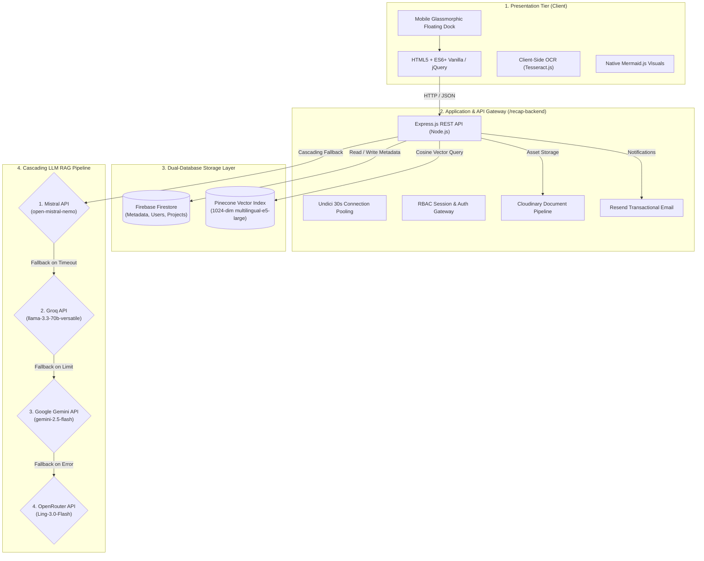

# 📚 RE-CAPS — Research Capstone Archiving and Retrieval System

[](https://nodejs.org/)
[](https://firebase.google.com/)
[](https://www.pinecone.io/)
[](https://tailwindcss.com/)
[](LICENSE)

> **RE-CAPS** is an AI-powered academic discovery platform and digital undergraduate theses repository engineered for institutional research management, semantic vector search, and Retrieval-Augmented Generation (RAG) at **Cebu Technological University (CTU) — Daanbantayan Campus**.

---

## 🎯 1. Overview & Institutional Purpose

Traditional university thesis archiving relies on rigid keyword matching and manual shelves, making related research difficult to locate. RE-CAPS bridges this gap through high-dimensional vector embeddings and multi-provider AI assistance across diverse academic degree programs:
- **BSIT** (Information Technology)
- **BIT** (Industrial Technology - Computer, Electronics, Automotive, Drafting)
- **BSFi** (Fisheries)
- **BSHM** (Hospitality Management)
- **BSIE** (Industrial Engineering)
- **BEEd & BSEd** (Elementary & Secondary Education)
- **BTLEd-HE** (Technology and Livelihood Education - Home Economics)

---

## 🏗️ 2. System Architecture & Tech Stack

RE-CAPS employs a modern, decoupled architecture separating client rendering, backend orchestration, and dual-database indexing.



---

## ✨ 3. Core Capabilities

### 🧠 A. Semantic Vector RAG Search
- **Pinecone Vector Database:** High-dimensional vector indexing using the Pinecone Inference API (`multilingual-e5-large`, 1024 dimensions, cosine distance metric).
- **Dual Indexes:**
  - `recaps-capstone`: Indexes research abstracts, methodology, problem statements, and academic degree programs.
  - `recaps-staff-copilot`: Dedicated knowledge index for librarian operations, call numbers, and institutional repository rules.

### 🤖 B. Resilient Cascading LLM Fallback
The RAG chatbot leverages multi-provider cascading failover to maintain 99.9% uptime:
1. **Mistral AI** (`open-mistral-nemo`) — Primary grounded synthesizer.
2. **Groq** (`llama-3.3-70b-versatile`) — Ultra-low latency fallback.
3. **Google Gemini** (`gemini-2.5-flash`) — Context-rich secondary fallback.
4. **OpenRouter** (`Ling-3.0-Flash`) — Autonomous tertiary safety net.

### 📱 C. Glassmorphic Mobile Navigation Dock
- **Responsive Dock:** Automatically transforms from the desktop sidebar rail into a floating glassmorphic pill bar on mobile viewports (`<= 768px`).
- **Center Action Focus:** Elevated circular button for instant access to the **Citation Generator**.
- **Role-Accented Glow:** Emerald accent for Student profiles, warm amber/gold for Teacher profiles.
- **Dynamic Content Clearance:** Viewport-aware padding prevents floating dock occlusion.

### 🛡️ D. Role-Based Access Control (RBAC)
- **Student (`student`):** Semantic search, public capstone exploration, interactive RAG chatbot, and project bookmarking.
- **Teacher / Adviser (`teacher`):** Title originality analysis, research tracking, OCR paper parsing, and student advising tools.
- **Librarian (`librarian`):** Physical library cataloging (`callNumber`, `accessionNo`, `location`), thesis ingestion, and Staff Copilot access.
- **Administrator (`admin`):** Account provisioning, catalog vector synchronization, storage pruning, and audit inspection.

### 📜 E. Automated Citation Generator
Generates instant, academic-grade bibliography citations across 5 standard formats:
- **APA (7th Edition)**
- **MLA (9th Edition)**
- **Chicago (17th Edition)**
- **IEEE**
- **Harvard**

### ⚡ F. Spark Free-Tier Quota Guard
- Activity tracking strictly resides in device-local storage (`localStorage`) rather than Firestore, safeguarding against daily Spark write limit exhaustion.

---

## 📂 4. Project Directory Layout

```
RE-CAPS/
├── public/                         # Client-Side Frontend
│   ├── index.html                  # Public Landing & Search Portal
│   ├── pages/                      # Role-Specific Dashboard Pages
│   │   ├── student_page.html       # Student Research Workspace
│   │   ├── teacher_page.html       # Adviser Review Portal
│   │   ├── librarian_page.html     # Cataloging & Submission Ingestion
│   │   └── admin_page.html         # System Administration & Analytics
│   ├── css/                        # Modular Stylesheets & Glassmorphic UI
│   │   ├── shared/dashboard-rail.css # Desktop Rail & Mobile Floating Dock
│   │   └── ...
│   └── js/                         # Vanilla ES6+ & jQuery Modules
│       ├── core/auth-service.js    # Firebase Auth Client Gateway
│       ├── shared/dashboard-rail.js# Navigation & Badge Sync Logic
│       └── shared/citation-generator.js # Citation Engine
├── recap-backend/                  # Express REST API Tier
│   ├── server.js                   # Main Backend Server & LLM Cascade
│   └── package.json                # Backend Dependencies
├── scripts/                        # Automated CI/CD & Guard Scripts
│   ├── preflight.js                # Instant Pre-Flight Integrity Test Suite
│   ├── test-routes.js              # Route Contract Verification
│   └── oxlint.json                 # Static Bug Analysis Config
├── .agents/                        # Agentic Pair-Programming Rules
│   ├── rules/academic-standards.md # Manuscript Layout & Degree Schemas
│   ├── rules/coding-standards.md   # Security, Architecture & README Rules
│   └── rules/rag-pipeline.md       # Pinecone Inference & Vector Sync
├── AGENTS.md                       # Master Architectural Blueprint & Directives
└── README.md                       # Public Project Documentation (This File)
```

---

## 🚀 5. Getting Started & Local Setup

### Prerequisites
- [Node.js](https://nodejs.org/) v18.0.0 or higher
- Modern Web Browser (Chrome, Edge, Firefox, Safari)
- Git

### 1. Clone the Repository
```bash
git clone https://github.com/JohnPerez012/Digital-Undergraduate-Theses-Repository-with-RAG-Search-at-Cebu-Technological-University-Library.git
cd RE-CAPS
```

### 2. Install Dependencies
```bash
# Install root preflight dependencies
npm install

# Install backend API dependencies
cd recap-backend
npm install
cd ..
```

### 3. Configure Environment Variables
Create a `.env` file inside `recap-backend/` following this template:

```env
# Application Port
PORT=3000

# Pinecone Vector Search
PINECONE_API_KEY=your_pinecone_api_key_here
PINECONE_INDEX_HOST=your_pinecone_index_host_here
PINECONE_STAFF_COPILOT_HOST=your_staff_copilot_host_here

# Cascading LLM API Providers
MISTRAL_API_KEY=your_mistral_api_key_here
GROQ_API_KEY=your_groq_api_key_here
GEMINI_API_KEY=your_gemini_api_key_here
OPENROUTER_API_KEY=your_openrouter_api_key_here

# Asset & Cloud Storage
CLOUDINARY_CLOUD_NAME=your_cloudinary_name_here
CLOUDINARY_API_KEY=your_cloudinary_api_key_here
CLOUDINARY_API_SECRET=your_cloudinary_api_secret_here

# Transactional Email
RESEND_API_KEY=your_resend_api_key_here
```

> [!NOTE]
> Never commit your live `.env` file. It is ignored by default in `.gitignore`.

### 4. Run the Application
```bash
# Start backend server
node recap-backend/server.js

# Access in browser
# Open: http://localhost:3000/
```

---

## 🔒 6. Security, Privacy & Secret Protection

RE-CAPS maintains a strict **Public vs. Private Information Boundary**:
- 🚫 **Strictly Private:** Live API keys, service account JSON certificates, database connection strings, bot tokens, and user credentials are **never exposed** in source code, commit history, or public documentation.
- 📢 **Public Transparency:** Architecture workflows, public endpoints, UI guidelines, and mock configuration schemas are openly documented to support academic peer review and open science.
- **Client Security:** All client inputs pass through sanitizers before DOM insertion to mitigate Cross-Site Scripting (XSS).

---

## 🧪 7. Automated Quality & Pre-Flight Suite

The repository includes a comprehensive 5-stage preflight guard script (`scripts/preflight.js`):
```bash
node scripts/preflight.js
```

| Guard Stage | Tool / Method | Purpose |
| :--- | :--- | :--- |
| **1. Syntax Check** | `node -c` | Verifies zero syntax typos across all server & client scripts |
| **2. Static Bug Scan** | `oxlint` (Rust) | Sub-millisecond linting for dead code and undefined references |
| **3. Route Contract** | Custom Scanner | Cross-checks frontend `fetch()` routes against Express endpoints |
| **4. Secrets Hygiene** | Regex Audit | Ensures no private keys or bot tokens leak into public directories |
| **5. Graph Status** | `graphify-out` | Verifies AST call-graph indexing freshness |

*Integrated Git Hooks (`.git/hooks/pre-commit` and `post-commit`) run these health checks automatically on every commit.*

---

## 📝 8. Recent Changelog & Visual Enhancements

- **Student-Exclusive ID Badge Display & Interactive Copy Action:** Added a dedicated, strictly role-guarded Student ID badge to the Student profile card (`student_page.html`, `student-settings.css`, `settings-handler.js`, `auth-service.js`, `registration.js`):
  - *Strict Role & Privacy Boundary:* The Student ID badge is strictly restricted to authenticated students viewing their own profile card; it remains completely hidden from all other user roles (Teachers, Administrators, Librarians) and unauthenticated contexts.
  - *Morphing Checkmark Clipboard Feedback:* Outfitted with a dedicated copy button (`#sset-card-copy-id-btn`) that mirrors the email copy behavior—morphing into an emerald checkmark (`#10b981`), triggering a "Student ID copied to clipboard" toast notification, and falling back gracefully on insecure local LAN/HTTP mobile origins before resetting after 2.5 seconds.
  - *Dual-Layer Cache & Hydration:* Cached directly via `sessionStorage` upon login/registration with automatic Firestore `users/{uid}` fallback hydration on session restore.
- **Monochrome Dynamic Icon Badges Across Settings Workstations:** Replaced colorful rainbow gradients and static pastel icon backgrounds with clean, dynamic monochrome black & white badges across Admin, Student, Teacher, and Librarian settings cards (`admin-settings.css`, `student-settings.css`, `librarian_renovated.css`, `admin_page.html`, `student_page.html`, `teacher_page.html`, `librarian_page.html`). In light mode, badges adopt subtle neutral slate tones (`rgba(0, 0, 0, 0.04)`); in dark mode, they adapt automatically to translucent white (`rgba(255, 255, 255, 0.06)`), removing generic AI-styled gradient signatures in favor of a clean, minimalist institutional theme.
- **Jump Navigation Deprecation & Profile Card Simplification:** Completely removed in-page jump navigation bars (`*-jump-nav`, `*-jump-link`) and their associated scroll-spy IntersectionObservers across all roles (Admin, Student, Librarian, Teacher) and all device viewports (`admin_page.html`, `student_page.html`, `librarian_page.html`, `admin-settings.js`, `settings-handler.js`, `librarian_main.js`, and associated CSS stylesheets). This declutters user profile cards across desktop and mobile, removing redundant anchor buttons and allowing users to navigate directly via the collapsible settings cards.
- **Interactive Email Copy SVG Checkmark Feedback:** Enhanced the email copy action button across Student (`student_page.html`), Teacher (`teacher_page.html`), Admin (`admin_page.html`), and Librarian (`librarian_page.html`) profile cards (`settings-handler.js`, `admin-settings.js`, `librarian_main.js`):
  - *Dynamic Icon Morphing:* Clicking the copy icon immediately transforms the copy SVG into an emerald checkmark (`#10b981`), scales subtly with active feedback styling (`.is-copied`), and reverts cleanly back to the copy SVG icon after 2.5 seconds.
  - *Resilient Insecure LAN / HTTP Clipboard Fallback:* Wrapped standard `navigator.clipboard.writeText` with an automatic `document.execCommand('copy')` textarea fallback, guaranteeing smooth copy execution and icon morphing on mobile phones accessing local LAN IP addresses (e.g., `pcg-2.local:3000`).
- **Mobile Collapsible Settings Cards (Student & Teacher Dashboards):** Implemented an ergonomic collapsible accordion card system across student and teacher workstation settings (`student_page.html`, `teacher_page.html`, `student-settings.css`, `settings-handler.js`):
  - *Mobile Information Overload Shield:* On mobile viewports (`<= 1024px`), settings category cards start collapsed into sleek, compact headers (~60px tall) with rotating chevron indicators, preventing cognitive fatigue and endless scrolling across dense account, appearance, notification, telemetry, and background preference panels.
  - *Independent Interactive Toggles:* Tapping any card header smoothly expands or collapses its contents independently with hardware-accelerated slide-down transitions (`@keyframes ssetSlideDown`).
  - *Smart Jump Nav Integration:* Tapping any category in the horizontal jump chip bar automatically expands the targeted section (and uncollapses nested containers such as Danger Zone) before smoothly scrolling to it with highlight flashing (`.sset-flash`).
  - *Desktop Integrity:* Desktop monitors and laptops (`> 1024px`) retain full static layout fidelity with all sections expanded and toggle chevrons safely hidden (`display: none !important;`).
- **Modernized Settings Gear Icon & Uniform Navigation Visuals:** Standardized the Settings / Profile icon across the Student (`student_page.html`) and Teacher (`teacher_page.html`) dashboards and mobile bottom floating docks. Replaced the outdated spiky asterisk geometry with the clean, canonical Feather/Lucide gear icon (`19.4 15...`) matching Admin settings, and updated the dock label from `Profile` to `Settings` for cross-role navigational clarity.
- **Floating Bottom Dock Citations Inactive State Hardening:** Neutralized the default idle appearance of the featured Citations button (`.dock-featured-btn`) in `public/css/shared/dashboard-rail.css`. Replaced persistent green/gold background gradients, borders, and box-shadow glows with subtle dark/light theme-adaptive neutral tokens (`rgba(255, 255, 255, 0.06)`, border `rgba(255, 255, 255, 0.12)`, text `#94a3b8`), reserving vibrant emerald/gold gradients, halos, and scaling strictly for active selection or touch hover.
- **Mobile Non-Sticky Ergonomic Profile Card & Horizontal Pill Jump Bar:** Overhauled profile card ergonomics on mobile viewports (`<= 1024px`) in `public/css/pages/student-settings.css` (`.sset-profile-card`) and `public/css/admin/admin-settings.css` (`.aset-profile-card`). Replaced desktop sticky anchoring (`position: sticky`) with a natural non-sticky flow (`position: static !important; max-height: none !important;`) so the card sits cleanly at the top of the single-column layout without overlaying or obscuring settings sections underneath during scrolling. Streamlined mobile cover/avatar dimensions and transformed vertical jump navigation into an ergonomic horizontal scrollable chip/pill bar (`.sset-jump-nav`, `.aset-jump-nav`).
- **Collapsible OCR Error Notice & Spinner Geometry Hardening:** Upgraded OCR scanning feedback in `public/pages/account_registration.html`, `public/js/registration/registration.js`, and `public/css/registration/registration.css`: fixed squished spinner geometry by enforcing `flex-shrink: 0; min-width: 20px;` and automatically hiding the spinner on verification failures. Replaced multi-line error dumps with a streamlined collapsible warning banner (`.ocr-error-banner`) that defaults to collapsed to maintain mobile viewport headroom while allowing one-tap expansion for detailed error explanations.
- **Registration Script Integrity & Gatekeeper Pre-Flight Guard:** Fixed a syntax termination token in `public/js/registration/registration.js` that halted the gatekeeper slider captcha execution. Added `registration.js` and `slider-captcha.js` to `scripts/preflight.js` (`CRITICAL_JS_FILES`) to ensure automated syntax testing across all future commits.
- **Registration State Synchronization, Insecure LAN Camera Fallback & Viewport Fit:** Resolved registration flow and device compatibility issues in `public/pages/account_registration.html`, `public/js/registration/registration.js`, and `public/css/registration/registration.css`:
  - *Dynamic Step 1 ↔ Step 2 Name Synchronization:* Implemented live state sync (`syncSummaryCardName()`) ensuring name corrections made on Step 1 immediately update the Step 2 verification summary card and registration state, resolving stale name persistence after ID scanning.
  - *LAN / Local Network Device Camera Shutter Fallback & Desktop Webcam Resilience:* Introduced an automatic camera shutter fallback (`<input type="file" capture="environment">`) and adaptive constraints for desktop/mobile. On desktop, relaxes mobile-specific `facingMode: 'environment'` constraints and falls back gracefully to `{ video: true }`, with contextual diagnostic badges explaining origin security (prompting `localhost:3000` or HTTPS) or missing webcam hardware.
  - *Zero-Scroll Mobile Viewport Ergonomics:* Refactored Step 1 container padding, step indicator dimensions, and form group spacing on mobile devices (`<= 640px` and `<= 480px`) to fit cleanly within dynamic viewport height (`100dvh`), eliminating unnecessary vertical scrollbars on smartphones while preserving vertical scrollability for taller content steps.
- **Modernized Authentication Notice Modals:** Overhauled "No Account Found" dialog on both desktop and mobile viewports (`public/js/shared/auth-modal.js`, `public/css/shared/style.css`): replaced emoji icons with a custom vector user-search SVG, switched from jarring multi-color gradients to an elegant tone-on-tone emerald palette, balanced button hierarchy, and enhanced light/dark mode presentation.
- **Mobile Smoothness & Touch Lag Optimization Suite:** Dedicated mobile-only performance overhaul preserving 100% desktop fidelity while eliminating mobile bottlenecks:
  - *Native Touch Scrolling:* Bypasses `smooth-scroll.js` on mobile devices (`<= 768px`), restoring native 120Hz compositor-threaded inertial touch momentum.
  - *Glassmorphic GPU Shield:* Replaced heavy `backdrop-filter: blur(24px)` with high-opacity 98% solids on mobile headers, docks, and secondary navigations, eliminating multi-pass GPU framebuffer capture overhead.
  - *Canvas Particle Sleep:* Bypasses the 200-particle 2D canvas animation loop in `ai-particles.js` on mobile devices to preserve battery and CPU cycles.
  - *Virtual DOM Paint Acceleration:* Injected CSS `content-visibility: auto; contain-intrinsic-size: auto 240px;` into mobile `.project-card` containers to skip rendering off-screen cards during long search queries.
  - *Asset Deduplication:* Eliminated duplicate SVG loader script tags in `public/index.html`.
- **Device-Adaptive Hero Background Engine:** Transformed background presentation in `public/js/home/cinematic-slider.js`: on mobile phones, eliminates recurring 6-second elastic GPU transitions and multi-image preloading in favor of a single randomized static background on entrance/page visit, resolving mobile lag and GPU throttling while preserving full dynamic animated slider transitions on desktop monitors and laptops.
- **Mobile Viewport Optimization & Modal Ergonomics:** Upgraded modern authentication modal (`public/css/shared/modern-login.css`) with dynamic viewport height (`100dvh`), compact mobile header branding, unclipped vertical scrolling, and safe-area padding (`env(safe-area-inset-bottom)`) ensuring registration links and OAuth action buttons are never obscured by mobile browser chrome or system gesture navigation bars.
- **Mobile Floating Bottom Dock:** Replaced drawer navigation on mobile viewports with an ergonomic glassmorphic tab dock featuring an elevated center Citation tool and real-time saved badge counter.
- **Pre-Flight Quality Suite:** Automated sub-second syntax checks, route contract validation, and secret hygiene verification prior to commits.
- **Continuous Knowledge Graph (graphify):** Real-time AST dependency graph indexing tracking over 1,100 nodes across all frontend and backend services.
- **Cascading LLM Resilience:** Quadruple failover engine guaranteeing constant availability for student and faculty queries.

---

## 🎓 Institutional Credits

- **Institution:** Cebu Technological University — Daanbantayan Campus
- **Repository:** Digital Undergraduate Theses Repository with RAG Search
- **Academic Year:** 2026
