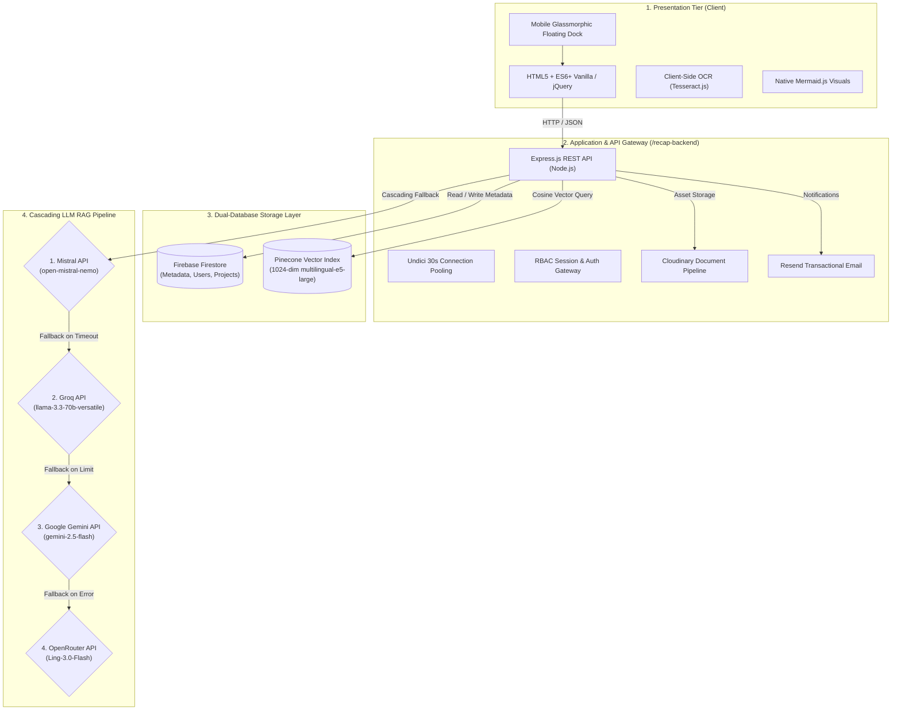

# 📚 RE-CAPS — Research Capstone Archiving and Retrieval System

[](https://nodejs.org/)
[](https://firebase.google.com/)
[](https://www.pinecone.io/)
[](https://tailwindcss.com/)
[](LICENSE)

> **RE-CAPS** is an AI-powered academic discovery platform and digital undergraduate theses repository engineered for institutional research management, semantic vector search, and Retrieval-Augmented Generation (RAG) at **Cebu Technological University (CTU) — Daanbantayan Campus**.

---

## 🎯 1. Overview & Institutional Purpose

Traditional university thesis archiving relies on rigid keyword matching and manual shelves, making related research difficult to locate. RE-CAPS bridges this gap through high-dimensional vector embeddings and multi-provider AI assistance across diverse academic degree programs:

- **BSIT** (Information Technology)
- **BIT** (Industrial Technology - Computer, Electronics, Automotive, Drafting)
- **BSFi** (Fisheries)
- **BSHM** (Hospitality Management)
- **BSIE** (Industrial Engineering)
- **BEEd & BSEd** (Elementary & Secondary Education)
- **BTLEd-HE** (Technology and Livelihood Education - Home Economics)

---

## 🏗️ 2. System Architecture & Tech Stack

RE-CAPS employs a modern, decoupled architecture separating client rendering, backend orchestration, and dual-database indexing.



---

## ✨ 3. Core Capabilities

### 🧠 A. Semantic Vector RAG Search

- **Pinecone Vector Database:** High-dimensional vector indexing using the Pinecone Inference API (`multilingual-e5-large`, 1024 dimensions, cosine distance metric).
- **Dual Indexes:**
  - `recaps-capstone`: Indexes research abstracts, methodology, problem statements, and academic degree programs.
  - `recaps-staff-copilot`: Dedicated knowledge index for librarian operations, call numbers, and institutional repository rules.

### 🤖 B. Resilient Cascading LLM Fallback

The RAG chatbot leverages multi-provider cascading failover to maintain 99.9% uptime:

1. **Mistral AI** (`open-mistral-nemo`) — Primary grounded synthesizer.
2. **Groq** (`llama-3.3-70b-versatile`) — Ultra-low latency fallback.
3. **Google Gemini** (`gemini-2.5-flash`) — Context-rich secondary fallback.
4. **OpenRouter** (`Ling-3.0-Flash`) — Autonomous tertiary safety net.

### 📱 C. Glassmorphic Mobile Navigation Dock

- **Responsive Dock:** Automatically transforms from the desktop sidebar rail into a floating glassmorphic pill bar on mobile viewports (`<= 768px`).
- **Center Action Focus:** Elevated circular button for instant access to the **Citation Generator**.
- **Role-Accented Glow:** Emerald accent for Student profiles, warm amber/gold for Teacher profiles.
- **Dynamic Content Clearance:** Viewport-aware padding prevents floating dock occlusion.

### 🛡️ D. Role-Based Access Control (RBAC)

- **Student (`student`):** Semantic search, public capstone exploration, interactive RAG chatbot, and project bookmarking.
- **Teacher / Adviser (`teacher`):** Title originality analysis, research tracking, OCR paper parsing, and student advising tools.
- **Librarian (`librarian`):** Physical library cataloging (`callNumber`, `accessionNo`, `location`), thesis ingestion, and Staff Copilot access.
- **Administrator (`admin`):** Account provisioning, catalog vector synchronization, storage pruning, and audit inspection.

### 📜 E. Automated Citation Generator

Generates instant, academic-grade bibliography citations across 5 standard formats:

- **APA (7th Edition)**
- **MLA (9th Edition)**
- **Chicago (17th Edition)**
- **IEEE**
- **Harvard**

### ⚡ F. Spark Free-Tier Quota Guard

- Activity tracking strictly resides in device-local storage (`localStorage`) rather than Firestore, safeguarding against daily Spark write limit exhaustion.

---

## 📂 4. Project Directory Layout

```
RE-CAPS/
├── public/                         # Client-Side Frontend
│   ├── index.html                  # Public Landing & Search Portal
│   ├── pages/                      # Role-Specific Dashboard Pages
│   │   ├── student_page.html       # Student Research Workspace
│   │   ├── teacher_page.html       # Adviser Review Portal
│   │   ├── librarian_page.html     # Cataloging & Submission Ingestion
│   │   └── admin_page.html         # System Administration & Analytics
│   ├── css/                        # Modular Stylesheets & Glassmorphic UI
│   │   ├── shared/dashboard-rail.css # Desktop Rail & Mobile Floating Dock
│   │   └── ...
│   └── js/                         # Vanilla ES6+ & jQuery Modules
│       ├── core/auth-service.js    # Firebase Auth Client Gateway
│       ├── shared/dashboard-rail.js# Navigation & Badge Sync Logic
│       └── shared/citation-generator.js # Citation Engine
├── recap-backend/                  # Express REST API Tier
│   ├── server.js                   # Main Backend Server & LLM Cascade
│   └── package.json                # Backend Dependencies
├── scripts/                        # Automated CI/CD & Guard Scripts
│   ├── preflight.js                # Instant Pre-Flight Integrity Test Suite
│   ├── test-routes.js              # Route Contract Verification
│   └── oxlint.json                 # Static Bug Analysis Config
├── .agents/                        # Agentic Pair-Programming Rules
│   ├── rules/academic-standards.md # Manuscript Layout & Degree Schemas
│   ├── rules/coding-standards.md   # Security, Architecture & README Rules
│   └── rules/rag-pipeline.md       # Pinecone Inference & Vector Sync
├── AGENTS.md                       # Master Architectural Blueprint & Directives
└── README.md                       # Public Project Documentation (This File)
```

---

## 🚀 5. Getting Started & Local Setup

### Prerequisites

- [Node.js](https://nodejs.org/) v18.0.0 or higher
- Modern Web Browser (Chrome, Edge, Firefox, Safari)
- Git

### 1. Clone the Repository

```bash
git clone https://github.com/JohnPerez012/Digital-Undergraduate-Theses-Repository-with-RAG-Search-at-Cebu-Technological-University-Library.git
cd RE-CAPS
```

### 2. Install Dependencies

```bash
# Install root preflight dependencies
npm install

# Install backend API dependencies
cd recap-backend
npm install
cd ..
```

### 3. Configure Environment Variables

Create a `.env` file inside `recap-backend/` following this template:

```env
# Application Port
PORT=3000

# Pinecone Vector Search
PINECONE_API_KEY=your_pinecone_api_key_here
PINECONE_INDEX_HOST=your_pinecone_index_host_here
PINECONE_STAFF_COPILOT_HOST=your_staff_copilot_host_here

# Cascading LLM API Providers
MISTRAL_API_KEY=your_mistral_api_key_here
GROQ_API_KEY=your_groq_api_key_here
GEMINI_API_KEY=your_gemini_api_key_here
OPENROUTER_API_KEY=your_openrouter_api_key_here

# Asset & Cloud Storage
CLOUDINARY_CLOUD_NAME=your_cloudinary_name_here
CLOUDINARY_API_KEY=your_cloudinary_api_key_here
CLOUDINARY_API_SECRET=your_cloudinary_api_secret_here

# Transactional Email
RESEND_API_KEY=your_resend_api_key_here
```

> [!NOTE]
> Never commit your live `.env` file. It is ignored by default in `.gitignore`.

### 4. Run the Application

```bash
# Start backend server
node recap-backend/server.js

# Access in browser
# Open: http://localhost:3000/
```

---

## 🔒 6. Security, Privacy & Secret Protection

RE-CAPS maintains a strict **Public vs. Private Information Boundary**:

- 🚫 **Strictly Private:** Live API keys, service account JSON certificates, database connection strings, bot tokens, and user credentials are **never exposed** in source code, commit history, or public documentation.
- 📢 **Public Transparency:** Architecture workflows, public endpoints, UI guidelines, and mock configuration schemas are openly documented to support academic peer review and open science.
- **Client Security:** All client inputs pass through sanitizers before DOM insertion to mitigate Cross-Site Scripting (XSS).

---

## 🧪 7. Automated Quality & Pre-Flight Suite

The repository includes a comprehensive 5-stage preflight guard script (`scripts/preflight.js`):

```bash
node scripts/preflight.js
```

| Guard Stage                  | Tool / Method     | Purpose                                                            |
| :--------------------------- | :---------------- | :----------------------------------------------------------------- |
| **1. Syntax Check**    | `node -c`       | Verifies zero syntax typos across all server & client scripts      |
| **2. Static Bug Scan** | `oxlint` (Rust) | Sub-millisecond linting for dead code and undefined references     |
| **3. Route Contract**  | Custom Scanner    | Cross-checks frontend `fetch()` routes against Express endpoints |
| **4. Secrets Hygiene** | Regex Audit       | Ensures no private keys or bot tokens leak into public directories |
| **5. Graph Status**    | `graphify-out`  | Verifies AST call-graph indexing freshness                         |

*Integrated Git Hooks (`.git/hooks/pre-commit` and `post-commit`) run these health checks automatically on every commit.*

---

## 📝 8. Recent Changelog & Visual Enhancements

- **Universal Auto-Save Architecture Across All "Add New Project" Modals & Workstations:** Standardized comprehensive draft preservation across all project submission modals in every corner of the system (`admin_page.html`, `librarian_page.html`, `public/js/admin/main.js`, `public/js/pages/librarian_main.js`, `librarian_renovated.css`):
  - *Unified Auto-Save Switch Interface & Layout Protection:* Integrated the identical tactile toggle switch (`.pmodal-autosave-label`, `.pmodal-autosave-track`, `.pmodal-autosave-thumb`, `.pmodal-autosave-text`) in the header of the Librarian "Add New Project" modal (`#upload-metadata-modal`), seamlessly aligned with the Admin Capstone modal (`#project-modal`). Hardened flexbox properties with `white-space: nowrap`, `flex-shrink: 0`, and `min-width: 0` on `.pmodal-header-left`, eliminating text-wrapping collisions between long subtitles and the Auto-save label.
  - *Symmetric Switch Thumb Calibration:* Calibrated the 38px switch capsule with `translateX(18px)` translation, ensuring exact 2px margin symmetry on both active and inactive states with zero capsule overhang.
  - *Comprehensive Input Event Listeners:* Debounced auto-save (1500ms) triggers automatically on all form inputs—including Title, Adviser, Year (with step buttons and arrow keys), Program select, Abstract, Physical Archival coordinates (Location, Call Number, Accession Number), and all dynamic multi-row inputs (Authors, Topics, Keywords, additions, removals, and split pastes).
  - *Isolated Local Draft Persistence:* Admin drafts persist under `admin_project_draft` and Librarian drafts under `librarian_project_draft` in `localStorage`, maintaining complete role boundary safety without overwriting each other.
  - *Intelligent Rehydration & Clean Lifecycle:* Opening the Add Project modal from any corner (Dashboard Quick Actions, Action Cards, or Catalog Navigation) automatically restores all draft fields with a reassuring `Draft restored ✨` toast. Drafts are safely retained across modal closures, permanently cleared upon successful Firebase Firestore submission, and guarded by explicit user confirmation when triggering "Clear Form".

- **Evaluate Project Submission Modal: Author Field Consistency & Dynamic Author Management:** Harmonized the author input interface in the Librarian/Admin "Evaluate Project Submission" modal (`#approval-review-modal`) with the "Edit Capstone Project" modal (`admin_page.html`, `public/js/admin/main.js`):
  - *Dynamic Multi-Row Author Interface:* Replaced the legacy single comma-separated input (`#approval-authors`) with `#approval-authors-container` utilizing `.dynamic-inputs-container.pform-dynamic-list`, `createDynamicRow()`, and an `Add Author` button (`#approval-add-author-btn`).
  - *Row Management & Paste Splitting:* Each author row features individual text entry and an instant remove button (`✕`). Retains automated multi-author splitting on paste (detecting commas, semicolons, and newlines) and Enter-key keyboard auto-advance.
  - *Seamless Data Population & Submission Handling:* Hydrates author arrays dynamically when opening pending project reviews, cleanly supporting both existing array structures and legacy delimited strings. Form submission extracts, trims, and validates author entries via `getDynamicValues()`.
  - *Project Lock State Enforcement:* When reviewing an evaluation record locked by an administrator, the `Add Author` button and row removal buttons (`.remove-row-btn`) are automatically disabled to prevent unauthorized edits.
- **Edit Capstone Project Modal: "Save Project" Button Visibility & Change Tracking:** Resolved modal state bug where the primary action button would intermittently hide or fail to render during project updates (`public/js/admin/main.js`):
  - *Persistent Action Visibility:* Enforced `#submit-project-btn` visibility (`inline-flex`) with the authoritative label "Save Project" upon modal opening, preventing accidental button suppression.
  - *Comprehensive Baseline State Tracking:* Enhanced `originalFormData` to track all catalog parameters including physical location, call number, accession number, and project gallery images (`images`), ensuring reliable dirty state detection without falsely dropping controls.
- **Admin Record Lock Status Toggle Resilience (`window.__adminToggleLockProject`):** Fixed `ReferenceError: saveProjectsToCache is not defined` when toggling capstone lock status (`public/js/admin/main.js`). Defined `saveProjectsToCache = saveToCache` and wrapped cache persistence with safe function detection and automatic fallback to `localStorage`, guaranteeing seamless real-time lock/unlock state updates in table views and toast notifications.

- **Tablet & Mobile Navigation Alignment: Eradication of .mobile-rail-toggle & Tablet Bottom Dock Expansion:** Addressed tablet breakpoint (`768px < width <= 1024px`) inconsistencies where the deprecated floating hamburger button was erroneously reappearing on tablet viewports (e.g. `776px`):

  - *Complete Eradication of `.mobile-rail-toggle`:* Removed `<button class="mobile-rail-toggle">` from DOM in `student_page.html` and `teacher_page.html`, and permanently disabled `.mobile-rail-toggle` in `dashboard-rail.css` (`display: none !important; visibility: hidden !important; pointer-events: none !important;`) across all viewports and media queries.
  - *Unified Tablet & Mobile Floating Dock (`<= 1024px`):* Extended the floating bottom navigation dock (`.mobile-bottom-dock-container`, `.mobile-bottom-dock`, `.mobile-back-home-btn`) from `768px` to `1024px`. On tablets (such as iPads and `776px` screens), provides a centered, ergonomic 480px dock with thumb-friendly access to all 5 sections and the Back Home button, while granting the dashboard content area 100% unobstructed full width.
  - *Accurate "Dashboard" Dock Tab Identification:* Corrected the first tab item in the mobile bottom floating dock from "Home" to "Dashboard", accurately reflecting that tapping it switches views to the active workstation dashboard (`#section-dashboard`).
  - *Dedicated Floating "Back Home" Navigation Anchor:* Integrated a prominent, pill-shaped "Back Home" button (`.mobile-back-home-btn`) positioned directly above the first dock item on mobile and tablet devices (`<= 1024px`). Tapping this button seamlessly returns users to the primary repository home portal (`../index.html`), complete with left-arrow iconography, emerald/gold brand tints, subtle backdrop blur, and touch-scale micro-interactions.
  - *Responsive Label Typography Clamping:* Implemented CSS `clamp(0.575rem, 2.3vw, 0.6875rem)` on `.dock-label` to guarantee the 9-character "Dashboard" text never wraps or clips, even on compact smartphone screens (320px–360px).
  - *Content Area Bottom Clearance:* Set `.dashboard-content` padding bottom to `calc(130px + env(safe-area-inset-bottom, 0px))` across mobile and tablet (`<= 1024px`), ensuring cards never get obscured behind floating navigation elements.
  - *Uniform Borderless Citation Dock Icon:* Removed the circular/oval container (`.dock-featured-btn`) around the Citations generator icon in the bottom floating dock across Student and Teacher workstations, unifying all five navigation tabs to use the identical, clean, borderless `.dock-icon-wrap` presentation.
- **Citation Generator Workspace De-clutter & Stress-Free Guided UX:** Overhauled the Academic Citation & Bibliography Studio across Student and Teacher dashboards (`citation-generator.js`, `citation-generator.css`, `student_page.html`, `teacher_page.html`):

  - *Mobile Studio Header Vertical Stacking (Zero Text Squishing / Zero Button Collisions):* Completely resolved mobile header compression on devices (`<= 768px`) where `.citation-studio-header` was erroneously attempting to fit title text and action buttons (`Import Saved Project` + `Reset`) on the same horizontal row, squishing the title and paragraph into a 90px vertical strip (1 word per line) and overlapping the badge. Enforced `flex-direction: column !important; align-items: stretch !important;` with 100% full-width text flow and a dedicated action button row underneath.
  - *Eradication of Bottom Horizontal Scrollbar & Mobile Width Blowouts:* Eliminated the unnecessary horizontal scroll pane at the bottom of mobile viewports by enforcing `overflow-x: hidden !important; width: 100% !important;` across `#section-citations`, `.citation-workstation-grid`, and `.dashboard-content`. Rescaled mobile card padding to `16px` (from `28px`) and stacked `.citation-fields-row` into a single vertical column (`grid-template-columns: 1fr !important;`), preventing `minmax(200px, 1fr)` two-column blowout from pushing inputs outside the screen.
  - *Vertical-Only Smooth Auto-Scroll on Generate (Zero Lost Width / Zero Horizontal Shift):* Replaced `scrollIntoView()` on mobile with strict vertical-only scrolling `window.scrollTo({ top: targetY, left: 0, behavior: 'smooth' })`. This permanently locks horizontal scroll to 0, ensuring `#generate-citation-btn` and the formatted output cards never lose their width, clip off-screen, or jump horizontally when clicked.
  - *Authoritative Import Saved Capstone Modal (Zero Overlapping / Zero Screen Clipping):* Completely eradicated the legacy floating dropdown menu (`.citation-import-menu`) which previously suffered from severe left-margin clipping (`-150px` offscreen on mobile) and awkward visual collision directly over the Citation Style selector. Replaced with an accessible, centered modal dialog (`.citation-import-modal-overlay`) with frosted backdrop blur (`rgba(42, 47, 53, 0.75)` + `backdrop-filter: blur(5px)`), clean dialog header with brand green bookmark badge, close button (`×`), escape key dismissal, and backdrop click handler.
  - *Full-Width Touch-Friendly Capstone List:* The modal displays the user's saved capstones with multiline titles, department pills, defense year tags, and copyable author lines (`data-allow-copy="true"`), protected under R.A. 10173 and anti-plagiarism guidelines (`user-select: none` on titles). Tapping any item auto-fills the studio fields, smoothly dismisses the modal, and provides a clear toast notification.
  - *Horizontal Swipeable Citation Style Track:* Transformed the multi-row wrapped citation style pills (`.citation-format-bar`, `.citation-format-pills`) into a sleek, single-row momentum-scrollable horizontal track (`flex-wrap: nowrap !important; overflow-x: auto !important; scrollbar-width: none;`). Clicking any citation pill automatically centers it into view (`scrollIntoView({ inline: 'center' })`).
  - *Device-Only On-Demand Results Visibility:* On mobile and tablet devices (`<= 1024px`), both `.citation-output-card` and `.citation-intext-card` remain hidden initially (`.device-hidden`), eliminating vertical scrolling clutter. They are revealed smoothly (`.device-visible` with `citationCardReveal` animation) and auto-scrolled into focus ONLY when the user taps "Generate & Save Citation" (`#generate-citation-btn`). On desktop (`> 1024px`), cards remain permanently visible in their side-by-side workstation column.
  - *Complete Purge of Dummy / Templated Data:* Completely removed all hardcoded student author names (`Cadaro, John P.`, `Allan P. De Jesus Jr.`, `Christine D. Conde`, `Cabardo`, `Ompoy`), dummy fallback titles (`[Project Title]`), and fake in-text citations (`(Cadaro et al., 2024)`).
  - *Serene Empty State on Load:* On initial workstation load or form clearing, replaces broken fake citations with a clean, reassuring empty-state illustration (`.citation-empty-state`) guiding the scholar to enter their thesis details or import directly from their bookmarked capstones.
  - *Awaiting Input Live Pill:* Status indicator now dynamically toggles between `Awaiting Input` (neutral tone) when empty and `Live Preview Active` (brand green) once active research details are provided.
  - *Contextual In-Text Writing Guides:* In-text citation cards now feature concise usage micro-guides explaining exactly when to use *Parenthetical* (end-of-sentence citations) versus *Narrative* (in-sentence subject citations) to eliminate student writing stress.
  - *Intelligent Copy & Export Guards:* Copy and download buttons are cleanly guarded when fields are empty, preventing accidental clipboard pollution or empty file downloads while providing helpful toast feedback.
  - *Sanitized Form Reset:* Replaced the legacy reset function that was re-injecting templated values with a clean reset mechanism that returns all fields to a pristine state.
- **Brand Palette Hardening, Saved Collection Export Modal, and 4-Step Account Deletion Lifecycle:** Comprehensive institutional alignment and security enhancements across student settings (`student-settings.css`, `settings-handler.js`, `password-change.css`, `auth-modal.js`):

  - *Institutional Color Alignment (Zero Lingering Blue):* Strictly purged unauthorized blue hues (`#3b82f6`, `#2563eb`, `#1d4ed8`, `#60a5fa`) across toggles, chips, status pills, and focus states in settings. Replaced colorful purple/blue linear gradients on `.password-change-icon` with institutional brand green accents (`rgba(8, 212, 136, 0.1)`, `border: 2px solid rgba(8, 212, 136, 0.25)`, `color: var(--brand-green, #08D488)`), locking all visuals to the core brand palette (`#2a2f35`, `#F7F7F8`, `#08D488`, `#FCCC56`).
  - *Progressive 4-Step Account Deletion Wizard:* Replaced the abrupt single-click deletion modal with an audited 4-step progressive lifecycle:
    1. *Security Confirmation:* Requires user to type exact uppercase `DELETE` before unlocking navigation.
    2. *Grace Period Selection:* User selects **15 Days** (Standard) or **30 Days** (Extended) inactivity grace period.
    3. *Departure Reason:* Dropdown menu selection with conditional "Other" custom explanation textarea.
    4. *Password Verification & Immediate Sign-Out:* Verifies account credentials with Firebase reauthentication, stores scheduled countdown metadata in Firestore (`deletionScheduled: true`, `scheduledDeletionTimestamp`, `deletionGraceDays`, `deletionReason`, `accountStatus: 'pending_deletion'`), and immediately logs out the user without blocking prompts or conditions.
    5. *Automatic Login Cancellation Guard:* The sole condition to cancel the timer is logging back in. Logging into an active pending-deletion account instantly removes the timer and restores the account to active status.
  - *Decoupled Account Data Clearing from Search History:* Separated "Clear Account Data" from search query storage. Clearing account data purges bookmarks, chat conversations, and local activity logs while strictly preserving user search history (`recap_search_history`, `recap_recent_searches`).
  - *Interactive Saved Projects Export Modal:* Replaced direct JSON downloads with an interactive `.export-modal-modern` dialog featuring live collection metrics (Saved Projects count, estimated payload size, export date, format), custom filename input with dynamic extension badge, and one-click export to JSON, CSV, or BibTeX format.
  - *Theme Toggle Toast Suppression:* Removed noisy toast notifications when switching between Light Mode and Dark Mode.
- **Mobile UI Responsiveness & UX Suite for Settings Blocks (.sset-block):** Comprehensive ergonomic overhaul across all Student and Teacher settings workstations (student-settings.css, student_page.html, settings-handler.js):

  - *Uncramped Vertical Stacking for Action Rows:* Replaced cramped horizontal flex wrapping on action rows (e.g. Password & Security) with a dedicated vertical stack (.sset-row-stacked, .sset-row:has(.sset-row-actions)). Titles and password masking dots now have full breathing room, helper notes display without truncation, and action buttons span full width with 44px thumb-friendly touch targets.
  - *Mobile Toggle Alignment:* Streamlined toggle switch rows (Dark Mode Theme, Toast Notifications) with high-priority flex alignment, keeping switches locked to the right while labels and descriptions wrap naturally without clipping.
  - *Mobile Danger Zone Optimization:* Refactored collapsible Danger Zone toggle and item actions with clean vertical stacking, clear hazard descriptions, and full-width touch buttons on screens <= 768px and <= 480px.
  - *Data Management & Cinematic Background Grids:* Converted multi-column action grids (.sset-actions-grid) and background mode options (.sset-bg-mode-grid) into clean single-column cards on mobile, with a balanced 2-column image gallery (
    epeat(2, 1fr)) for campus ambiance selection.
  - *Intelligent UX Auto-Scroll on Expansion:* Integrated subtle viewport auto-scrolling on mobile when expanding settings blocks or opening the Danger Zone, smoothly bringing expanded content into view.
- **Institutional Anti-Plagiarism & Intellectual Property Protection System (R.A. 10173):** Comprehensive codebase-wide hardening safeguarding capstone research assets against unauthorized reproduction across all surfaces:

  - *Universal Title & Abstract Shield:* Closed loopholes across Saved Projects cards (`.saved-card-title`, `.saved-card-abstract`), search catalogs (`.project-title`, `.project-abstract`), detail modals (`.project-title-large`, `.section-text`), recent theses spotlights (`.recent-thesis-title`), and catalog cells (`.project-title-cell`, `.catalog-card-title`), enforcing strict uncopyable attributes (`user-select: none !important; -webkit-touch-callout: none !important; data-protected="true"`).
  - *Author Citation Whitelist Guarantee:* Explicitly whitelisted research authors across all views (`.authors`, `.saved-card-authors`, `.project-authors-line`, `.recent-thesis-authors`, `[data-allow-copy="true"]`), guaranteeing that scholars can seamlessly highlight, select, and copy author names for bibliography and literature citations without false-positive protection alerts.
  - *Multi-Event Callout Interception:* Intercepts text selection, copy key combinations (`Ctrl+C` / `Cmd+C`), drag attempts, right-click/context menus, and mobile 450ms touch-holds (`touchstart` with scroll displacement cancellation) on protected titles and abstracts, displaying the institutional Data Privacy Act (R.A. 10173) and Anti-Plagiarism callout modal.
- **Mobile Activity Controls Overhaul & Horizontal Chip Track:** Completely decluttered the search and filter panel (`.activity-controls-card`) in `public/css/shared/activity-log.css`:

  - *Unified Single-Row Search & Date Filter:* Paired the search input and "All Time" select dropdown side-by-side in one compact 38px row (`.activity-controls-top`), eliminating the tall stacked dropdown box.
  - *Horizontal Swipeable Chip Bar:* Replaced the 5-row wrapped cluster of 9 filter buttons (`.activity-category-pills`) with a single-line, momentum-scrollable chip track (`overflow-x: auto; flex-wrap: nowrap !important; scrollbar-width: none;`). Users can now smoothly flick between categories horizontally without screen clutter or visual fatigue.
  - *Vertical Height Savings:* Reduced the mobile controls card footprint by over 70% (~108px down from ~350px), bringing the actual Activity Timeline directly into immediate view upon opening the tab.
- **Ergonomic 2 \| 2 \| 1 Activity Stats Grid on Mobile:** Overhauled the activity metrics summary cards (`.activity-stats-grid`, `.activity-stat-card`) in `public/css/shared/activity-log.css`: on mobile screens (`<= 768px` and `<= 480px`), converted the layout into a balanced, symmetrical **2 \| 2 \| 1 configuration** (`grid-template-columns: repeat(2, 1fr) !important;`). The first four cards (Total Activities, Actions Today, Storage Used, Top Category) form two compact 2-column rows, while the fifth card (Last Active) spans full width across both columns (`grid-column: 1 / -1;`), providing abundant horizontal space for full timestamp dates without awkward wrapping or vertical overflow.
- **Compact 2x2 Workstation Stat Cards on Mobile Viewports:** Re-architected the interactive workstation KPI cards (`.student-stats-grid`, `.student-stat-card`) on mobile devices (`<= 768px` and `<= 480px`) in `public/css/pages/student_page.css`: replaced the vertical single-column stack with an ergonomic 2-column by 2-row compact grid (`grid-template-columns: repeat(2, 1fr) !important;`). Optimized card paddings (`0.85rem 0.8rem`), typography, status badges, and action link spacing while applying 2-line vertical truncation (`-webkit-line-clamp: 2`) to descriptions, ensuring uniform card row heights and eliminating endless vertical scrolling on smartphones.
- **Student-Exclusive ID Badge Display & Interactive Copy Action:** Added a dedicated, strictly role-guarded Student ID badge to the Student profile card (`student_page.html`, `student-settings.css`, `settings-handler.js`, `auth-service.js`, `registration.js`):

  - *Strict Role & Privacy Boundary:* The Student ID badge is strictly restricted to authenticated students viewing their own profile card; it remains completely hidden from all other user roles (Teachers, Administrators, Librarians) and unauthenticated contexts.
  - *Morphing Checkmark Clipboard Feedback:* Outfitted with a dedicated copy button (`#sset-card-copy-id-btn`) that mirrors the email copy behavior—morphing into an emerald checkmark (`#10b981`), triggering a "Student ID copied to clipboard" toast notification, and falling back gracefully on insecure local LAN/HTTP mobile origins before resetting after 2.5 seconds.
  - *Dual-Layer Cache & Hydration:* Cached directly via `sessionStorage` upon login/registration with automatic Firestore `users/{uid}` fallback hydration on session restore.
- **Monochrome Dynamic Icon Badges Across Settings Workstations:** Replaced colorful rainbow gradients and static pastel icon backgrounds with clean, dynamic monochrome black & white badges across Admin, Student, Teacher, and Librarian settings cards (`admin-settings.css`, `student-settings.css`, `librarian_renovated.css`, `admin_page.html`, `student_page.html`, `teacher_page.html`, `librarian_page.html`). In light mode, badges adopt subtle neutral slate tones (`rgba(0, 0, 0, 0.04)`); in dark mode, they adapt automatically to translucent white (`rgba(255, 255, 255, 0.06)`), removing generic AI-styled gradient signatures in favor of a clean, minimalist institutional theme.
- **Jump Navigation Deprecation & Profile Card Simplification:** Completely removed in-page jump navigation bars (`*-jump-nav`, `*-jump-link`) and their associated scroll-spy IntersectionObservers across all roles (Admin, Student, Librarian, Teacher) and all device viewports (`admin_page.html`, `student_page.html`, `librarian_page.html`, `admin-settings.js`, `settings-handler.js`, `librarian_main.js`, and associated CSS stylesheets). This declutters user profile cards across desktop and mobile, removing redundant anchor buttons and allowing users to navigate directly via the collapsible settings cards.
- **Interactive Email Copy SVG Checkmark Feedback:** Enhanced the email copy action button across Student (`student_page.html`), Teacher (`teacher_page.html`), Admin (`admin_page.html`), and Librarian (`librarian_page.html`) profile cards (`settings-handler.js`, `admin-settings.js`, `librarian_main.js`):

  - *Dynamic Icon Morphing:* Clicking the copy icon immediately transforms the copy SVG into an emerald checkmark (`#10b981`), scales subtly with active feedback styling (`.is-copied`), and reverts cleanly back to the copy SVG icon after 2.5 seconds.
  - *Resilient Insecure LAN / HTTP Clipboard Fallback:* Wrapped standard `navigator.clipboard.writeText` with an automatic `document.execCommand('copy')` textarea fallback, guaranteeing smooth copy execution and icon morphing on mobile phones accessing local LAN IP addresses (e.g., `pcg-2.local:3000`).
- **Mobile Collapsible Settings Cards (Student & Teacher Dashboards):** Implemented an ergonomic collapsible accordion card system across student and teacher workstation settings (`student_page.html`, `teacher_page.html`, `student-settings.css`, `settings-handler.js`):

  - *Mobile Information Overload Shield:* On mobile viewports (`<= 1024px`), settings category cards start collapsed into sleek, compact headers (~60px tall) with rotating chevron indicators, preventing cognitive fatigue and endless scrolling across dense account, appearance, notification, telemetry, and background preference panels.
  - *Independent Interactive Toggles:* Tapping any card header smoothly expands or collapses its contents independently with hardware-accelerated slide-down transitions (`@keyframes ssetSlideDown`).
  - *Smart Jump Nav Integration:* Tapping any category in the horizontal jump chip bar automatically expands the targeted section (and uncollapses nested containers such as Danger Zone) before smoothly scrolling to it with highlight flashing (`.sset-flash`).
  - *Desktop Integrity:* Desktop monitors and laptops (`> 1024px`) retain full static layout fidelity with all sections expanded and toggle chevrons safely hidden (`display: none !important;`).
- **Modernized Settings Gear Icon & Uniform Navigation Visuals:** Standardized the Settings / Profile icon across the Student (`student_page.html`) and Teacher (`teacher_page.html`) dashboards and mobile bottom floating docks. Replaced the outdated spiky asterisk geometry with the clean, canonical Feather/Lucide gear icon (`19.4 15...`) matching Admin settings, and updated the dock label from `Profile` to `Settings` for cross-role navigational clarity.
- **Floating Bottom Dock Citations Inactive State Hardening:** Neutralized the default idle appearance of the featured Citations button (`.dock-featured-btn`) in `public/css/shared/dashboard-rail.css`. Replaced persistent green/gold background gradients, borders, and box-shadow glows with subtle dark/light theme-adaptive neutral tokens (`rgba(255, 255, 255, 0.06)`, border `rgba(255, 255, 255, 0.12)`, text `#94a3b8`), reserving vibrant emerald/gold gradients, halos, and scaling strictly for active selection or touch hover.
- **Mobile Non-Sticky Ergonomic Profile Card & Horizontal Pill Jump Bar:** Overhauled profile card ergonomics on mobile viewports (`<= 1024px`) in `public/css/pages/student-settings.css` (`.sset-profile-card`) and `public/css/admin/admin-settings.css` (`.aset-profile-card`). Replaced desktop sticky anchoring (`position: sticky`) with a natural non-sticky flow (`position: static !important; max-height: none !important;`) so the card sits cleanly at the top of the single-column layout without overlaying or obscuring settings sections underneath during scrolling. Streamlined mobile cover/avatar dimensions and transformed vertical jump navigation into an ergonomic horizontal scrollable chip/pill bar (`.sset-jump-nav`, `.aset-jump-nav`).
- **Collapsible OCR Error Notice & Spinner Geometry Hardening:** Upgraded OCR scanning feedback in `public/pages/account_registration.html`, `public/js/registration/registration.js`, and `public/css/registration/registration.css`: fixed squished spinner geometry by enforcing `flex-shrink: 0; min-width: 20px;` and automatically hiding the spinner on verification failures. Replaced multi-line error dumps with a streamlined collapsible warning banner (`.ocr-error-banner`) that defaults to collapsed to maintain mobile viewport headroom while allowing one-tap expansion for detailed error explanations.
- **Registration Script Integrity & Gatekeeper Pre-Flight Guard:** Fixed a syntax termination token in `public/js/registration/registration.js` that halted the gatekeeper slider captcha execution. Added `registration.js` and `slider-captcha.js` to `scripts/preflight.js` (`CRITICAL_JS_FILES`) to ensure automated syntax testing across all future commits.
- **Registration State Synchronization, Insecure LAN Camera Fallback & Viewport Fit:** Resolved registration flow and device compatibility issues in `public/pages/account_registration.html`, `public/js/registration/registration.js`, and `public/css/registration/registration.css`:

  - *Dynamic Step 1 ↔ Step 2 Name Synchronization:* Implemented live state sync (`syncSummaryCardName()`) ensuring name corrections made on Step 1 immediately update the Step 2 verification summary card and registration state, resolving stale name persistence after ID scanning.
  - *LAN / Local Network Device Camera Shutter Fallback & Desktop Webcam Resilience:* Introduced an automatic camera shutter fallback (`<input type="file" capture="environment">`) and adaptive constraints for desktop/mobile. On desktop, relaxes mobile-specific `facingMode: 'environment'` constraints and falls back gracefully to `{ video: true }`, with contextual diagnostic badges explaining origin security (prompting `localhost:3000` or HTTPS) or missing webcam hardware.
  - *Zero-Scroll Mobile Viewport Ergonomics:* Refactored Step 1 container padding, step indicator dimensions, and form group spacing on mobile devices (`<= 640px` and `<= 480px`) to fit cleanly within dynamic viewport height (`100dvh`), eliminating unnecessary vertical scrollbars on smartphones while preserving vertical scrollability for taller content steps.
- **Modernized Authentication Notice Modals:** Overhauled "No Account Found" dialog on both desktop and mobile viewports (`public/js/shared/auth-modal.js`, `public/css/shared/style.css`): replaced emoji icons with a custom vector user-search SVG, switched from jarring multi-color gradients to an elegant tone-on-tone emerald palette, balanced button hierarchy, and enhanced light/dark mode presentation.
- **Mobile Smoothness & Touch Lag Optimization Suite:** Dedicated mobile-only performance overhaul preserving 100% desktop fidelity while eliminating mobile bottlenecks:

  - *Native Touch Scrolling:* Bypasses `smooth-scroll.js` on mobile devices (`<= 768px`), restoring native 120Hz compositor-threaded inertial touch momentum.
  - *Glassmorphic GPU Shield:* Replaced heavy `backdrop-filter: blur(24px)` with high-opacity 98% solids on mobile headers, docks, and secondary navigations, eliminating multi-pass GPU framebuffer capture overhead.
  - *Canvas Particle Sleep:* Bypasses the 200-particle 2D canvas animation loop in `ai-particles.js` on mobile devices to preserve battery and CPU cycles.
  - *Virtual DOM Paint Acceleration:* Injected CSS `content-visibility: auto; contain-intrinsic-size: auto 240px;` into mobile `.project-card` containers to skip rendering off-screen cards during long search queries.
  - *Asset Deduplication:* Eliminated duplicate SVG loader script tags in `public/index.html`.
- **Device-Adaptive Hero Background Engine:** Transformed background presentation in `public/js/home/cinematic-slider.js`: on mobile phones, eliminates recurring 6-second elastic GPU transitions and multi-image preloading in favor of a single randomized static background on entrance/page visit, resolving mobile lag and GPU throttling while preserving full dynamic animated slider transitions on desktop monitors and laptops.
- **Mobile Viewport Optimization & Modal Ergonomics:** Upgraded modern authentication modal (`public/css/shared/modern-login.css`) with dynamic viewport height (`100dvh`), compact mobile header branding, unclipped vertical scrolling, and safe-area padding (`env(safe-area-inset-bottom)`) ensuring registration links and OAuth action buttons are never obscured by mobile browser chrome or system gesture navigation bars.
- **Mobile Floating Bottom Dock:** Replaced drawer navigation on mobile viewports with an ergonomic glassmorphic tab dock featuring an elevated center Citation tool and real-time saved badge counter.
- **Comprehensive Workstation, Citation, and Responsive Alignment Suite:**

  - *Welcome Modal Brand Palette & Icon Modernization:* Replaced the corny waving-hand emoji and circular green-to-yellow gradient bubble in the welcome-back dialog (`auth-modal.js`, `style.css`) with a clean institutional academic cap vector SVG. Stripped all colorful gradients from the icon wrapper and primary action button ("Continue"), aligning the modal strictly with core brand tokens (`--brand-green: #08D488` and `--brand-black: #2a2f35`).
  - *Balanced 2-Top, 1-Bottom Activity Header Actions:* Redesigned `.activity-header-actions` on mobile viewports (`<= 768px`) into a clean CSS grid layout where "Refresh" and "Export Log" share the top row equally (`1fr 1fr`) and "Clear History" spans full width below them (`grid-column: 1 / -1`), eliminating asymmetrical gaps and awkward wrapping.
  - *Institutional Account Sign-Out / Log Out Button:* Integrated prominent Log Out buttons in the Settings section across Student and Teacher workstations (`student_page.html`, `teacher_page.html`, `dashboard-rail.js`) inside Account Management (`#student-settings-logout-btn`) and at the base of the profile card (`#student-card-logout-btn`), connecting to centralized confirmation dialogs, activity logging, and Firebase sign-out.
  - *Citation Generator Precautionary Reset Modal:* Added an intelligent confirmation precaution to `#btn-citation-reset` (`citation-generator.js`). Automatically verifies if user-entered manuscript details (Title, Authors, Year, Program) exist; if data is present, triggers `ModalDialog.confirm` to prevent accidental loss, while clearing immediately if all custom fields are empty (ignoring institutional defaults).
  - *Strict Viewport Width Locking & Seamless Home/Dashboard Return:* Fixed layout scale drifting when navigating between project views on the repository home page and workstation dashboards (`student_page.html`, `teacher_page.html`, `student_page.css`, `dashboard-rail.css`). Locked viewport meta with `maximum-scale=1.0, user-scalable=no, viewport-fit=cover` and enforced `overflow-x: hidden !important; max-width: 100vw !important;` across all dashboard containers and card lists.
  - *Mobile Chatbot Send Button Right-Lock:* Formatted `.chatbot-fullpage .input-footer` and `.input-controls-right` on mobile viewports (`<= 768px`) to guarantee the send button (`#send-btn`) is permanently anchored at the far right edge of the input wrapper without overlapping character counters or mobile navigation docks.
  - *Project Detail Abstract Text Alignment Customizer:* Introduced a sleek, non-intrusive segmented toolbar (`.abstract-align-toolbar`) directly in the Abstract header on the Project Detail page (`view-manager.js`, `view_project_details.css`). Allows readers to toggle text alignment between Justify, Left, Center, and Right with instant CSS application and `localStorage` persistence, while strictly preserving R.A. 10173 anti-plagiarism protection (`data-protected="true"`).
  - *Unified Saved Projects Counter Across Desktop & Mobile Dropdowns:* Upgraded `updateSecondaryNavSavedCount` in `view-manager.js` and dropdown triggers in `auth-modal.js` and `project-list.js` using `querySelectorAll`, ensuring the emerald saved count badge (`#pd-saved-count`) displays reactively and identically on both desktop profile menus and mobile devices.
  - *Core Brand Palette Enforcement for Projects Scope Filter:* Purged unauthorized blue hues (`#2563eb`, `#38bdf8`) from `.projects-scope-filter` and `.scope-filter-btn` in `public/css/home/project-list.css`, strictly aligning all active, hover, and badge styles with official brand tokens: `--brand-black: #2a2f35`, `--brand-white: #F7F7F8`, `--brand-green: #08D488`, and `--brand-yellow: #FCCC56`.
  - *Project Detail Bookmark Toggle Inversion Fix:* Fixed a race condition in `view-manager.js` where clicking the save buttons (`#header-save-btn`, `#detail-save-btn`) inside the Project Detail view dispatched an optimistic bookmark event before `ProjectBookmarkService.toggleSave` executed. This had caused premature state pollution in `window.savedProjectIds` and `localStorage`, inverting subsequent save operations into unexpected removals and rollback toasts. The service now accepts an explicit target state (`desiredState = nextSaved`), eliminates premature event emissions, and ensures reliable single-click bookmarking.
  - *Instant Cache Render & Lazy Background Sync (Cinematic Entrance Zero-Wait Architecture):* Engineered a high-efficiency Stale-While-Revalidate data pipeline in `project-list.js`. Upon visiting the homepage, locally cached capstone projects (`projectsData`) and bookmark states (`savedProjects`) render immediately into the DOM in 0 milliseconds with zero user waiting time. During the cinematic dramatic intro animation (~3.5s) or initial load, background validation runs asynchronously via Realtime Database (RTDB) version counters and Firestore sync without freezing the UI or blocking page paint. When the cinematic entrance concludes, the entire catalog, counter badges, and pagination are already 100% prepared and populated.
  - *Desktop Workstation Dashboard Layout & Grid Overflow Alignment Fix:* Resolved horizontal blowout and column crushing on desktop viewports (`dashboard-rail.css`, `student_page.css`). Enforced strict `width: calc(100% - var(--content-shift))` and `box-sizing: border-box` across `.dashboard-main` and `.dashboard-content` to prevent the fixed slim sidebar rail from pushing dashboard content off-screen. Upgraded `.student-content-columns` to `grid-template-columns: minmax(0, 1.4fr) minmax(320px, 1fr)` and constrained `.student-card-panel`, `.recent-thesis-item`, and `.recent-thesis-title` with `min-width: 0` and ellipsis truncation, preventing long thesis titles from expanding the left column track and squishing the right Academic Program discovery column.
- **Pre-Flight Quality Suite:** Automated sub-second syntax checks, route contract validation, and secret hygiene verification prior to commits.
  - *Formal Institutional Activity Register & Multi-Selection Audit Table:* Overhauled the User Activity Timeline card (`activity-ui.js`, `activity-log.css`, `activity-service.js`) from an informal timeline into a formal, dignified academic audit ledger. Engineered a strict 4-column structured layout:
    - **Col 0 (Selection Checkbox):** Dedicated selection column with select-all header toggle. Activates a reactive Universal Action Toolbar (`#activity-universal-toolbar`) upon checking one or more records, providing instant batch actions (`Remove Selected`, `Export Selected` in CSV/JSON, and `Deselect All`) with atomic local storage cleanup (`ActivityService.deleteActivities`).
    - **Col 1 (Activity Record Portion):** Concise academic presentation displaying strictly the title and detail description portion without bulky cartoon avatars or vertical connector lines.
    - **Col 2 (Category Badge):** Formal neutral monochrome badges (`.activity-formal-badge`) stripped of all rainbow colors, utilizing subtle dark and light mode tone-on-tone contrast.
    - **Col 3 (Date & Time):** Tabular numeric date and time formatting (`Nov 2, 2026` / `05:43 PM`) with chronological date grouping sections.
    - **Uniform Modal Header & Scroll Height Hardening:** Fixed vertical crowding and collapsed gaps in `#activity-details-modal` when inspecting capstones with long thesis titles. Implemented a uniform 2-line title clamp (`-webkit-line-clamp: 2`) in the modal header with dedicated full-title representation inside the body, pinned the close button to the top-right corner (`align-self: flex-start`), and enforced an automated scroll-top reset (`modalBody.scrollTop = 0`) on modal open to ensure guaranteed visual padding and formal separation between the header and activity cards regardless of manuscript title length.
    - **Activity Ledger "View Manuscript →" Direct Navigation & Deep-Link Resolution:** Fixed the action link (`.activity-item-action-link`) across the formal Activity Register and inspection modal (`activity-ui.js`, `activity-log.css`, `view-manager.js`). Replaced passive anchor links with an interactive handler (`navigateToProjectDetails`) that queries the client's repository cache (`projectsData`, `libCatalogProjectsData`, `libProjectsData`, and `window.__allProjectsData`) using project ID and title normalization. Stores the resolved capstone record directly into `sessionStorage.selectedProjectForViewDetails` and arms `showProjectDetails = 'true'` before transitioning to `index.html`. On page load, `view-manager.js` detects the payload, merges cached catalog metadata, and automatically switches the active view to `project-detail` displaying the specific manuscript, rather than falling back to the default catalog view. Also added a dedicated "View Manuscript →" action button (`.btn-formal-primary`) inside the Activity Inspection Modal footer for one-click access while auditing records.
    - **Alternating Zebra Lightness Differentiation for Activity Rows:** Implemented subtle alternating row lightness (`.activity-row-odd`, `.is-odd-row`, `.activity-row-even`, `.is-even-row`) across the Activity Register (`activity-ui.js`, `activity-log.css`). Applies a refined 3.8% light overlay (`rgba(255, 255, 255, 0.038)`) on odd rows in dark mode (and `rgba(0, 0, 0, 0.025)` in light mode) with balanced hover and selection tints. Guarantees immediate visual separation and scannability between adjacent rows on both desktop and mobile viewports.
    - **Mobile-Adaptive Morphing Category Filter Pills (Icon-Only Inactive, Text-Only Active):** Engineered a specialized mobile UI pattern for `.activity-category-pills` in `activity-log.css` and `activity-ui.js`. On mobile viewports (`<= 768px`), inactive filter pills collapse into compact circular icon discs (`width: 34-36px`) hiding their text label (`span { display: none }`), while the active pill expands to display its descriptive title without its icon (`svg { display: none }`). Tapping any inactive icon smoothly morphs it into the active text pill with auto-scroll centering (`scrollIntoView`), while collapsing the previously selected pill into an icon disc. Desktop screens (`> 768px`) preserve full static fidelity with both icon and text displayed simultaneously across all pills.
    - **Role-Aware Activity Pill Scoping (Student & Teacher Exclusions):** Scoped `.activity-category-pills` rendering in `activity-ui.js` by checking active user roles (`document.documentElement[data-required-role]` and `sessionStorage.userRole`). Strictly excludes the `"Administrative"` category pill for Student (`student`) and Faculty (`teacher`) accounts, ensuring their activity view displays only relevant academic interaction categories (Searches, Project Views, Bookmarks, Citations, Auth & Security, AI Assistant, System) while retaining the Administrative pill exclusively for authorized administrative roles.
    - **Academic Prompt Starter Redesign & Non-AI Badge Polish:** Refactored the interactive prompt cards in the Chatbot welcome view (`index.html`, `chatbot.css`, `chatbot.js`). Stripped all conversational emojis (`🔍`, `💡`, `📊`, `📝`, `🤖`) in favor of clean institutional typography. Removed the playful green pill background on `.prompt-card-tag`, replacing it with bold, background-complimenting uppercase typography (`--text-secondary` slate in dark/light modes) and direct logo avatars to eliminate toy-AI aesthetics and elevate the discovery portal's academic rigor.
    - **Settings Profile Card Vertical Proportions & Logout Button Alignment:** Corrected excessive vertical gap between the Academic Activity KPI block and the Log Out button in `.sset-profile-card` (`student-settings.css`, `student_page.html`). Removed colliding inline margins, balanced bottom card padding, and aligned button insets to the standard `1.4rem` card gutter.
    - **Modal Chrome Modernization & Elimination of Pseudo-Element Accent Bars:** Stripped all top colored gradient accent bars (`.app-dialog-card::before`, `.librarian-modal-content .pmodal-header::before`) across all system modals in `modal-dialog.css` and `admin/style.css`, enforcing clean, unencumbered dialog aesthetics.
    - **Silent Theme Switching (Zero-Toast Experience):** Suppressed redundant toast notifications during light/dark theme toggling (`dashboard-rail.js`, `settings-handler.js`), delivering an immediate, seamless visual transition without alert distraction.
    - **Functional Settings Toast Notification Control:** Connected the Toast Notifications toggle switch in user Settings (`settings-handler.js`, `toast.js`) to active toast dispatch. Fleeting confirmation alerts are instantly suppressed across all views when toggled off while strictly preserving high-priority security notifications.
    - **Universal Institutional Home Button (`home.svg`):** Standardized the universal Home navigation button across all dashboard side rails and top headers (`student_page.html`, `teacher_page.html`, `admin_page.html`, `librarian_page.html`, `index.html`, `svg-registry.js`, `home.svg`), ensuring consistent SVG path geometry and `currentColor` theme inheritance.
    - **Dashboard Launchpad Card Content Clamping & Ellipsis Alignment:** Resolved multi-line subtext truncation and overflow collisions on `#launchpad-chatbot-btn` (`student_page.css`, `student_page.html`, `teacher_page.html`). Enforced strict 2-line WebKit clamping with ellipsis and set `margin-top: auto` on `.stat-card-action` to guarantee clean vertical anchoring across all screen sizes.
    - **Bare Modal SVG Icons (Purged Circular & Shape Backgrounds):** Stripped all circular, shaded, or bordered background containers (`.app-dialog-icon-wrapper`, `.logout-modal-icon`, `.password-change-icon`, `.delete-modal-icon`, `.export-modal-icon-wrap`) across all modal dialogs (`modal-dialog.css`, `logout-modal.css`, `password-change.css`, `admin/style.css`, `chatbot.css`, `student-settings.css`). Modal dialog icons now render purely as clean, crisp bare SVGs with complementary semantic stroke colors (`#ef4444`, `#f59e0b`, `#10b981`, `#6366f1`) without shape backgrounds.
    - **Unified Formal Action Toolbar Button Styling:** Resolved styling inconsistency on the Activity Register universal multi-select toolbar (`activity-log.css`, `activity-ui.js`). Added cohesive class definitions for `.btn-formal-neutral` and `.btn-formal-danger`, unifying "Remove Selected", "Export Selected", and "Deselect" into refined dark/light theme-compliant elevated action buttons with subtle borders and balanced hover states.
    - **Settings Profile Card Logout Centering & Full-Width Alignment:** Resolved desktop left-alignment and fixed-width bug in `.sset-profile-logout-wrap` and `.sset-profile-logout-btn` (`student-settings.css`, `student_page.html`). Moved rules to base stylesheet with `width: calc(100% - 2.8rem)` and `display: flex !important; width: 100% !important; justify-content: center;`, symmetrically matching the card gutter and `.sset-contrib` KPI block directly above it across desktop and mobile screens.
    - **Harmonized Home Button & Text Spacing:** Eliminated cramped zero-gap collisions between the universal Home icon and "Home" label by applying `gap: 0.75rem;` to `.rail-footer-item` in `dashboard-rail.css` and `gap: 0.55rem;` to `.nav-item` in `secondary-header.css`, ensuring elegant breathing room across side rails, secondary navigation, and mobile viewports.
    - **Chatbot Conversation Deletion Streamlining (Purged Countdown Badge & Timers):** Removed the pulsating 5-second red countdown badge (`#countdown-badge`) and eliminated all artificial delay timers (`startDeleteCountdown`, `stopDeleteCountdown`, `deleteCountdownInterval`) from the Chatbot Clear Conversation modal (`index.html`, `chatbot.css`). The confirmation button is now immediately active and executes instantaneous conversation clearing upon user confirmation.
    - **Streamlined Academic Citation Generator (Purged Chicago 17th, Harvard, and BibTeX):** Refined the institutional citation engine across all dashboard surfaces (`student_page.html`, `teacher_page.html`, `about_page.html`, `index.html`, `citation-generator.js`, `citation.js`, `citation-generator.css`). Deprecated and stripped all UI tabs, selectors, methods, format builders (`buildChicago`, `buildHarvard`, `buildBibTeX`), and toolbar buttons (`btn-copy-bibtex`) for Chicago 17th, Harvard, and BibTeX. Standardized the system strictly onto the university repository's primary authoritative citation styles: APA 7th Edition, MLA 9th Edition, and IEEE Style.
    - **Universal Toast Notification Overhaul (Full-Text Wrapping & Emoji/Icon Elimination):** Overhauled the centralized toast notification system across all application pages (`toast.css`, `toast.js`, `network-monitor.js`):
      - *Zero Text Truncation Guarantee:* Eliminated fixed 70px/66px height constraints, removed `-webkit-line-clamp: 2`, and replaced ellipsis text clipping (`overflow: hidden; text-overflow: ellipsis`) with dynamic, auto-expanding card containers (`height: auto; min-height: 56px; max-height: none; width: min(480px, calc(100vw - 2.5rem)); padding: 0.85rem 1.25rem;`). All messages—including extensive connectivity diagnostics and database status notices—wrap naturally and display 100% of their text without truncation.
      - *Universal Anti-Emoji & Icon Sanitization:* Implemented a centralized sanitizer (`stripEmojisAndIcons`) inside `window.showToast` that automatically filters all Unicode emojis, pictographs, SVGs, and images across all callers. Toasts across every page now render solely as clean, legible text accompanied by the minimalist `✕` dismiss control, with bottom progress bars and status accent borders preserved.
    - **Chatbot Response Interface Simplification (Purged "Projects Referenced" Pill Badge):** Removed the green gradient pill badge (`[rag-book] X projects referenced`) and all accompanying detection logic (`detectProjectUsage`, inline styles, and `rag-book` SVG definitions) from AI responses in `chatbot.js` and `svg-registry.js`. AI chatbot answers now render directly and cleanly into the conversation bubble without decorative project-count pill clutter.
    - **Student & Teacher Settings Architecture Unification:** Unified the Settings section (`#section-settings`) between Student and Faculty/Teacher dashboards (`teacher_page.html`, `student_page.html`, `settings-handler.js`, `student-settings.css`). Replaced the legacy single-column teacher settings with the identical modern 2-column layout (`.sset-layout`), including the sticky left profile card (avatar, live status, name, email copy, institutional ID badge, academic activity telemetry counters, and centered full-width log out button) and 5 collapsible main content blocks (Account Management, Appearance & Theme, Notifications, Research Data Management, and Cinematic Background Preference). Upgraded `settings-handler.js` to dynamically hydrate teacher profile data (`#teacher-name`, `teacherId`, `employeeId`, `idNumber`) seamlessly alongside student accounts.
    - **Administrator Profile Identity Form Hardening:** Re-engineered the Edit Admin Profile modal (`admin_page.html`, `admin-settings.js`). Replaced the generic "Full Name / Institutional Title" field with structured, dedicated "First Name" and "Last Name" responsive grid inputs. Kept the Institutional Email field permanently locked (`readonly`/`disabled`) to protect Firebase Authentication integrity. Added a mandatory "Personal Email" input for administrative communications and recovery with regex validation, and permanently fixed the Department / Office field to "University Library" across form rendering, Firebase Auth profile updates, and Firestore persistence.
    - **Administrator Project Edit Modal Button Visibility & Form Hardening:** Fixed an issue where the "Save Project" button in the "Edit Capstone Project" modal (`admin_page.html`, `public/js/admin/main.js`) was dynamically hidden (`display: none`) on initial load for projects with no pre-existing field mismatches. Standardized `submitProjectBtn.style.display` to permanently render (`inline-flex`) with the label "Save Project" across all projects. Extended change detection (`hasFormChanges`, `getChangedFields`) to monitor Section 5 Physical Catalog details (Shelf Location, Call Number, Accession Number) and image modifications, ensuring changes across all form sections are tracked and saved to both `projects` and `catalogNotes` collections with non-destructive verification guards.
    - **Administrator Project Lock Toggle & Cache Resilience Fix:** Resolved a runtime exception in `__adminToggleLockProject` and `__adminForceReleaseCatalogLock` (`admin/main.js`). When an administrator toggled a project's edit/cataloging lock, Firestore was successfully updated (displaying the red `LOCKED` badge via real-time listeners), but execution threw `ReferenceError: saveProjectsToCache is not defined`. This triggered the error `catch` block and falsely showed the toast `"Failed to update project lock status."`. Fixed by aliasing `const saveProjectsToCache = saveToCache` and wrapping cache updates with safe async verification (`await saveToCache(allProjectsData)` with fallback to `localStorage`), ensuring success toasts dispatch accurately.
    - **In-Place Image Orientation & Mirroring Pipeline:** Engineered a zero-modal, in-place orientation toolkit directly on the thumbnail cards in the Capstone Project image gallery (`admin/main.js`, `admin/style.css`, `librarian_main.js`, `librarian_renovated.css`):
      - *Sleek Glassmorphic Floating Toolbar:* Integrated a floating control bar (`.image-preview-toolbar`) with dedicated actions: Rotate 90° Left (`⟲`), Rotate 90° Right (`⟳`), and Mirror / Flip Horizontal (`⇄`), styled with dark glassmorphism and institutional emerald hover accents without obscuring book cover previews.
      - *Lossless Cloudinary URL Transformations:* For existing uploaded book photos, orientation changes manipulate dynamic Cloudinary URL transformation segments (`/upload/a_90/`, `/upload/a_180/`, `/upload/a_270/`, `/upload/a_hflip/`) with zero re-upload latency and zero storage overhead.
      - *Client-Side Canvas Processing for Local Uploads:* For newly dropped local files before cloud upload, orientation changes execute via off-screen HTML5 `<canvas>` matrix transformations, replacing the raw file with an accurately oriented Blob/File ready for cloud synchronization upon project saving.
    - **Chatbot-to-Project-Detail Full Record Hydration & Live Image Pipeline:** Resolved an issue where clicking a capstone project link inside an AI Chatbot response opened the Project Detail view with empty image placeholders and a zero save count (`chatbot.js`, `ai-service.js`, `message-formatter.js`, `view-manager.js`). The root cause was identified as Pinecone vector RAG snippets returning partial text-only metadata, while early termination in `openProjectDetailsFromChat` bypassed Firestore and local catalog cache lookups. Implemented a multi-layered hydration pipeline:
      - *Precise ID Embedding:* Upgraded `formatProjectTitles` and `formatLinks` in `message-formatter.js` to automatically attach `data-project-id` to generated `.ai-project-link` elements for instantaneous document resolution.
      - *RAG Result Enrichment:* Enhanced `searchRelevantProjects` in `ai-service.js` to cross-reference Pinecone search results against local catalog caches (`projectsData`, `libCatalogProjectsData`, `libProjectsData`, `window.__allProjectsData`), attaching book covers, gallery arrays (`images: [...]`), live save metrics (`saveCount`), and physical shelf classifications prior to conversation delivery.
      - *Multi-Source Hydration in Chatbot:* Overhauled `openProjectDetailsFromChat` in `chatbot.js`. It now checks in-memory catalog arrays, local storage collections, and executes a live Firestore document lookup (`db.collection('projects').doc(id).get()` or normalized title query) whenever images or save counts are missing.
      - *Robust ViewManager Hydration Guard:* Patched `switchView('project-detail')` in `view-manager.js` to detect missing images or save counts, perform an intelligent non-destructive cache merge without overwriting populated fields with `undefined`, and trigger an asynchronous background Firestore document refresh to seamlessly update the gallery and community save badges in real time.
    - **Role-Based Record Seeder (`scripts/seed-roles.js`):** Added a production-safe CLI seeder that creates Student, Teacher, and Librarian accounts (Firebase Auth + `users/{uid}`) mirroring the exact live schema produced by registration and `/api/users/create-librarian`. Students and teachers receive saved-project milestones (`usersSavedProjects` drawn from existing `Completed` projects, with matching `projects.saveCount` increments) and AI conversation history; librarians receive their role claim, profile, and conversations with no catalog writes. Citations, activity logs, and the Realtime Database are intentionally untouched (localStorage-only / project-counter scope). Runs as a dry run by default, tags every record with `seedBatch`, uses the reserved `@seed.recaps.local` domain, records a per-run manifest, and supports exact reversal via `--rollback=<tag> --commit`. Usage: `node scripts/seed-roles.js --role=all --count=3 [--saved=3] [--chats=2] [--commit]`. Optional `SEED_PASSWORD` placeholder in `recap-backend/.env`.
    - **Universal Local-First Firebase SDK Architecture & Offline Auth Guard:**
      - *Local Vendor SDK Delivery (`public/vendor/firebase/`):* Eliminated external Google CDN single-point-of-failure (`gstatic.com`) by serving official Firebase v9.22.0 compat SDKs (`firebase-app-compat.js`, `firebase-auth-compat.js`, `firebase-firestore-compat.js`, `firebase-database-compat.js`) directly through the local Node.js Express server with seamless dynamic fallbacks to Google CDN. Protects against browser adblockers, enterprise firewalls, and offline interruptions.
      - *Bulletproof Auth Exception Prevention (`auth-modal.js`, `firebase-config.js`):* Resolved a fatal `ReferenceError: firebase is not defined` on the login interface. Hardened `auth-modal.js` by defensively checking `typeof firebase !== 'undefined'` across all persistence handlers (`Auth.Persistence.LOCAL`/`SESSION`), server timestamps (`FieldValue.serverTimestamp()`), and account deletion cancellation flags (`FieldValue.delete()`). Enforced global `window.firebase` namespace stubs and mock auth persistence methods in `firebase-config.js` to guarantee graceful, crash-free degradation in offline or restricted environments.
    - **Institutional UI & Visual Design Directives (The 3 Immutable Aesthetic Pillars):**
      - *Strict Palette Adherence (Zero Out-of-Palette Colors):* Enforced absolute conformance to official institutional tokens (`--brand-black: #2a2f35`, `--brand-white: #F7F7F8`, `--brand-green: #08D488`, `--brand-yellow: #FCCC56`) across all dashboards, modals, and components. Purged all unauthorized purples, sky blues, cyans, and magentas.
      - *Zero Emoji Directive (Strict Modular SVG Architecture):* Formally banned all emojis from labels, buttons, headers, and toasts. Created independent SVGs (`public/assets/svgs/shelved.svg`, `public/assets/svgs/unassigned.svg`) and registered them in `SVGRegistry` (`svg-registry.js`) for crisp, theme-inheriting vector rendering.
      - *Monochromatic Gradient Law (Anti-AI Signature):* Restricted all CSS gradients strictly to monochromatic transitions within the exact same color hue (e.g. brand green to dark brand green `#08D488` to `#069F66`), permanently eliminating multi-color/cross-hue gradients characteristic of generic AI UI. Refactored the Librarian Archival Summary modal (`#catalog-thesis-modal`) to strictly adhere to these 3 pillars.
    - **Semantic Relevance Score Precision & Borderline Rounding Resolution:** Resolved visual tier ambiguity and rounding misconceptions on the catalog discovery search interface (`project-list.js`, `rag-styles.css`, `project-list.css`):
      - *Root Cause Diagnosis:* Vector cosine similarity scores from Pinecone are continuous floating-point values (e.g. `0.8015` vs `0.7984`). Results are partitioned strictly at `>= 0.8` (High tier, green) and `< 0.8` (Moderate tier, orange). However, `(relevanceScore * 100).toFixed(0)` rounded scores between `0.7950` and `0.7999` up to `80%`, causing projects in the "Below 80% Match" section to paradoxically display "80% Match" in orange.
      - *Exact Decimal Hover Inspection:* Upgraded the badge tooltip (`title="Semantic relevance score: ${exactPercent}%"`) and stylized CSS popover (`.relevance-badge[title]:hover::after`) to render the exact 2-decimal score (e.g. `79.84%` or `80.15%`) in monospace typography upon hover.
      - *Truthful Non-Contradictory Badge Text:* Enforced guard logic preventing scores in the `< 0.8` tier from rounding up to `80%`. Borderline scores between `79.5%` and `80.0%` now display explicitly with 1 decimal place (e.g. `79.8% Match` or `79.9% Match`), ensuring clear distinction from the `80% and Above` green tier.
    - **Librarian Overview Dashboard Renovation & De-Cluttering:** Overhauled the primary Librarian Dashboard overview (`#section-dashboard` in `librarian_page.html`, `librarian_renovated.css`, `librarian_main.js`):
      - *Visual De-Cluttering & Micro-Chip Purge:* Stripped redundant micro-chips (`Holdings`, `Archived`, `Staged`, `Inflow`, `Latest Repository Inflow`, `Direct Access`, `Librarian Tools`) across hero banners, KPI stat cards, and widget headers.
      - *KPI Number Normalization:* Normalized stat value styling across all 4 top cards into cohesive primary typography (`var(--text-primary)`, `1.85rem`, `font-weight: 800`), eliminating glaring single-card neon green numbers while preserving subtle emerald accents on icon badge containers.
      - *Header Wrap & Alignment Fix:* Constrained `.dash-widget-header` to `flex-wrap: nowrap`, permanently resolving the awkward line-break where the "Archival Studio" action button wrapped below the "Physical Archival Coverage" title.
      - *Strict 2-Row Uniform Activity Feed Layout:* Restructured recent thesis cards in `librarian_main.js` into an invariant two-row grid: Row 1 pins the project title (with ellipsis and green hover) on the left and the intake date on the right; Row 2 neatly aligns metadata pills (Program, AY, Shelved status) on the left with author names and SVG icon truncated on the right. Guaranteed equal card heights and eliminated jagged multi-line author/date wrapping.
      - *Pillar Adherence & Emoji Elimination:* Purged emoji `⚪` and unicode entity `&#9888;`, replacing them with clean, theme-inheriting vector SVGs in strict compliance with the system's 3 Universal Institutional UI Pillars.
    - **Pending Submission Modal Visual Unification (`#pending-project-edit-modal`):** Restructured and unified the "Edit Pending Submission" modal styling (`librarian_renovated.css`) to eliminate conflicting multi-palette accents and enforce the 3 Universal Institutional UI Pillars:
      - *Brand Palette Harmonization:* Replaced arbitrary orange/amber icons (`#f59e0b`) with a refined institutional emerald badge (`background: rgba(8, 212, 136, 0.12)`, `border: 1px solid rgba(8, 212, 136, 0.3)`, `color: #08D488`).
      - *Input Focus Glow Alignment:* Replaced the glaring amber/orange input focus rings (`#f59e0b`) with institutional brand green (`border-color: #08D488 !important; box-shadow: 0 0 0 3px rgba(8, 212, 136, 0.2) !important;`), providing unified focus feedback across both dark and light themes.
      - *Live Editing Concurrency & Status Standard:* Harmonized the real-time concurrency banner with brand green accents (`rgba(8, 212, 136, 0.05)`, `#08D488`) while anchoring the "Awaiting Admin Review" status pill to official brand yellow (`#FCCC56`, `rgba(252, 204, 86, 0.1)`).
      - *Monochromatic Action Button & Scrollbar Neutralization:* Standardized `.ppe-btn-save` with a monochromatic brand green gradient (`linear-gradient(135deg, #08D488 0%, #069F66 100%)`) and normalized the modal body scrollbar thumb to subtle slate (`rgba(255, 255, 255, 0.12)`), eliminating distracting green bars against input fields.
    - **Comprehensive Full-Data Search & Interactive Non-Column Transparency Chips (`admin_page.html`, `public/js/admin/main.js`, `public/js/pages/librarian_main.js`, `public/css/admin/style.css`):**
      - *Full-Dataset Search Scope:* Expanded the live table search filter (`getFilteredProjects` in `main.js` and `getFilteredLibProjects` in `librarian_main.js`) to index the entire project corpus—including full research abstracts (`abstract`), topics (`topics`), methodology keywords (`keywords`), shelf location (`catalogLocation`), and call numbers (`callNumber`), eliminating search blind spots.
      - *Contextual Abstract Snippet Generation & Header Architecture:* Integrated a word-boundary-aware contextual excerpt generator (`extractContextSnippet`) structured into a two-tier card layout (`.matched-field-card`): an un-wrapped top header line (`.mfc-header`, `white-space: nowrap !important`) displaying the section indicator (`MATCHED IN ABSTRACT`, `MATCHED IN KEYWORD`, `MATCHED IN TOPIC`) alongside SVG icons and chevron indicators, and a clean lower body (`.mfc-body`) rendering the contextual passage with official system yellow highlighting (`#FCCC56`). Permanently eliminated awkward multi-line text wrapping on the prefix label.
      - *Multi-Field Interactive Deep-Linking (`jumpToMatchedField`):* Configured all non-column match badges (Abstract, Topics, Keywords) as clickable buttons. Clicking an abstract match opens the project modal, smooth-scrolls to the **Abstract** textarea (`#project-abstract-input`), focuses the field, highlights the exact matched text with `setSelectionRange`, and triggers an institutional emerald focus pulse (`@keyframes keywordMatchPulse`). Clicking a topic or keyword badge scrolls to and pulses the corresponding dynamic input row.
      - *Multi-Match Compact Popover Dropdown Architecture (`renderMatchedHiddenBadges`, `toggleMatchedDropdown`):* Resolved table vertical bloating caused by single-letter or high-frequency queries matching across multiple keywords and abstracts simultaneously:
        - When a project matches in only 1 hidden field (`matches.length === 1`), renders the clean `.matched-field-card` directly with its header badge and context excerpt.
        - When a project matches in multiple hidden fields (`matches.length > 1`), automatically collapses matches into a single sleek pill button (e.g. `[ 📄 3 Matched Fields (2 Keywords, 1 Abstract) ▾ ]`).
        - Clicking the toggle button displays an institutional, elevated popover menu (`.mfc-dropdown-menu`, `min-width: 360px`, `z-index: 1050`) cataloging every matched keyword, topic, and abstract passage with highlighted search tokens (`#FCCC56`).
        - Clicking any dropdown item instantly triggers `selectMatchedDropdownItem`, automatically dismissing the popover and invoking `jumpToMatchedField` to focus and highlight the exact term inside the edit modal.
        - Includes automatic click-outside detection and `Escape` key dismissal, with full dark- and light-theme support adhering to the 3 Universal Institutional UI Pillars.
      - *Catalog & Physical Archival Studio Palette Standardization (`#catalog-note-modal`, `librarian_renovated.css`):* Enforced absolute adherence to the 3 Universal Institutional UI Pillars across the physical archival studio and cataloging workspace:
        - *Elimination of Unauthorized Rainbow Hues:* Fully purged all non-system colors (sky blues `#0ea5e9`, `#0284c7`, `#38bdf8`, purples `#a855f7`, `#c084fc`, and indigos `#6366f1`, `#818cf8`, `#a5b4fc`) from modal headers, collapsible cards, inputs, focus states, and accountability audit trails.
        - *Harmonized Brand Icons & Accordion Section Accents:* Standardized header and section badge iconography with official brand tokens: Thesis Context (`#08D488`), Location Note (`#08D488`), Classification & Indexing (`#FCCC56`), and Accountability Audit (`#cbd5e1` / `#08D488`).
        - *Primary Action Button Monochromatic Gradient:* Refactored `.cn-btn-save` ("Save Catalog Note") to a sleek monochromatic brand green gradient (`linear-gradient(135deg, #08D488 0%, #069F66 100%)`) with emerald drop shadow (`rgba(8, 212, 136, 0.35)`), permanently replacing the prohibited electric cyan/blue styling.
        - *Input Focus & Light-Theme Parity:* Unified all input wrappers, textareas, and active collapsible section borders with subtle emerald focus rings (`#08D488`) across both dark and light modes.
      - *Action Column Micro-Pill Architecture & Layout Stabilization (`admin_page.html`, `public/js/admin/main.js`, `public/css/admin/style.css`):*
        - Replaced the bloated, column-stretching text pill (`In catalog by: Marco ✖`, ~180px wide) with a high-efficiency `.approvals-live-editing-mini-pill` (~80px wide).
        - Designed with a pulsating 6px brand yellow indicator (`.live-editing-dot`), ellipsis-truncated librarian name (`.live-editing-name`, max 48px), and an embedded 16px circular dismissal button (`.force-release-lock-btn`).
        - Preserves strict table geometry and column alignment without forcing horizontal scrollbars or wrapping other action buttons. Fully supports light and dark themes using `--brand-yellow: #FCCC56`.
      - *Real-Time Presence Heartbeat & Stale Lock Auto-Reclamation Engine (`librarian_main.js`, `admin/main.js`):*
        - Resolved zombie lock persistence where closing a tab, crashing, or navigating away left projects permanently marked as "In catalog by Librarian":
        - *Active Concurrency Heartbeat:* Cataloging sessions now run an active 20-second background heartbeat (`catalogingHeartbeat: serverTimestamp()`) while `#catalog-note-modal` remains open.
        - *Aggressive 45-Second TTL:* Replaced the legacy 15-minute static timeout with a 45-second stale threshold. If a librarian disconnects, closes the window, or goes inactive, the lock auto-expires within 45 seconds.
        - *Real-Time Lock Reclamation:* Both Admin and Librarian catalog loaders now proactively detect stale locks (>45s) or corrupt/orphan locks missing timestamps, automatically resetting Firestore lock fields and restoring action buttons.
        - *Multi-Surface Cleanup Guards:* Attached automatic lock-release triggers to the `Escape` key, backdrop dismissal, section/tab switches (`switchSection`), and user sign-out (`initLogout`), preventing accidental session lockouts.
      - *Institutional UI Compliance & Sorting Defense:* Enforced strict compliance with the 3 Universal Institutional UI Pillars (Zero Emojis, system palette tokens, monochromatic animations) and preserved alphabetical Title sorting via `data-original-title`.
      - *Real-Time Server-Sent Events (SSE) Admin AI Copilot Streaming (`server.js`, `admin/main.js`, `admin/style.css`):*
        - Implemented real-time token streaming via Server-Sent Events (`text/event-stream`) on the Executive Librarian AI Copilot endpoint (`POST /api/staff-copilot/chat`) and Admin UI.
        - Fulfills academic survey questionnaire requirement **4.1.4 (Real-Time Streaming AI Responses)** across both the public student chatbot and the internal admin copilot.
        - Emits real-time tokens across the 4-tier cascading fallback LLM engine (Mistral, Groq, Gemini, OpenRouter) with an emerald typewriter cursor (`.streaming-cursor`), dynamically parsing Spatial Landmark cards, Step Stepper cards, and Policy Precaution warnings in real time.
        - Preserves instant offline/local institutional knowledge base fallback if external LLM gateways are unreachable.
- **Universal Institutional Typography System (Google Fonts "Roboto Mono"):** Migrated and established "Roboto Mono" as the universal, system-wide primary typeface across all RE-CAPS surfaces:
  - *Comprehensive Variable Font Integration:* Embedded Google Fonts preconnect and variable stylesheet links (`family=Roboto+Mono:ital,wght@0,100..700;1,100..700&family=Cedarville+Cursive&display=swap`) across all 8 HTML entry points (`index.html`, `maintenance.html`, `about_page.html`, `account_registration.html`, `admin_page.html`, `librarian_page.html`, `student_page.html`, and `teacher_page.html`).
  - *Global CSS Tokens & Cascade:* Configured `--font-primary: 'Roboto Mono', monospace;`, `--font-display: 'Roboto Mono', monospace;`, and `--font-mono: 'Roboto Mono', monospace;` with global `@import` rules in `style.css`, propagating universally across `body`, `button`, `input`, `select`, `textarea`, headers, and cards.
  - *Full Component Unification:* Modernized all subsystem stylesheets (`admin/style.css`, `admin-settings.css`, `chatbot.css`, `dashboard-rail.css`, `project-list.css`, `about_page.css`, `librarian_renovated.css`, `library_page.css`, `view_project_details.css`, `registration.css`, `citation-generator.css`, `text-protection.css`, `toast.css`, and `maintenance.html`) to inherit and utilize `Roboto Mono`.
  - *Utility Classes & Legacy Resilience:* Provided `.roboto-mono-regular`, `.roboto-mono-medium`, `.roboto-mono-semibold`, and `.roboto-mono-bold` classes with backward-compatible aliases for legacy typography selectors.
- **Continuous Knowledge Graph (graphify):** Real-time AST dependency graph indexing tracking over 1,100 nodes across all frontend and backend services.
- **Cascading LLM Resilience:** Quadruple failover engine guaranteeing constant availability for student and faculty queries.

---

## 🎓 Institutional Credits

- **Institution:** Cebu Technological University — Daanbantayan Campus
- **Repository:** Digital Undergraduate Theses Repository with RAG Search
- **Academic Year:** 2026
